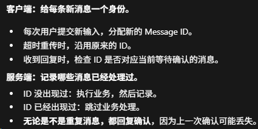

### What：尝试手动实现一个简单但可靠有序的UDP

### Why：对游戏服务端有些兴趣+沐瞳科技的MLBB面试（涉及MOBA的帧同步）

### Content：

**首先是很常见的一个问题：TCP和UDP有什么区别？为什么游戏中多数使用UDP？**

我认为区别主要是以下内容：

* TCP是一种面向连接的可靠有序字节流（无明确边界）协议；
* UDP则无需连接，也不保证可靠有序，有明确的边界；

**UDP往往比TCP快，但这不是选择UDP的唯一原因，UDP往往能够给开发者提供针对不同类型消息不同可靠性策略的选择**，比如生成、复活、捡物品到背包等消息就需要保证可靠，而位置旋转等消息是可以被覆盖的类型，丢了就丢了，直接使用新的消息就行。

我这里的可靠不是将UDP变成和TCP一样在网络模型传输层上的可靠有序协议，而是针对游戏中的每一条业务消息，使其可靠有序。详细内容可以看文档：Notes/Game/Network/Gaffer-On-Games-Summary.md。

**我认为真正掌握一个知识点，最好是手动实现一遍，其次是阅读别人的实现，最后是仅仅停留在表面的文字解释。**

所以我打算手动实现一下，代码位于Program/reliable-udp。

今天主要实现了四个点，前三点是AI写的代码：

1. 搭建了一个UDP通信框架（语言C++，客户端和服务端通信，客户端运行在本地Windows电脑，服务端运行在远程Linux服务器）；
2. 服务端收到客户端的消息后会给客户端发送确认消息（我这里将确认消息设计为和客户端的消息保持一摸一样），客户端也会比较服务器发来的消息和自己发出去的是否一样；
3. 客户端的超时重传（5s还没有收到服务器发来的确认消息，则进行重传，最多重传2次，注意这里可能是确认消息丢了，也可能是客户端发送的消息丢了）；
4. 给客户端发送的消息进行编号，这样服务器可以根据消息编号进行去重（还没有完全写好，明天继续）；

