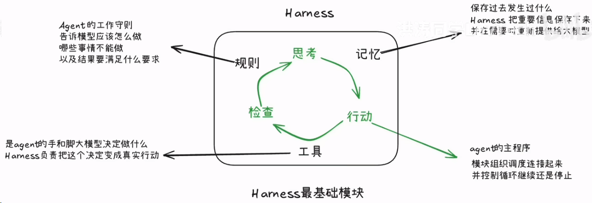

### What：尝试手动实现一个简单但可靠有序的UDP

### Why：对游戏服务端有些兴趣+沐瞳科技的MLBB面试（涉及MOBA的帧同步）

### Content：

今天打算实现UDP的有序功能。

已完成今日目标，具体内容见代码。

**在单个有效会话内，让客户端发来的业务消息按 Message ID 交付，避免因重传而重复执行；无法继续时结束会话，而不是跳过缺口。**

先对目前的项目做一个总结吧。

#### **最初的流程**如下：

```
Windows 客户端
    → 向 Linux 公网 IP 的 UDP 9000 发送文本
Linux 服务端
    → 接收数据及来源 IP:Port
    → 向来源地址原样回复
Windows 客户端
    → 接收并核对回复
```

#### **模拟服务端确认消息丢失**

使用一个变量记录收到的消息数量，每几个就不发一次确认消息。

#### **使用message id区分业务消息**

从1开始编号，这个编号不仅可以服务于去重也可以服务于可靠有序，所以编号很重要！

#### **安全解析消息**

从消息中解析得到message id和content，当然后面还有session id。

#### **ACK、超时重传与固定截止时间**

发送一条业务消息的流程大致如下：

```
最多尝试 3 次
    → 发送相同 Session ID、Message ID 和正文
    → 记录本轮截止时间：现在 + 5 秒
    → 在截止时间之前接收回复
         匹配的 ACK：确认成功
         旧会话、旧 ID 或无效 ACK：忽略并继续等待
         当前会话的 ERROR：终止
         超时：进行下一次发送
```

#### **服务端去重与乱序缓存**

不交付已经收到过的消息，只回复，避免客户端一直重传这个消息；

将提前收到的消息缓存下来，当收到预期的消息后，如果满足要求一起处理；

#### **按序交付及缓存清理**

消息交付之后需要将缓存中的消息进行删除

#### **显式会话建立与隔离**

只用 IP:Port 作为消息状态的身份不能区分客户端重启，因为地址可能被复用，新进程的 Message ID 又会从 1 开始。

所以采用显式握手：

```
客户端生成 nonce=N
    → HELLO:N
服务端创建 Session ID=S，并保存来源地址、nonce 和接收状态
    → WELCOME:N:S
客户端验证来源、nonce 和 Session ID 格式
    → 保存 S，之后所有业务消息携带 S
```

#### **会话结束、过期和缓存上限**

* 客户端用户输出指定命令可以结束会话；
* 一个会话一定时间内没有消息的传输会自动清理；
* 一个服务端程序连接的客户端数量有限，超出限额后会话建立不成立；

额外的一个小知识点：**Harness究竟是什么？**（刷的B站视频）

简单来说就是：Agent=Model+Harness

大模型的能力越来越强，但是这并不代表大模型能够很好地帮我们完成任务，因此为了完成这个目的搭建的一套工作流程就可以称之为Harness，一般包含思考-行动-检查-思考这样一个循环，其中涉及记忆、工具、规则、上下文管理等方法。


