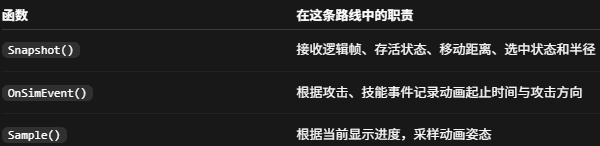

### What：帧同步MOBA Demo项目

### Why：对游戏服务端有些兴趣+沐瞳科技的MLBB面试（涉及MOBA的帧同步）

### Content：

之前为了了解帧同步，让AI制作了一款简单的帧同步MOBA游戏，但是游戏具体的实现方法还没有很好地理解与掌握，所以今天来仔细阅读一下这个项目具体是如何工作的！！！加油！！！

#### Archify的安装与使用

目的：快速了解这个项目的框架；

方法：Codex一键安装；

结果：绘制的图放在image/18-帧同步文件夹下

我认为这些图适合初步地了解项目，如果想要深入研究还是不够的。

#### 阅读项目代码

##### DemoBootstrap.cs

项目入口代码，包含了一个运行时报告类DemoRunReport，记录了项目运行一次的各种数据。

##### TransportStats.cs

传输状态，主要作用是保存一些和网络传输相关的数据，比如RTT，超时重传次数等。

##### BattleConfigAsset.cs

战斗配置资源代码，可以在编辑器中创建对应的资源文件，主要作用是保存**一个战斗配置**。

##### BattleConfig.cs

战斗配置类，主要作用是配置战斗中的一些数据值，比如英雄速度，生命值，塔的位置，生命值等。

##### MatchRuntime.cs

一局战斗一个该类对象，主要作用是创建一个服务端AI系统。

##### ServerAiSystem.cs

服务端AI系统类，有一个行为树管理器，两个实例化的AI Agents（每个Agent都有一个BlackboardAdapter和一个BehaviorTree），一个最近处理过的逻辑帧ID，行为树调度Runner，最近一次决策生成的调试轨迹以及Evaluated完成一次决策后，向外发布轨迹的事件。

##### BlackboardAdapter.cs

行为树与战斗逻辑之间的接口，从世界读取决策所需的信息，暂存行为树提交的命令，并记录决策过程。

##### ServerAiRunner.cs

对行为树进程一些设置，比如行为树的Tick频，手动调度行为树等。

##### AiTrace.cs

记录一次决策的信息，比如当前决策依据的世界状态帧，决策对应的命令帧，谁做出了什么决策，目标是谁等。这些轨迹用于调试观察，不参与客户端战斗模拟和状态哈希。

##### BattleView.cs

收到新的逻辑状态时更新显示数据；每个渲染帧再根据这些数据更新画面。

| 成员            | 作用                                        |
| --------------- | ------------------------------------------- |
| BattleCamera    | 观察战场、进行屏幕坐标转换                  |
| FollowCamera    | 相机跟随控制组件                            |
| 四个Prefab      | 不同实体不同模型                            |
| EffectMaterial  | 技能范围圈、伤害连线等使用的材质            |
| SelectedId      | 当前选中查看的实体 ID                       |
| **views** | **保存实体 ID 到 EntityView 的映射** |
| ...             | ...                                         |

**关键函数：Synchronize()**

当前客户端在收到权威命令帧后，会执行自己的战斗模拟，表现层读取这个本地世界的结果。这个函数主要做的是模拟逻辑上的数据。

**关键函数：LateUpdate()**

画面怎样在两次逻辑更新之间移动。

##### EntityView.cs

负责一个逻辑单位的视觉效果。

##### CollisionMovement.cs

里面有一个MotionTrace类，保存本逻辑帧已经接受的移动轨迹。

##### SimEvent.cs

一个结构体，保存一个事件的信息，比如事件的发生帧id，种类等。

##### UnitVisual.cs

##### InputWindow.cs

按玩家和帧号缓存输入，只有指定帧的双方输入都到齐，才将它们取出，组合成FrameCommands。

解决下一帧的输入是否准备好。

##### FrameScheduler.cs

解决真实时间上，是否已经到了推进下一逻辑帧的时候。
