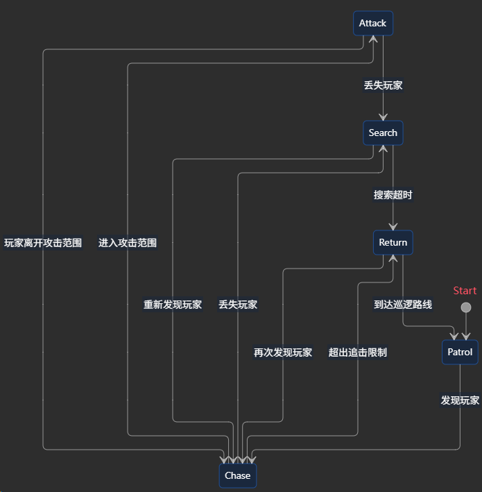
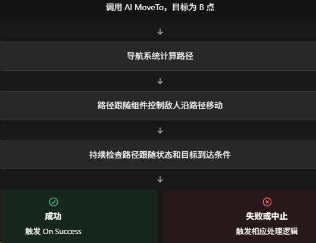

### What：状态机

### Why：鹰角面试被问了，感觉回答地不够好

### Content：

如果设计这样一个敌人的状态机：在敌人没有看到玩家的时候在三个固定的地方来回巡逻，当敌人看见玩家的时候会追击玩家，如果追到了就进行攻击，如果没有追到就回到巡逻状态。

首先几种状态：巡逻、追击、攻击、返回、搜索

状态转换关系图：



##### 巡逻状态

刚开始处于巡逻状态，三个巡逻点ABC，可以ABCABC，也可以ABCBA（需更换巡逻方向）等。

考虑以下两个问题：

**敌人当前应该前往哪个巡逻点？**

```C++
TArray PatrolPoints;
int CurrentPatrolIndex;
```

**如何判断敌人已经到达了巡逻点？**

不能只是每帧都根据敌人和巡逻点之间的距离进行判断，更合理的方法是使用寻路系统。

单纯判断距离，无法充分处理下面的情况：

* 敌人是否真的沿着有效路径移动。
* 移动请求是否被取消或替换。
* 路径是否被阻挡或失效。
* 目标是否不可达。
* 敌人是否已经到达允许的终点误差范围。

UE5中是这么做的：



**巡逻过程中发现玩家怎么办？**

中断巡逻任务，离开巡逻状态，进入到追击状态。注意记录当前的巡逻任务方便后续恢复。

##### 追击状态

主要完成下面三件事：

1. 持续更新玩家位置；
2. 利用寻路系统追击玩家；
3. 判断是否应该攻击或放弃追击；

**敌人如何判断自己看到了玩家？**

需要考虑实际距离、视野距离、视野角度、遮挡检测。

**玩家突然躲到掩体后，敌人应该停止追击吗？**

一般不应该，否则玩家只需反复进出掩体，敌人就会在追击和巡逻之间反复切换。所以需要搜索状态！

这样当敌人丢失玩家视野后，前往最后已知的玩家位置，如果发现玩家，继续追击，没有则放弃追击回到巡逻状态。

##### 攻击状态

当敌人与玩家的距离小于攻击距离是，退出追击状态，进入攻击状态。

但是不能`if (Distance < AttackRange)`这样简单判断，容易使得每帧执行攻击函数，需要把攻击设计成**一个具有完整生命周期的行为**。

1. 停止或调整移动；
2. 面向玩家；
3. 判断攻击冷却时间；
4. 播放攻击动画；
5. 在动画指定时刻进行命中检测；
6. 造成伤害；
7. 等待攻击动画结束；
8. 判断是否继续攻击或者重新追击；

**滞回控制**：100米之内进入攻击状态，150米之外退出攻击状态。避免在边界导致不断切换状态。

##### 返回状态

这里可以有一些不同的返回策略，比如可以返回发现玩家之前的位置，也可以返回最近的巡逻点，或者返回原来的巡逻点等。

#### 面试推荐回答

首先，我会把敌人的行为抽象成巡逻、追击、攻击和返回四个核心状态。

巡逻状态维护三个固定路径点及当前巡逻方向，敌人到达目标点后更新下一个路径点。

通过视觉感知系统检测玩家，在满足视距、视角和遮挡条件时切换到追击状态，并利用导航系统持续追踪玩家。

当玩家进入攻击范围且满足攻击条件时，切换到攻击状态，通过攻击动画、冷却控制和命中检测完成攻击。

如果玩家离开攻击范围，则重新追击。如果敌人丢失玩家视野，会保存最后已知位置，并设置丢失目标超时机制，避免状态频繁切换。

当敌人超过追击距离或者丢失玩家达到规定时间时，就放弃追击，返回原来的巡逻路线。

实现上，我会将 AI 决策、感知、寻路和战斗模块解耦，并特别处理状态切换时的任务中断、寻路失败和目标失效等边界情况。
