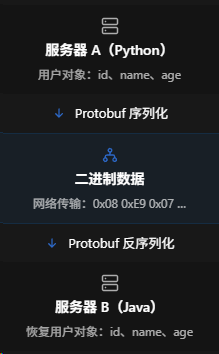
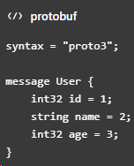
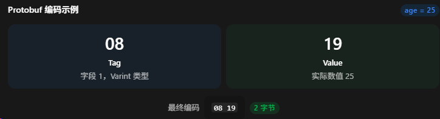

### What：Protobuf

### Why：刷视频看到了，之前粗略看过，没细看

### Content：

##### 什么是序列化？

一句话解释：负责把数据（比如程序中的一个对象）转换成适合传输或存储的表示形式。

在Protobuf中是这样的



##### Json与Protobuf的区别

| 维度         | Json                 | Protobuf           |
| ------------ | -------------------- | ------------------ |
| 数据格式     | 文本                 | 二进制             |
| 可读性       | 好                   | 差                 |
| 体积         | 较大                 | 较小               |
| 解析速度     | 较慢                 | 较快               |
| 数据类型     | 较简单               | 明确定义字段类型   |
| 数据结构定义 | 灵活使用             | 需要.proto定义     |
| 调试难度     | 容易                 | 复杂               |
| 常见应用     | REST API、前后端通信 | gRPC、游戏网络通信 |

Protobuf对比Json的重要优势：

JSON会**重复传输**字段名称

```JSON
{
    "id": 1001,
    "name": "ZhangSan",
    "age": 25
}
```

传输过程中，字符串“id”、“name”、“age”会被重复传输，但是双方已经知道结构，不需要再重复传输这些内容

Protobuf使用**二进制**编码

##### Protobuf怎么使用

1、定义数据结构：创建.proto文件；



2、生成代码：使用protoc编译工具来生成

protoc --python_out=. user.proto会生成user_pb2.py文件

3、程序中使用：不同语言形式不同

##### Protobuf如何编码

Protobuf 在二进制编码时，通常以字段为单位进行处理。

每个字段包含：

1. Tag：说明这是哪个字段，以及采用哪种线格式。
2. Value：实际存储的数据；对于某些类型，还包含长度信息。

Tag的计算公式为：

* Field Number：字段编号。
* Wire Type：编码类型。
* `<< 3`：向左移动三位。
* `|`：按位或运算。

比如age=25，age类型为int32，那么WireType为0，tag=(1<<3)|0=8，tag为8，对应十六进制08，数值25对应十六进制19，所以编码结果如下图



所以整个age=25字段只需2个字节！！！

##### 面试如何回答

Protobuf 是 Google 开发的一种**跨语言、跨平台**的结构化数据序列化技术。

它需要通过 `.proto` 文件预先定义数据结构，包括字段类型和字段编号，然后使用编译工具生成对应语言的代码，完成序列化和反序列化。

相比 JSON，Protobuf 通常具有更小的数据体积和更快的解析速度。这主要是因为它采用二进制编码，通过字段编号代替完整字段名称，并对整数等类型使用高效的编码方式。

此外，Protobuf 支持在一定规则下进行数据结构的版本演进，也支持 Java、Python、C++ 等多种语言，因此非常适合微服务和跨语言的内部通信。

不过它的二进制格式不如 JSON 直观，使用时也需要维护 `.proto` 文件，所以一般会根据具体业务场景进行选择。
