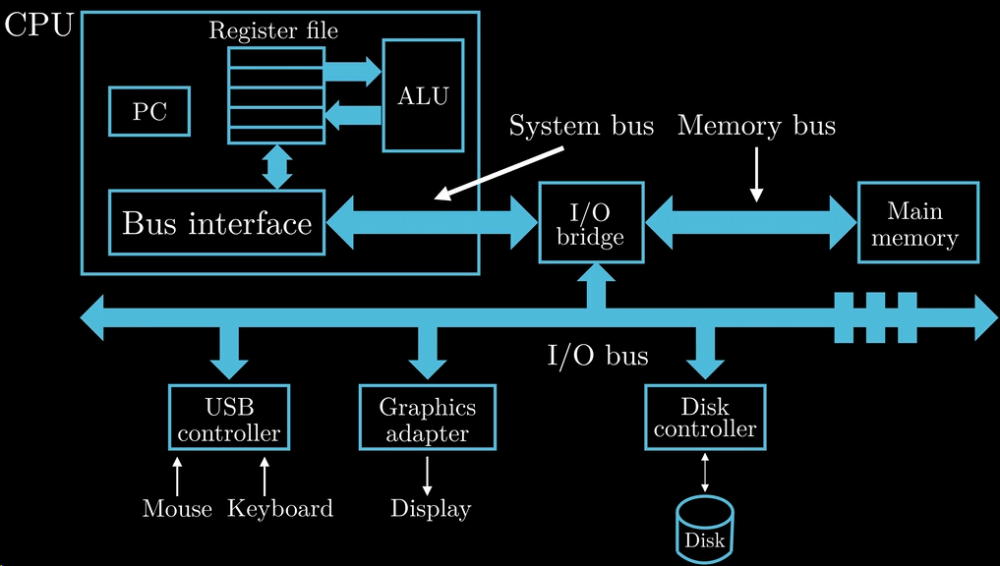
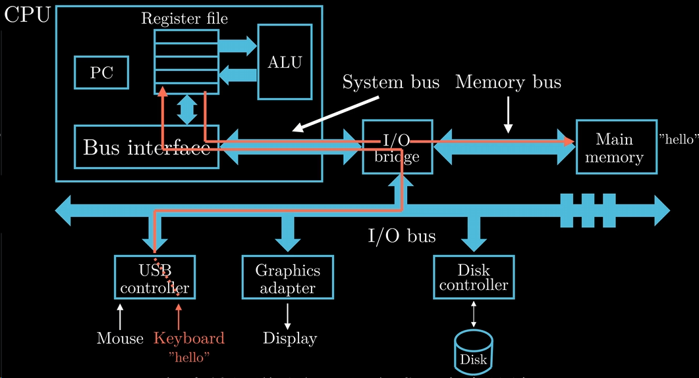
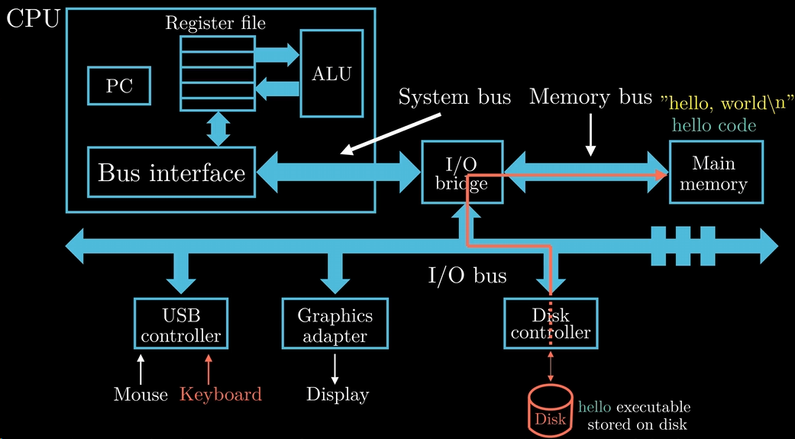
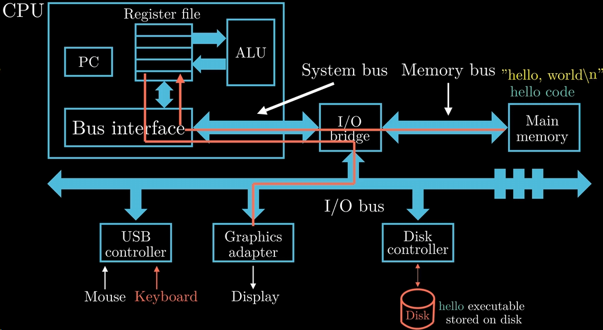
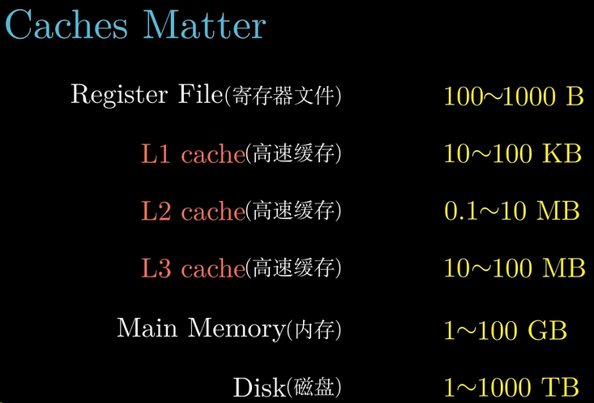
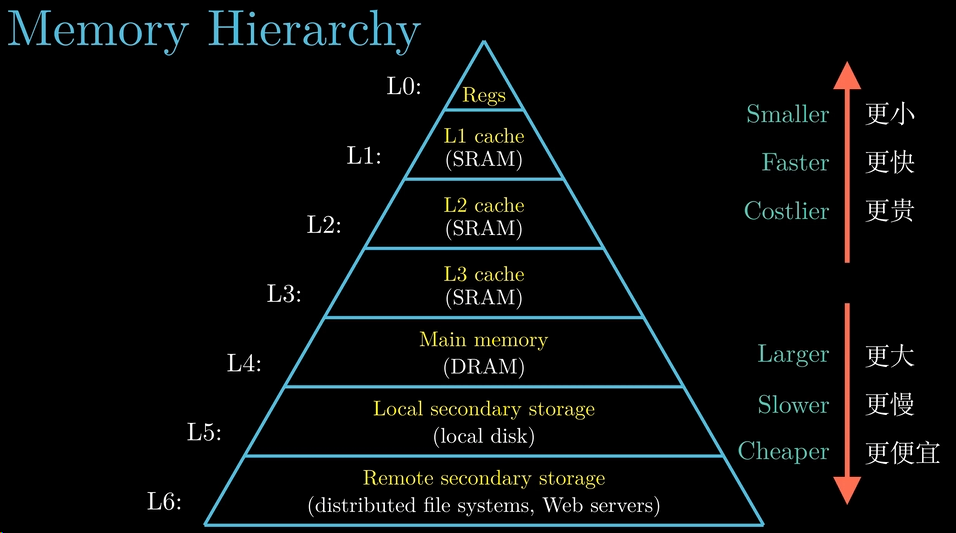

### What：CSAPP中文版教程-第二节-计算机系统漫游

### Why：加固一下计算机基础知识，第一性原理很重要

### Content：

##### 计算机系统的硬件组织

CPU：中央处理器，图中画出了CPU中的一些重要组件，PC（Program Count），一个word字长的存储器，存储下一步要运行的指令的地址；Register file（寄存器文件），CPU中的主要存储器；ALU（执行整数算术和逻辑运算的电路模块）；Bus interface（总线接口），是CPU和其它硬件交换数据信息的核心。

I/O bridge：连接高速系统与低速外设的缓冲地带。

Main memory：内存。

System bus：系统总线，连接 CPU 总线接口和 I/O 桥的通道。

Memory bus：内存总线，连接 I/O 桥和内存的通道。

I/O bus：I/O总线，连接I/O 桥和各种输入输出设备。

**注：图中展示的是****经典的“南北桥（Northbridge / Southbridge）”架构，**但在现代计算机中，这种架构已经发生了巨大变化**，为了提高内存访问速度，**内存控制器（Memory Controller）已经被直接集成到了 CPU 内部**，显卡的高带宽总线（PCIe）也直接连接到了 CPU 内部，现在的 **I/O bridge** 在物理形态上主要演变成了主板上的 **平台控制器中枢（PCH，即以前的南桥）** ，它主要只负责连接那些低速的外部设备（USB、SATA硬盘、网卡、声卡等）。**

##### 一个简单程序的执行流程

Step1：键盘输入hello，shell程序通过总线将hello字符逐一读入寄存器，然后处理器把hello字符串放入内存中

Step2：键盘按下回车键，shell程序就知道我们已经输入完指令了，然后执行一系列指令来加载hello程序，这些指令将hello中的数据和代码从磁盘复制到内存（这个复制过程使用了DMA技术，数据可以不经过处理器，从磁盘直接到达内存）

Step3：CPU将字符串从内存复制到寄存器文件，再从寄存器文件复制到显示设备，这样字符串hello world就显示在了屏幕上

##### 缓存的大小与被CPU读取的速度

缓存大小

读取速度

