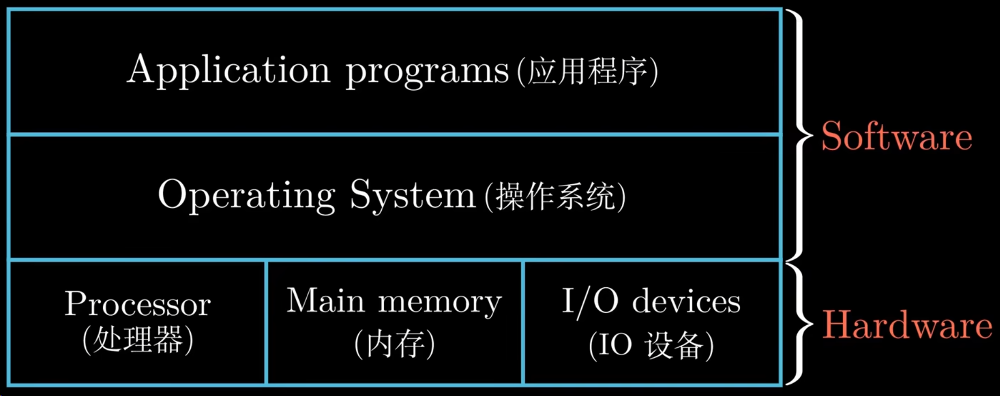
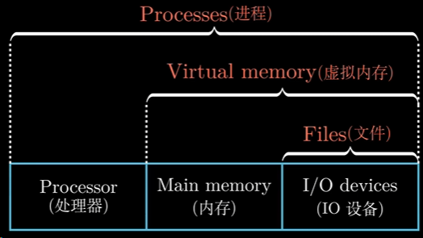
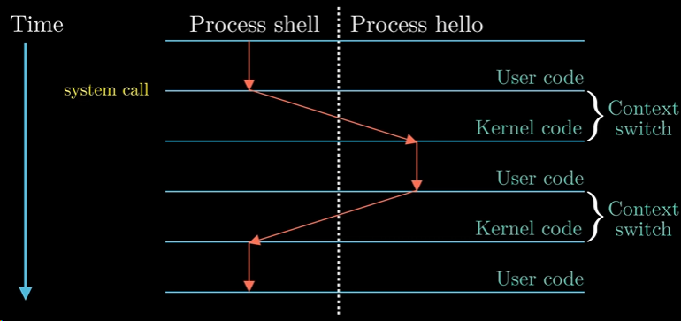
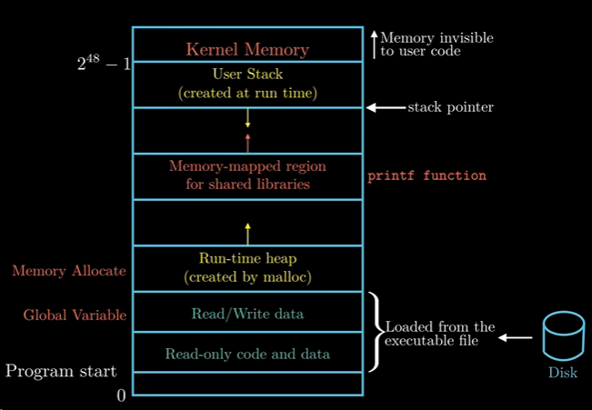
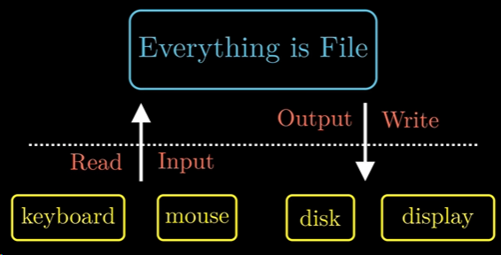

### What：CSAPP中文版教程-第三节-计算机系统漫游

### Why：加固一下计算机基础知识，第一性原理很重要

### Content：

应用程序需要通过操作系统来操作硬件，目的有二：防止硬件被失控的应用程序滥用；操作系统提供统一的机制来控制这些复杂的底层硬件

操作系统中对一些概念的抽象如下图所示

运行程序时的进程切换过程如下图

Linux系统中**进程的虚拟地址空间**

Linux系统的哲学思想：**一切皆为文件**

