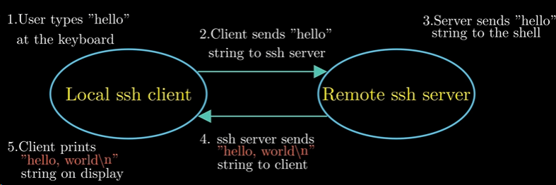
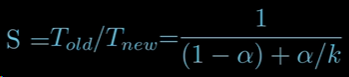
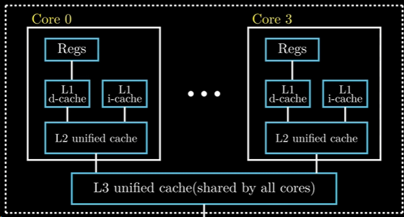
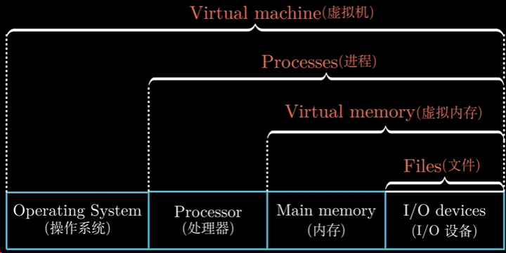

### What：CSAPP中文版教程-第四节-计算机系统漫游

### Why：加固一下计算机基础知识，第一性原理很重要

### Content：

利用ssh在远程服务器中运行hello程序的流程如下图所示：

阿姆达尔定律：当我们对某一系统的某一部分进行加速时，加速部分的重要性和加速程度是影响整体系统性能的关键因素

计算机系统中如何获得更高的计算能力：

* 线程级并发
* 指令级并行（现代处理器可以同时执行多条指令的属性）
* 单指令，多数据并行（多数是为了提高处理视频以及音频这类数据的）

多核处理器的组织结构：

什么是超线程（也叫同时多线程）？

每个CPU核心并行执行两个线程

计算机系统中的抽象：

