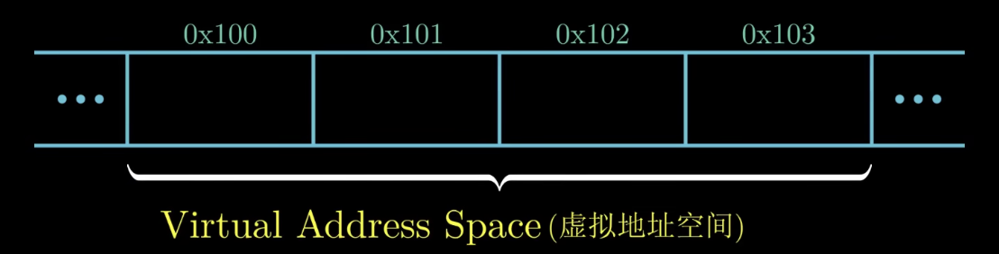
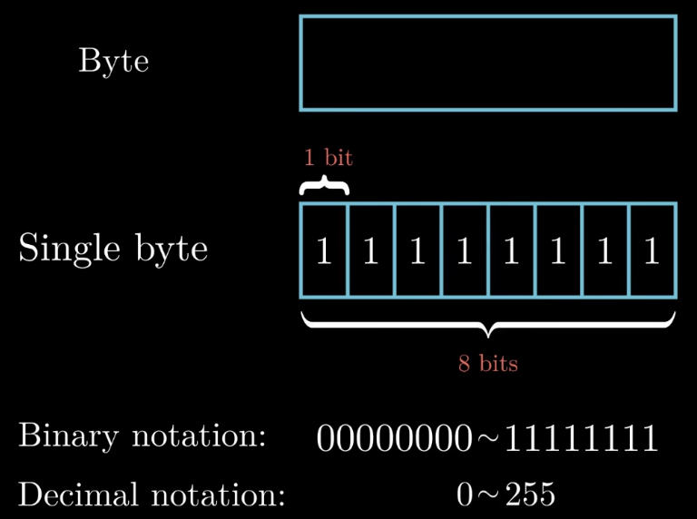
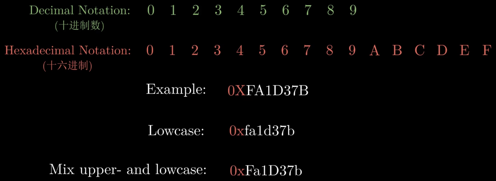
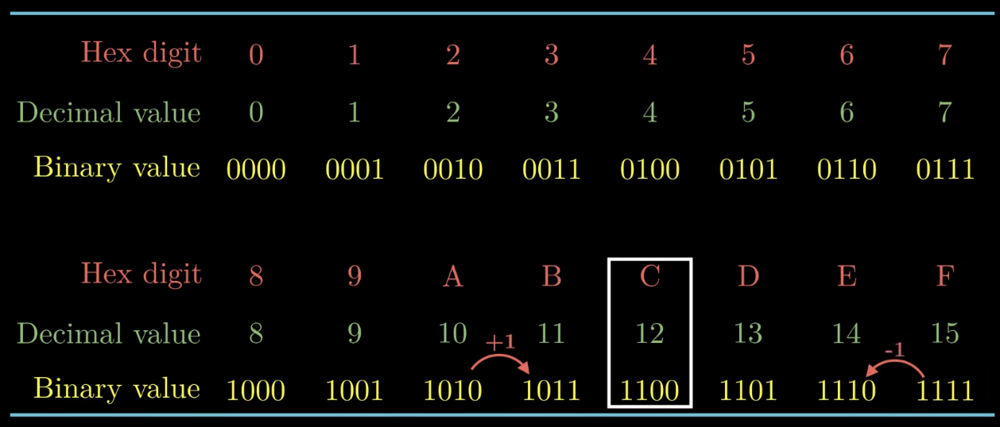
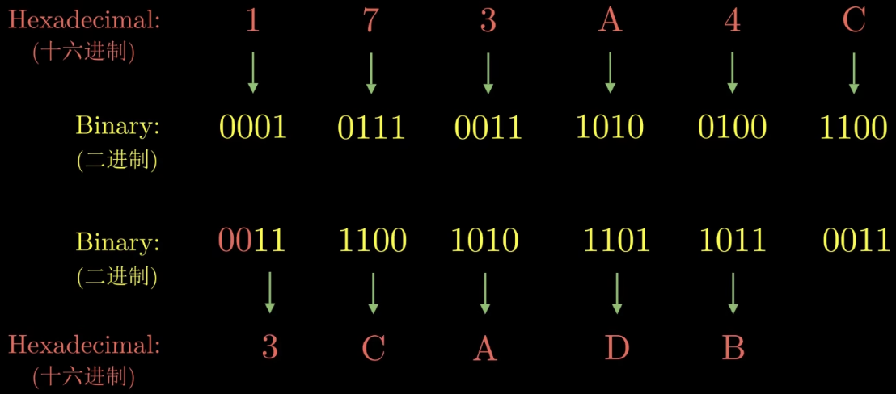
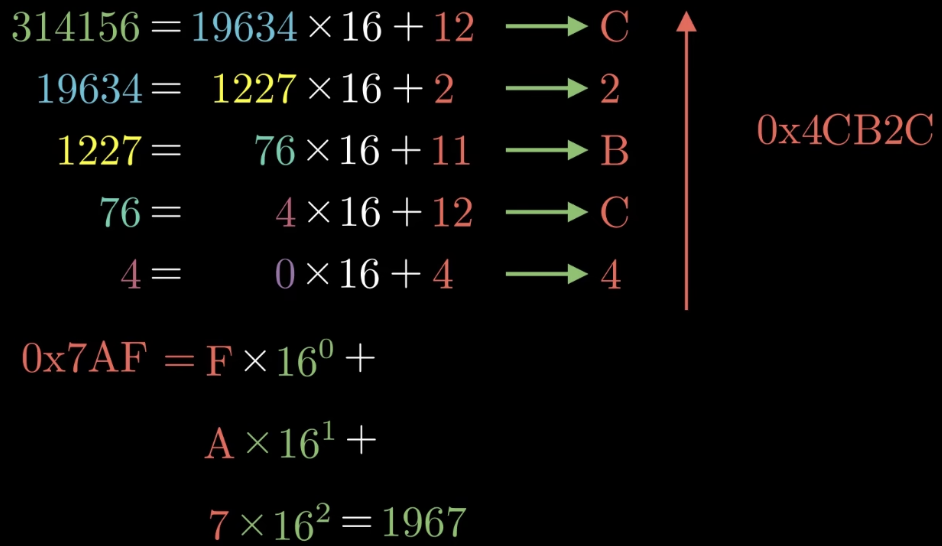
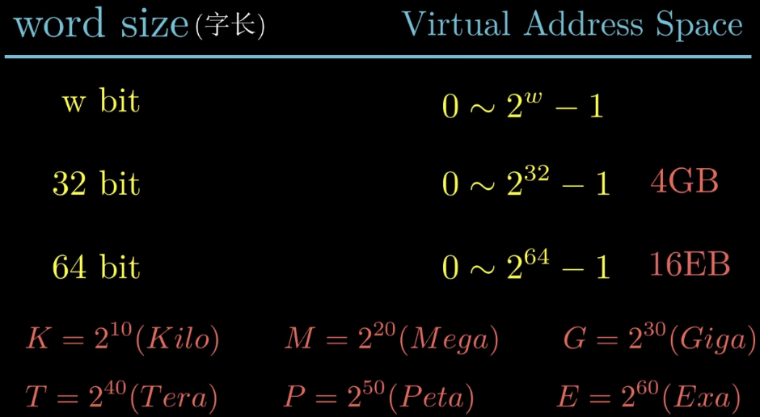
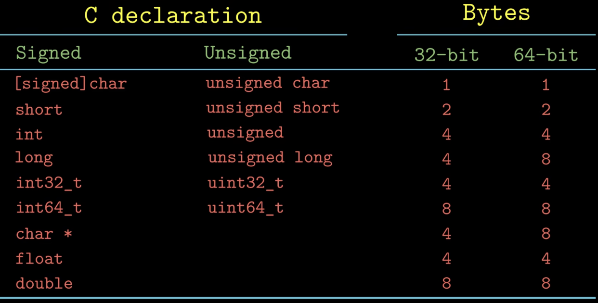
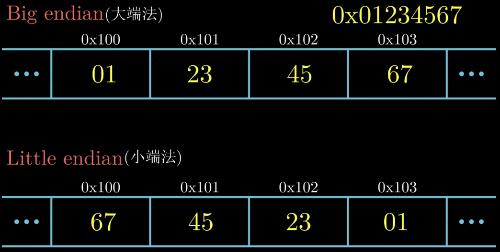

### What：CSAPP中文版教程-第五节-信息的存储上

### Why：加固一下计算机基础知识，第一性原理很重要

### Content：

计算机中信息的存储如下图所示

字节：信息存储的基本单元

十六进制：

十六进制数与二进制数的转换：

十六进制数与十进制数的转换：

字长与最大虚拟地址空间的关系：

现代计算器主要有32位机器和64位机器，64位机器向后兼容，可以运行32位的程序。

32位程序和64位程序主要的区别在于程序是如何编译的，而不是运行机器的类型。

C语言中不同数据类型所需的字节大小如下图所示：

大端与小端：与处理器（CPU）架构相关，Intel多数为小端，arm多数为双端，网络通信中一般为大端。现代处理器多数为小端，一部分是由于历史原因，另一部分是因为小端方便计算。

