### What：CSAPP中文版教程-第七节-整数的表示

### Why：加固一下计算机基础知识，第一性原理很重要

### Content：

C语言中，不同数据类型表示的范围以及所需字节数：

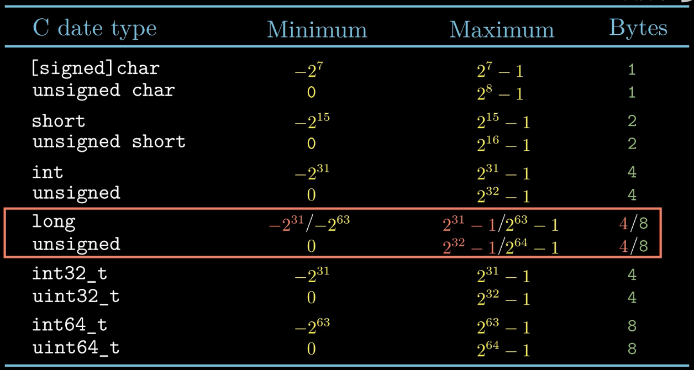

二进制转无符号整数：

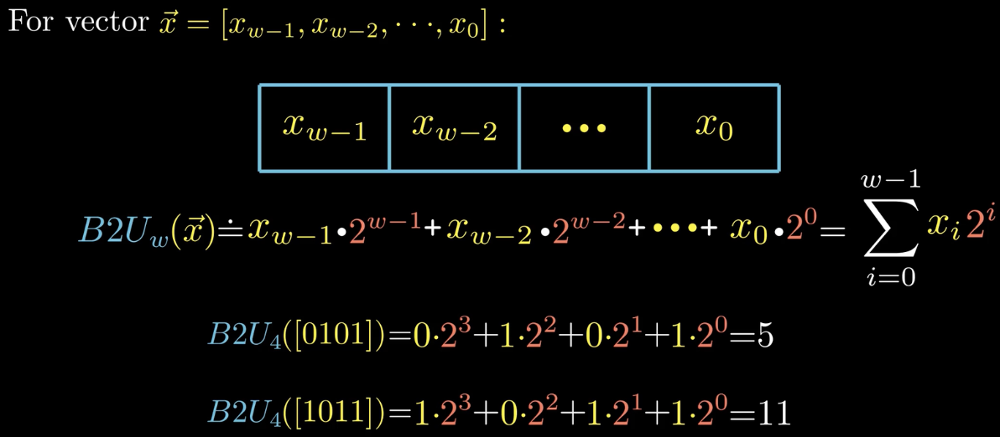

负数在计算机中采用补码的编码方式：

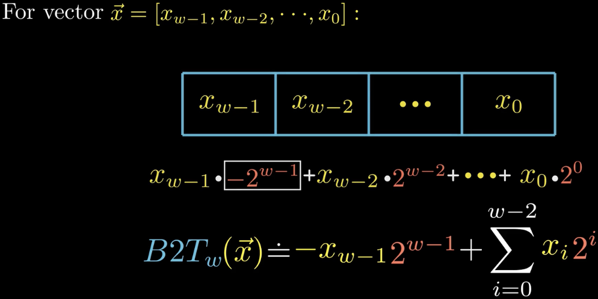

有符号数-1和无符号数的最大值有相同的二进制表示：

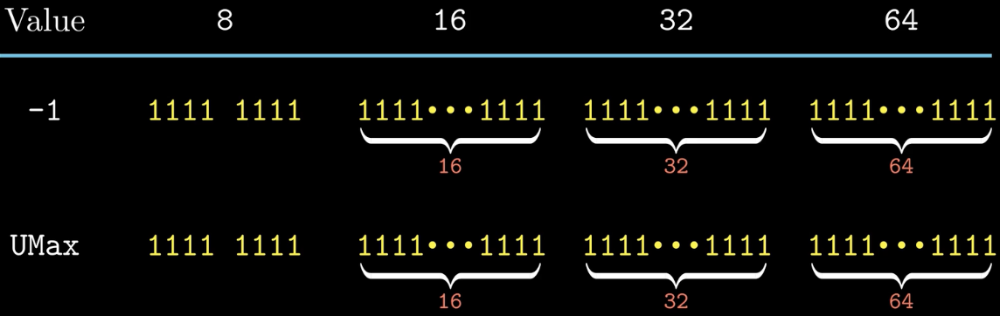

示例：

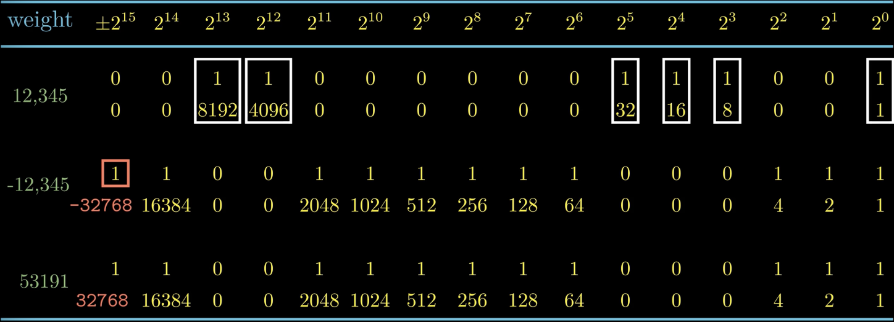

无符号数与有符号数的转换：

对于大多数语言来说，有无符号数之间的转换都是二进制的位模式不变，但是解释这些位的方式改变了。

T2U表示有符号数转为无符号数，U2T表示无符号数转为有符号数

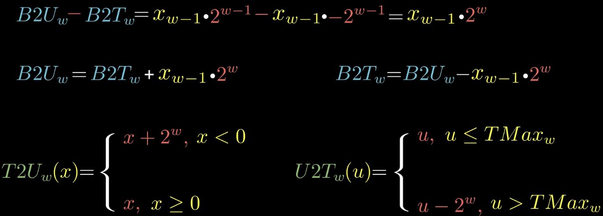

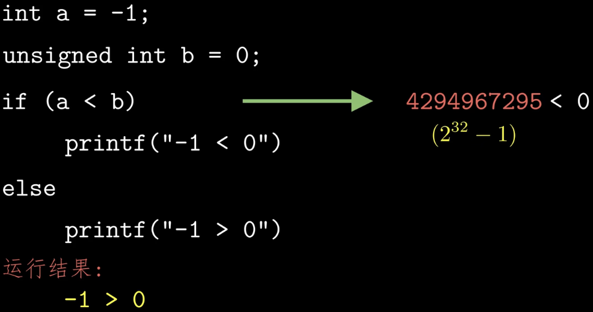

C语言中，不同字长的数据类型之间的转换：

较小转较大：扩展

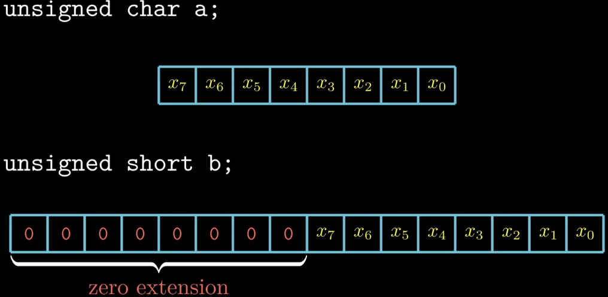

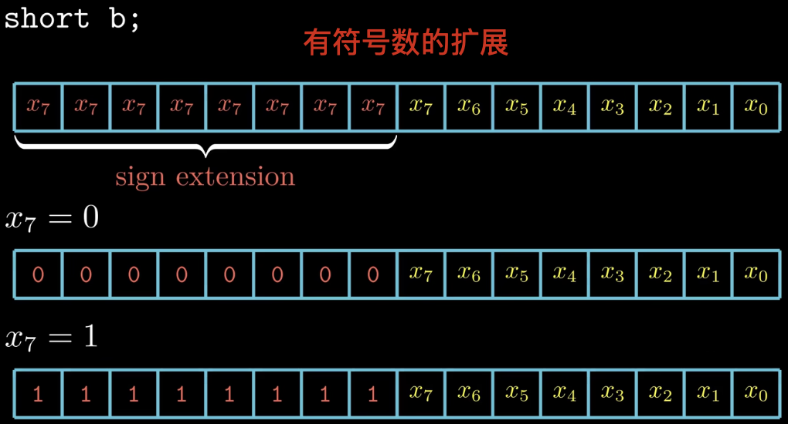

较大转较小：截断

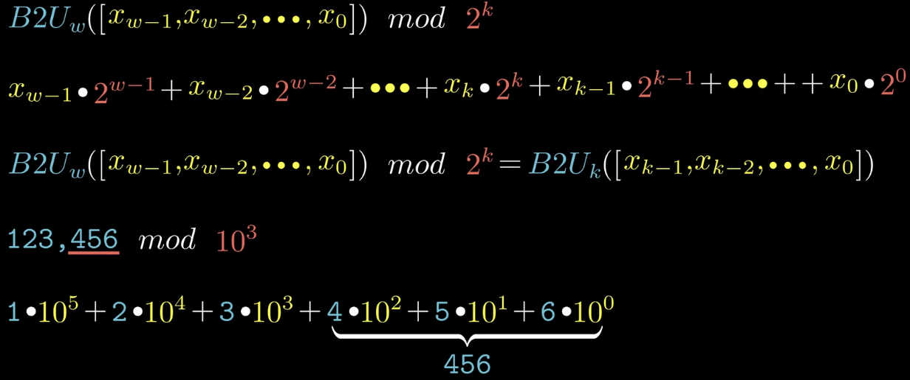

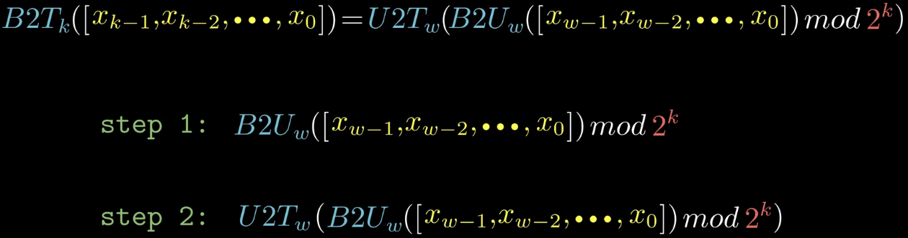
