### What：CSAPP中文版教程-第八节-整数的运算

### Why：加固一下计算机基础知识，第一性原理很重要

### Content：

##### 无符号数的加法运算公式和原理：

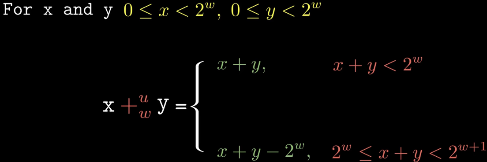

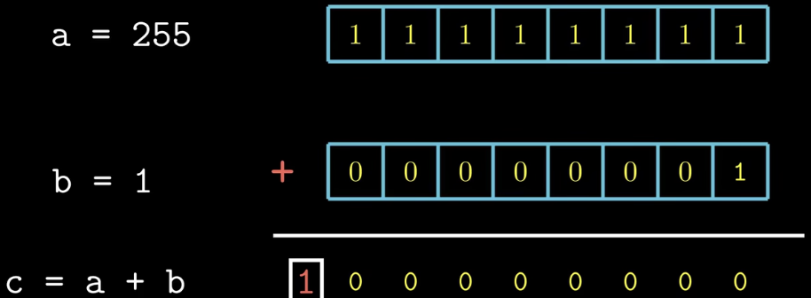

为了保持位数不变，最高位的1会被丢弃，这叫做溢出，在C语言中，溢出并不会报错。那么如何判断是否发生了溢出呢，由于都是大于等于0的数，所以和肯定大于等于其中的任意一个数，又因为如果发生了溢出，和肯定小于其中任意一个数，所以只需判断sum是否大于等于x即可（y也行）。

##### 有符号数的加法运算公式和原理：

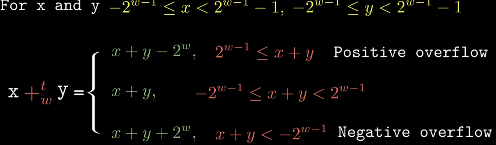

正溢出：

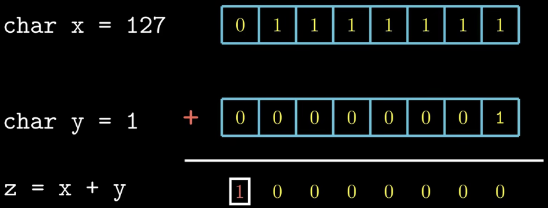

负溢出：

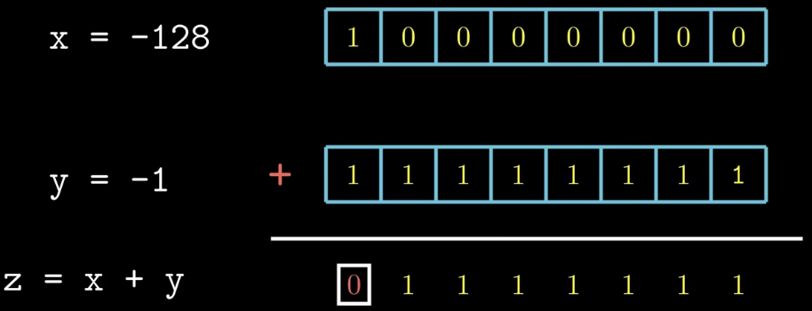

如何判断是否溢出？很简单，如果两个非负数相加得到的结果是负数，那么就发生了正溢出；如果两个非正数相加得到的结果是正数，那么就发生了负溢出。（实际上在真正的项目中，不能已经发生了溢出再判断说发生溢出了，而应该在相加之前就判断是否会发生溢出）那么如果是一正一负呢？实际上，一正一负并不会发生溢出，因为 **一正一负相加时，结果的绝对值不会超过两个操作数中绝对值较大的那个** ，所以结果一定落在两个操作数之间，而两个操作数本身都在类型范围内，因此不可能越界。

##### 加法逆元

这里的逆元简单来说就是相反数，但区别于数学中的相反数，而是在计算机世界中补码编码下的“和为0”

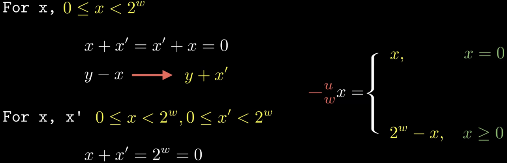

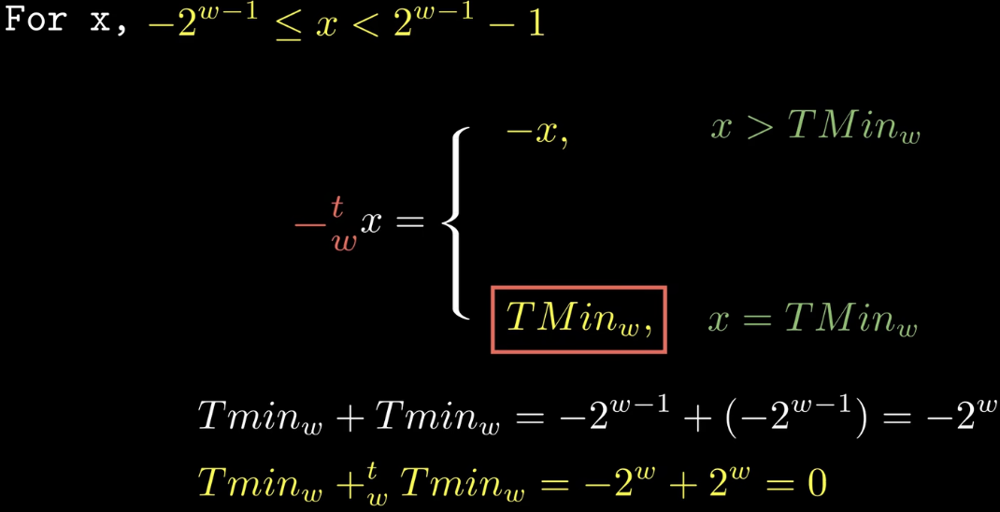

##### 无符号数的乘法运算

w位的x和w位的y相乘，计算结果应该使用2w位的z保存，但是计算机中只会使用w位来保存，所以会截取2w位的后面的w位数字，即对运行结果进行2的w次方取模。

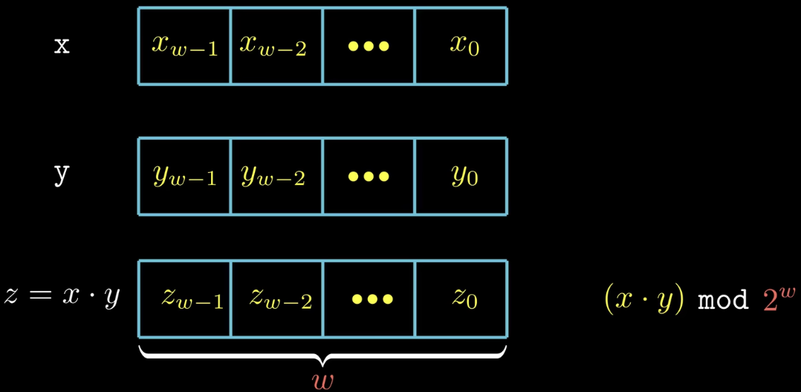

##### 有符号数的乘法运算

公式：

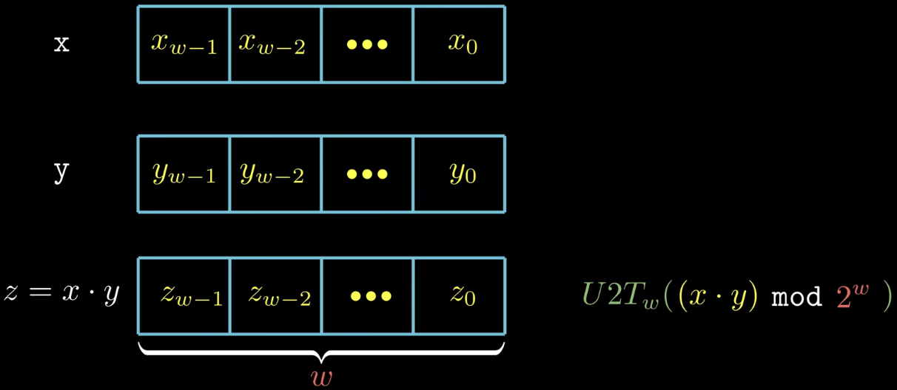

示例：无符号数和有符号数两种乘法乘积的完整位数不同，但是截断之后是相同的

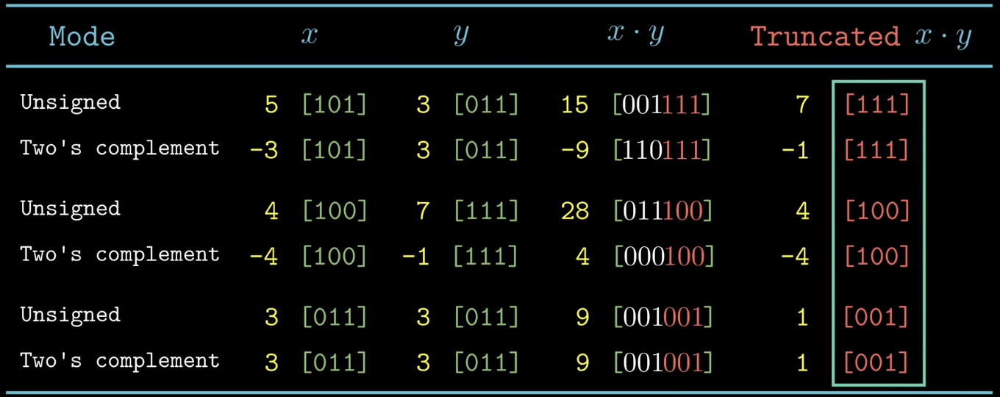

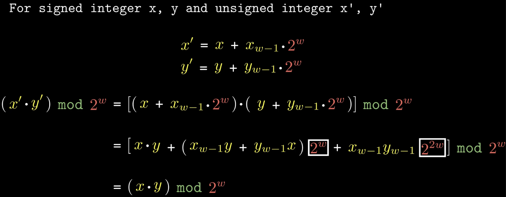

由于乘法运算需要多个时钟周期，所以很多编译器会优化为左移和加减法的运算。

下图所示的例子，一个乘法运算可以转化为三个左移运算和两个加法运算或者是两个左移运算和一个减法运算。

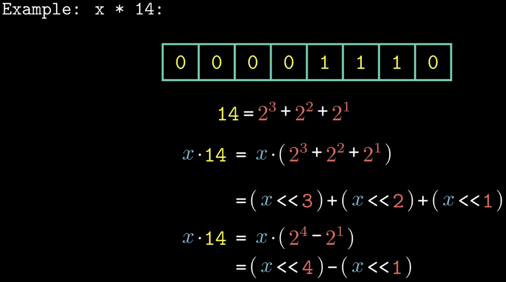

##### 除法运算（只包含除以2的幂的情况！！！）

与乘法不同，不能用除以2的的幂的方法来表示除以任意常数k的除法！！！

整数可能除不尽，那么会往0的方向进行舍入（这是数学中的舍入规则）。

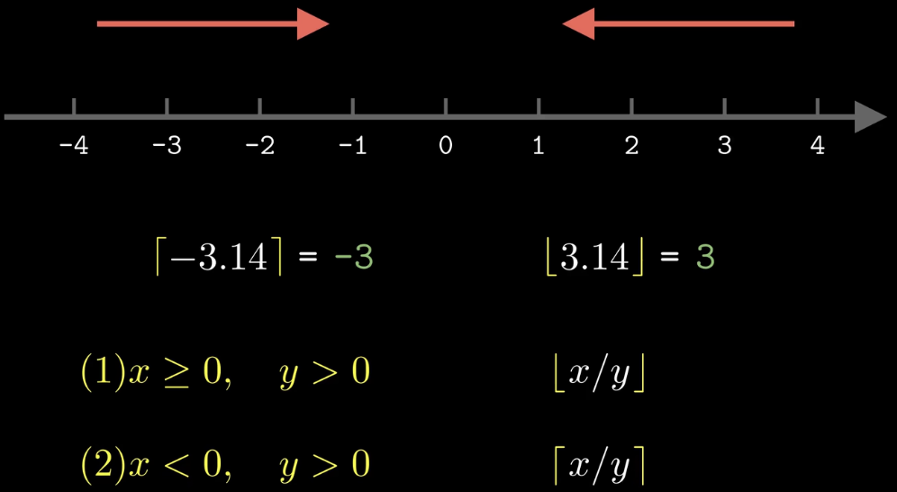

无符号数：

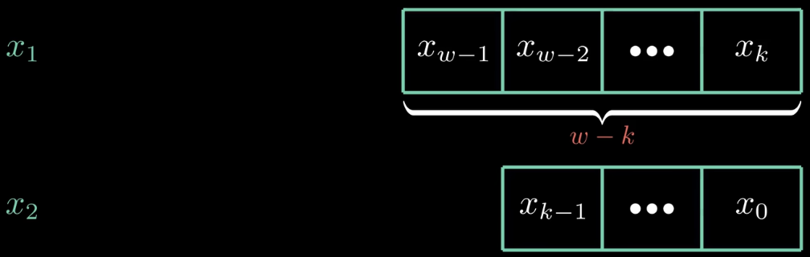

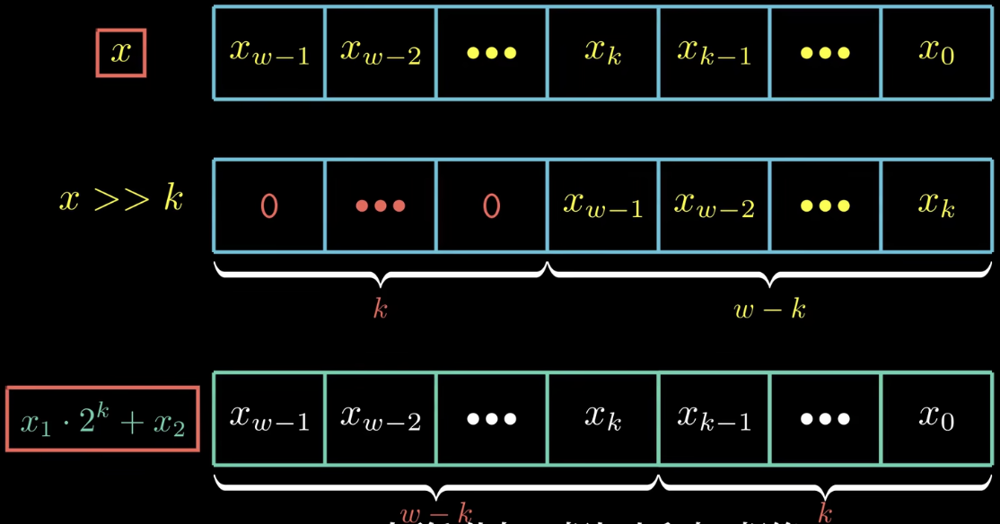

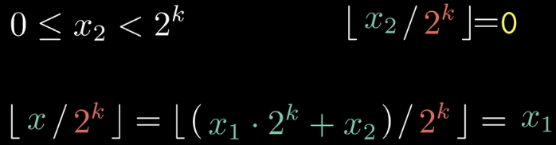

有符号数：

除不尽的时候有可能会发生舍入方向不对的情况，所以需要加入一个偏置来纠正舍入方向。

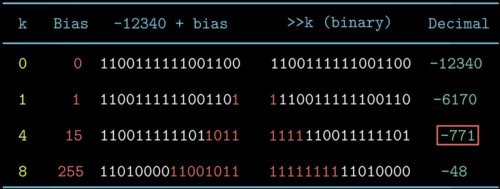

公式：

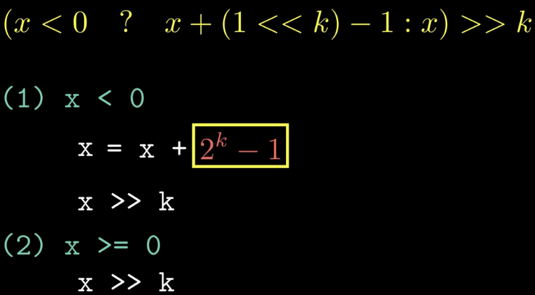
