### What：CSAPP中文版教程-第九节-浮点数

### Why：加固一下计算机基础知识，第一性原理很重要

### Content：

小数的十进制表示与二进制表示如下图所示：

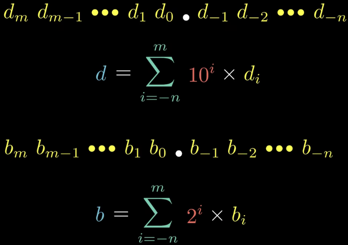

##### IEEE关于浮点数的表示：

s为0表示浮点数为非负，浮点为1表示浮点数为负；

E是阶码，M表示小数字段。

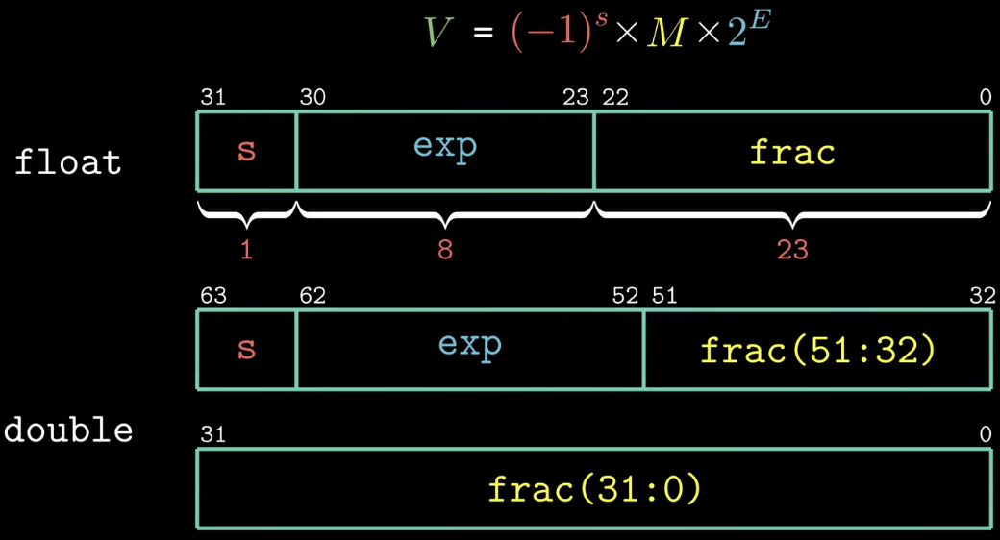

浮点数可以分为三类：**规格化的值，非规格化的值，特殊值**。

类别可以通过e（注意，这里是小e，表示这8位的二进制表示的值）来区分：

1. 当e不全为0且不全为1的时候，为规格化的值；
2. 当e全为0的时候，为非规格化的值；
3. 当e全为1的时候，为特殊值（特殊值又分为两类，一种表示无穷大和无穷小，另一种则表示不是一个数）；

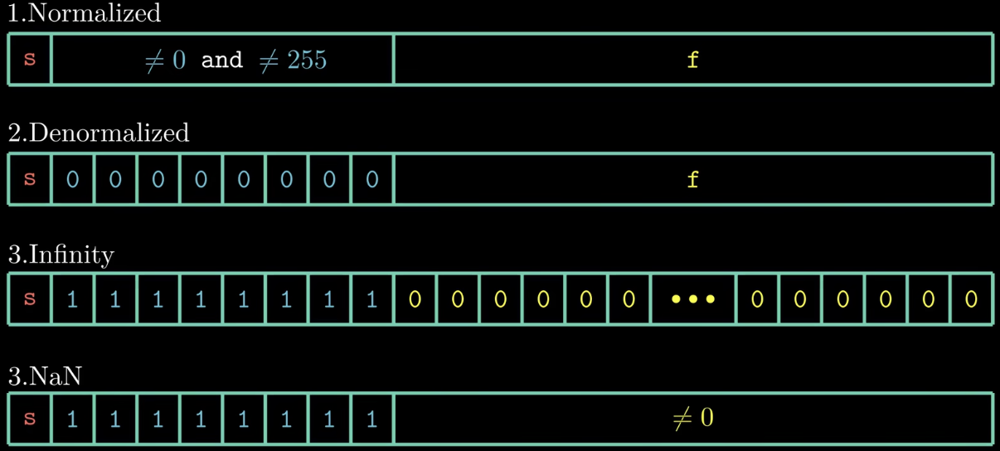

**规格化的值**

注意：阶码的值并不等于这8（对于float来说）个二进制位所表示的值，需要减去一个偏置，而偏置的值和阶码的位数相关，对于float来说，偏置为127，所以阶码的最小值为-126，最大值为127。

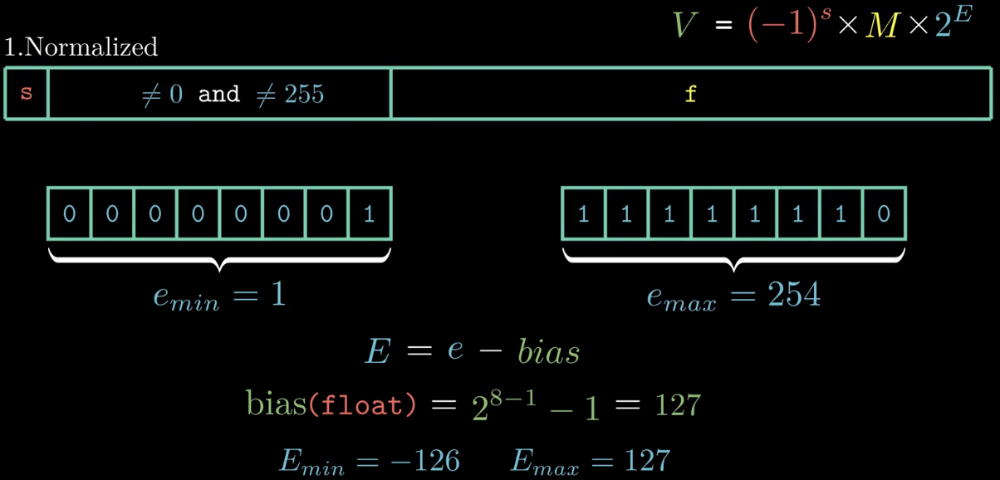

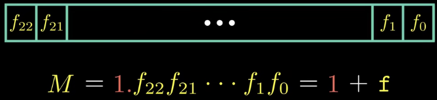

示例：

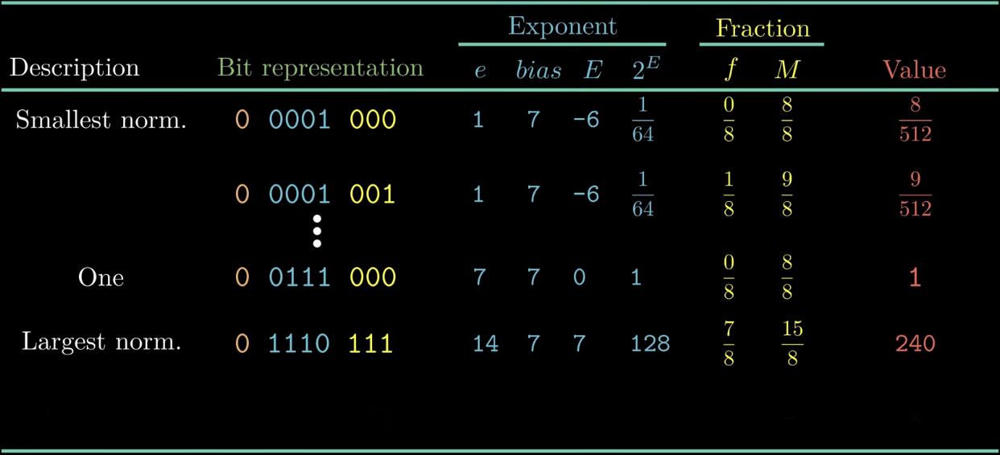

**非规格化的值**

非规格化的值主要有两个用途：表示零和非常接近零的数

正零和负零在某些情况下被认为是相同的，某些情况下则认为不同

E和M的解释与规格化值不同

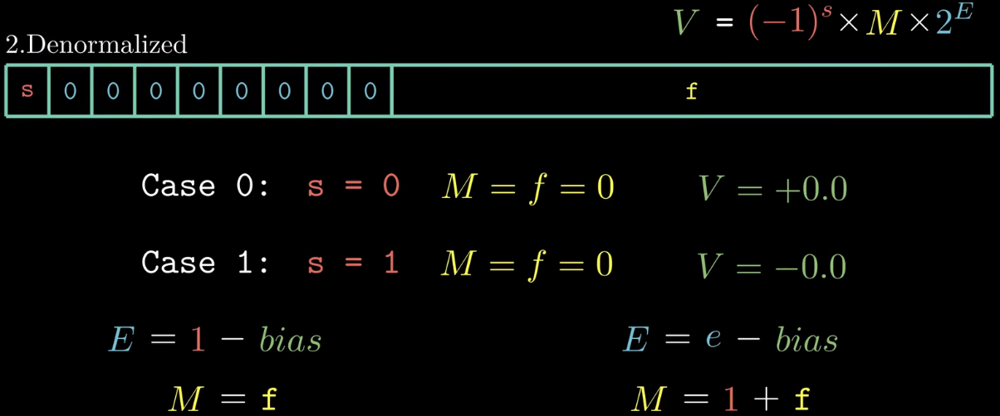

示例：

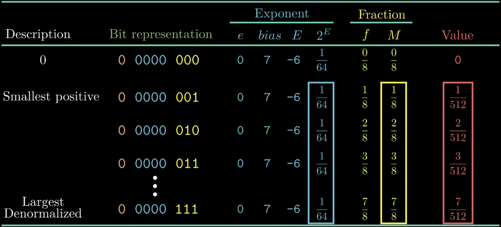

**特殊值**

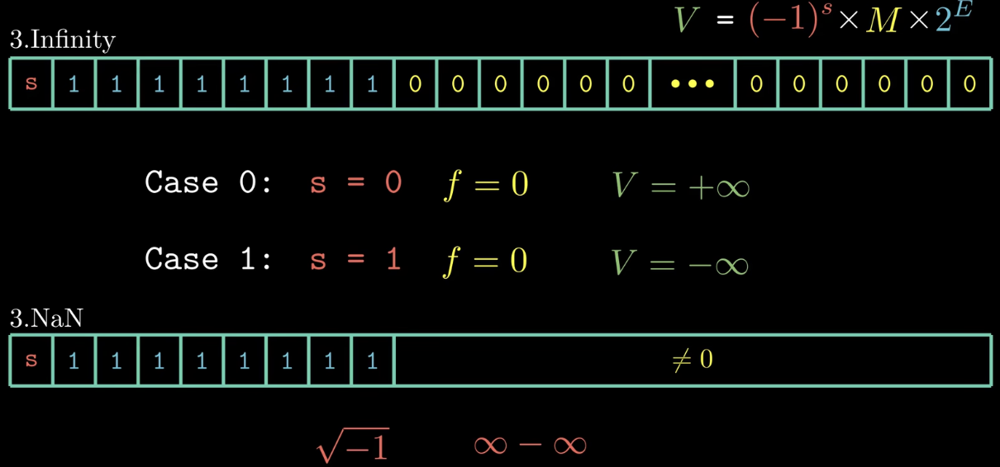

示例：

整数转换为浮点数：

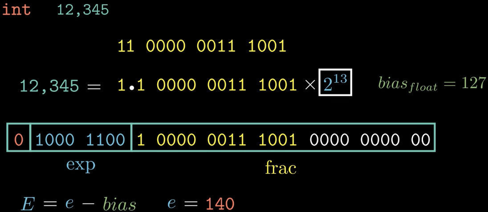

由于位数是确定的，所以浮点数的精度和范围有限，对于一个实数x，可能无法用浮点数来精确的表示，那么就只能退而求其次，用一个近似的数来表示，这就涉及到了舍入，而舍入也有不同的规则，IEEE定义了4种不同的舍入规则。

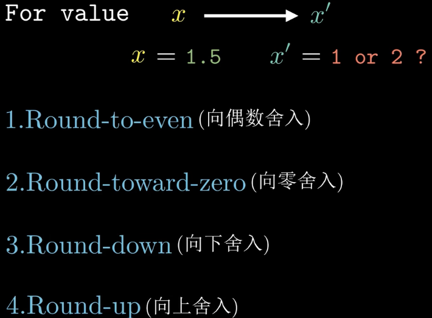

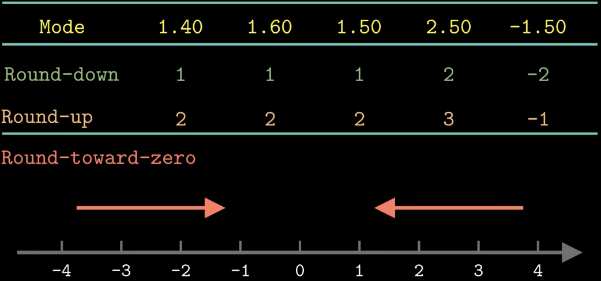

向偶数舍入实际上首先是向最近的数舍入，当左右相等的时候才考虑向偶数舍入

向上舍入会导致结果比实际值略大，向下舍入会导致结果比实际值略小

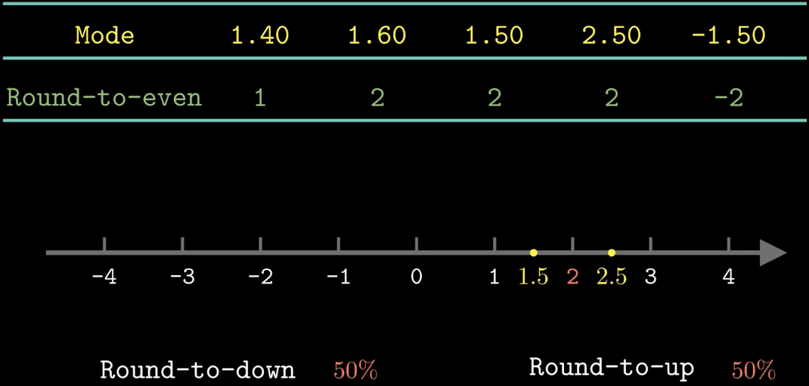

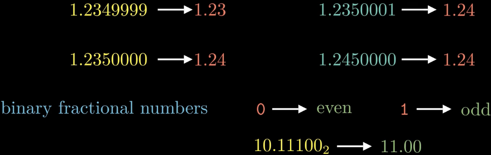

计算机中浮点数不具备结合性和分配性

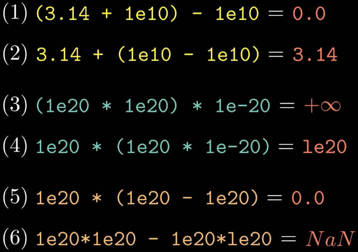

浮点数和整数的转换

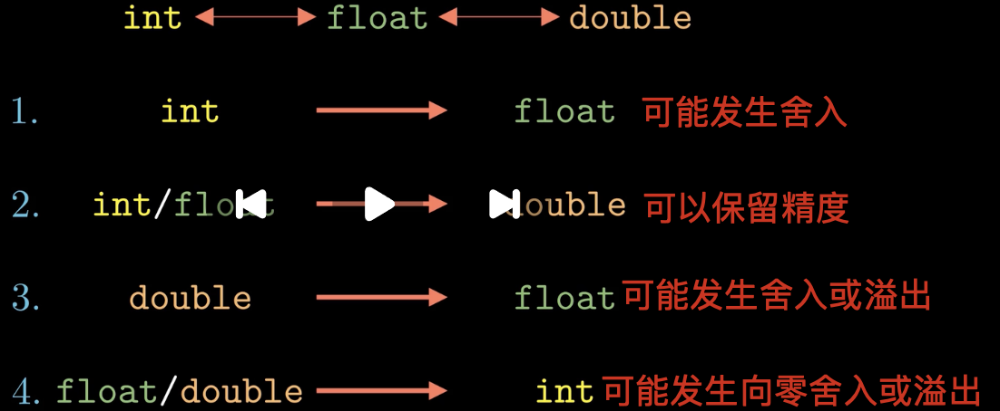

##### AI补充总结：精度、运算顺序与类型

以下按 32 位 `int`、IEEE 754 单精度 `float`、双精度 `double` 讨论，浮点运算采用默认的“向最近值舍入，中间取偶数”。

**1. 24 位有效精度不等于只能表示 24 位整数**

- 规格化 `float` 表示为 `±1.xxx × 2^E`，隐含的前导 `1` 加上 23 位小数字段，共有 **24 位二进制有效精度**；`double` 为 53 位。
- 指数决定范围，有效位决定精度。`2^25 = 1.0 × 2^25`，尾部的零可由指数表达，因此能精确表示；`2^24 + 1` 的二进制是首尾各一个 `1`、中间 23 个 `0`，需要 25 位有效精度，因此无法精确表示。
- `float` 能精确表示 `[-2^24, 2^24]` 内的所有整数。超过该范围后，仍能表示部分整数，但无法表示每个整数。

| 正数区间         | 相邻 `float` 的间距 | 能精确表示的整数 |
| ---------------- | --------------------: | ---------------- |
| `[2^23, 2^24)` |                     1 | 每个整数         |
| `[2^24, 2^25)` |                     2 | 偶数             |
| `[2^25, 2^26)` |                     4 | 4 的倍数         |

一般地，在规格化数区间 `[2^E, 2^(E+1))` 内，间距为 `2^(E-23)`。数越大，间距越大。

**2. 结合律和分配律不保证成立**

每一步浮点运算都可能舍入或溢出；改变运算顺序，会改变信息丢失的时机。以下每一步均按 `float` 计算，结果为简写：

| 性质       | 一种顺序                        | 另一种顺序                          | 原因                                               |
| ---------- | ------------------------------- | ----------------------------------- | -------------------------------------------------- |
| 加法结合律 | `(3.14 + 1e10) - 1e10 = 0`    | `3.14 + (1e10 - 1e10) ≈ 3.14`    | `1e10` 附近的间距为 1024，加上的 `3.14` 被舍掉 |
| 乘法结合律 | `(1e20 * 1e20) * 1e-20 = +∞` | `1e20 * (1e20 * 1e-20) ≈ 1e20`   | 前一种顺序的中间乘积溢出                           |
| 分配律     | `1e20 * (1e20 - 1e20) = 0`    | `1e20 * 1e20 - 1e20 * 1e20 = NaN` | 展开后两项均溢出，`+∞ - +∞` 得到 `NaN`       |

丢失的信息无法通过后续运算恢复。C 中复现上述结果应使用 `3.14f`、`1e10f` 等单精度字面量；不带 `f` 的小数字面量默认是 `double`。

**3. 类型转换分别检查范围与精度**

| 转换                    | 规则与示例                                                                                           |
| ----------------------- | ---------------------------------------------------------------------------------------------------- |
| `int → float`        | 可能舍入：`16777217 → 16777216`，再转回 `int` 也无法恢复                                        |
| `int → double`       | 32 位 `int` 的所有值都能精确表示                                                                   |
| `float → double`     | 精确保留已有的有限值，但不能恢复此前丢失的精度                                                       |
| `double → float`     | 可能舍入、溢出为无穷大，或因数值太接近零而舍入为零                                                   |
| `float/double → int` | 在结果可表示时，直接丢弃小数部分：`3.9 → 3`、`-3.9 → -3`；这叫向零截断，不是四舍五入或向下取整 |

在普通 C/C++ 语义下，浮点数转整数时，若截断后的值超出目标整数范围，行为未定义，不能依赖某个固定结果。
