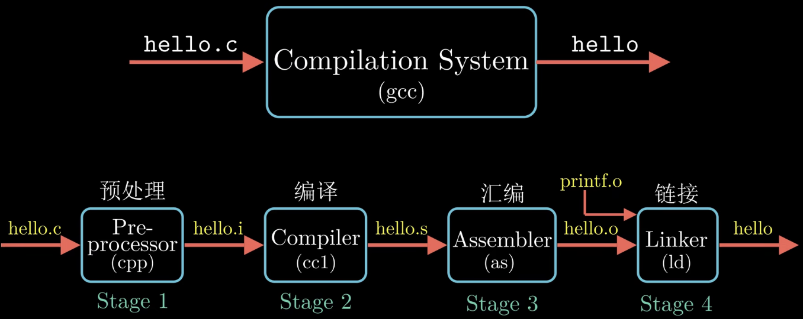
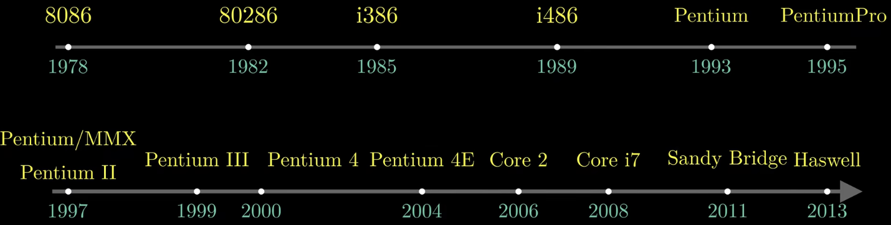
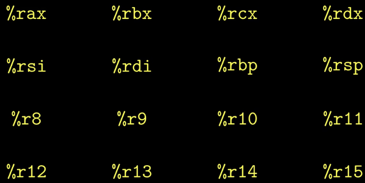
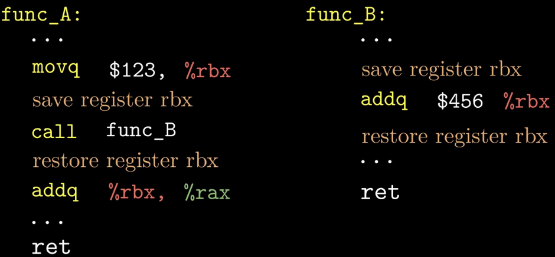
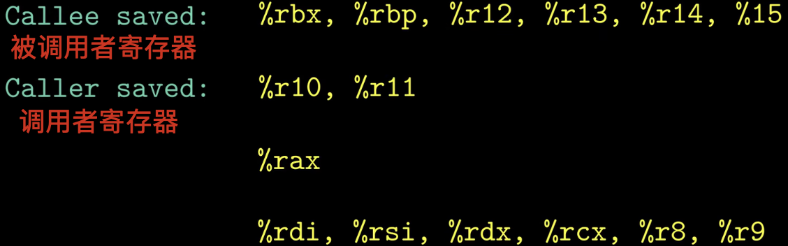
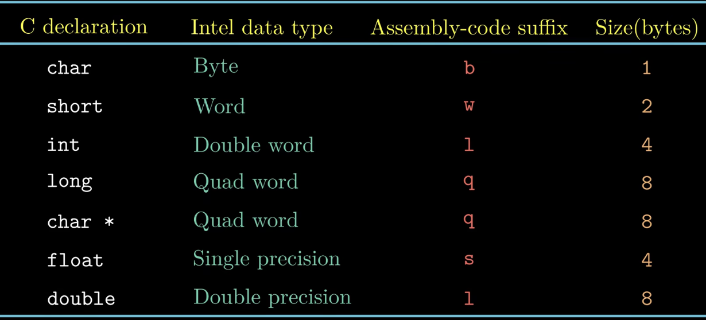
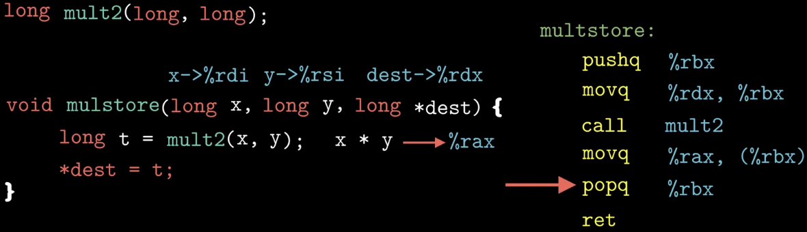
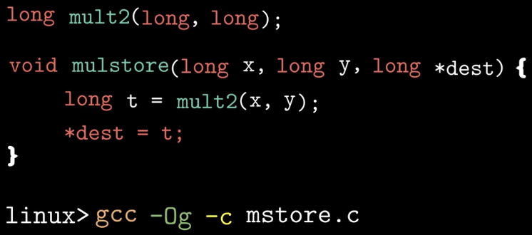
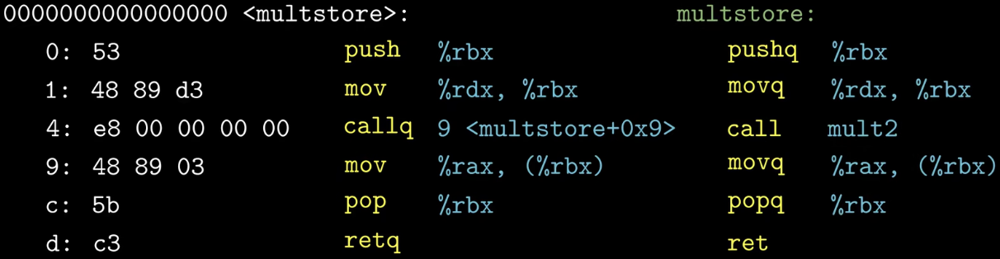

### What：CSAPP中文版教程-第十节-程序的机器级表示

### Why：加固一下计算机基础知识，第一性原理很重要

### Content：

简单回顾一下程序的编译流程：

Intel处理器的发展历史：

寄存器：

在Intel x86-64的处理器中包含了16个通用目的的寄存器，这些寄存器用来存放整数数据和指针，下图中显示的16个寄存器，它们的名字都是以%r开头的。

调用者保存寄存器和被调用者保存寄存器：

下图中，函数A调用了函数B，因为函数B中修改了寄存器%rbx的值，那么为了使函数A的运行正确，有两种不同的策略：调用者保存和被调用者保存。

调用者保存：函数A在调用函数B之前保存寄存器%rbx的值，调用结束后恢复寄存器%rbx的值；

被调用者保存：函数B在修改寄存器%rbx的值之前保存其值，返回函数A前恢复寄存器%rbx的值；

使用哪一种策略，寄存器就被叫做哪一种寄存器。

不同的寄存器有着不同的策略，具体情况如下图所示：

Intel用字来表示16位的数据类型

大多数gcc生成的汇编指令都有一个字符后缀来表示操作数的大小，第三列

汇编示例：

将C代码编译为机器码：

其中的-Og表示编译优化的级别，Og表示不优化，O（1，2，3，，，），数字越大优化越多，越不容易理解

可以通过使用objdump工具来将机器码反汇编成汇编代码：

objdump -d mstore.o

