### What：CSAPP中文版教程-第十一节-寄存器与数据传送指令

### Why：加固一下计算机基础知识，第一性原理很重要

### Content：

最早的8086处理器中，只有8个16位的通用寄存器，如下图所示：

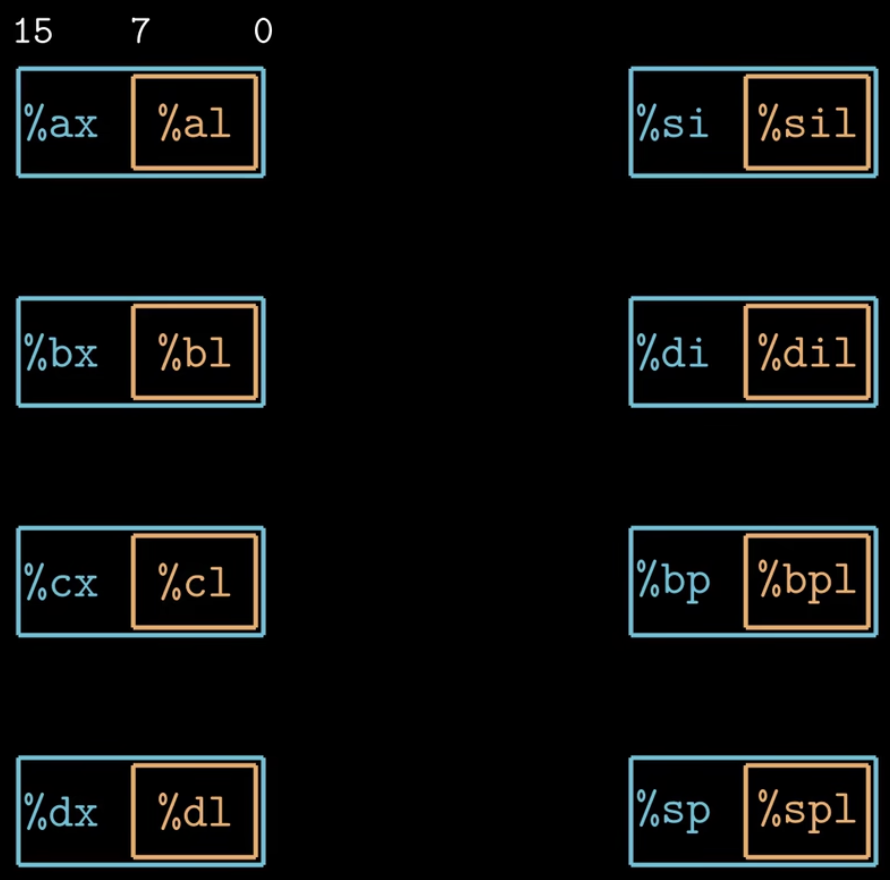

后来处理器从16位扩展到32位时，寄存器的位数也随之扩展到了32位，直到今天64位的处理器中，寄存器也扩展到了64位，且增加了8个新的寄存器，具体如下图所示

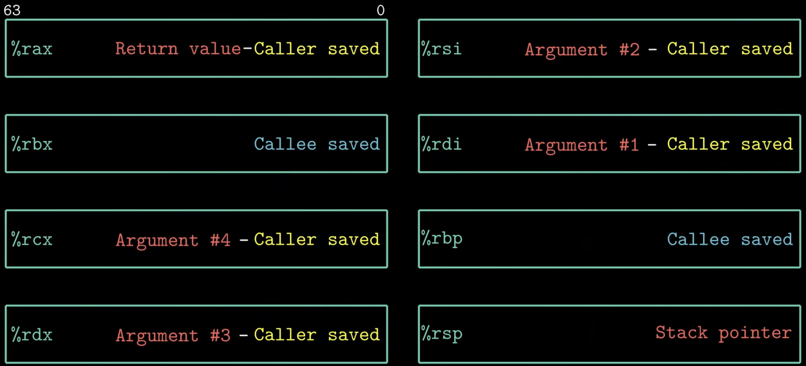

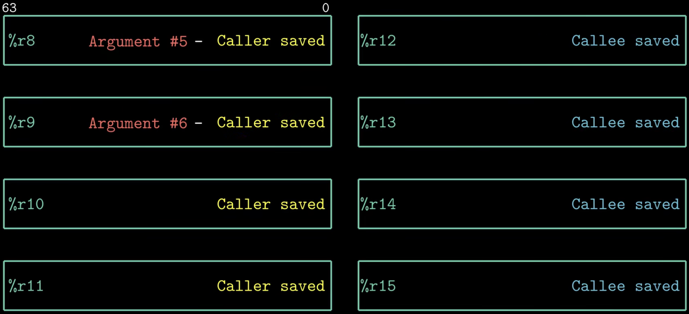

不同的寄存器保存不同的值：

* rax保存函数的返回值；
* rsp保存程序栈的结束位置；
* 还有6个寄存器用来传递函数参数；

##### 来看看汇编

指令一半包含两个部分：操作码和操作数

不同指令的操作数又可以分为三类：立即数、寄存器以及内存引用

立即数一般用一个$+整数的形式表示

寄存器很好辨别，%开头

值得一提的是如果寄存器被（）包含了，那么则表示内存引用

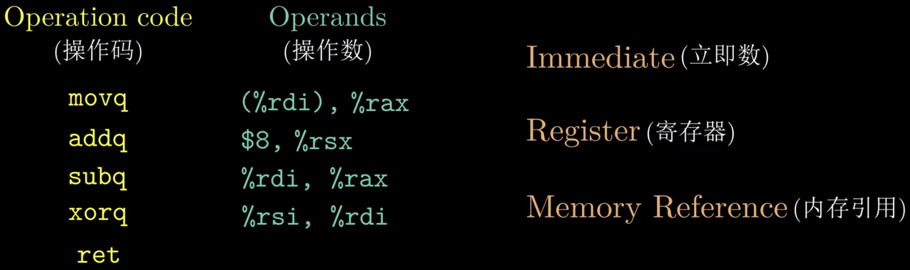

##### 内存引用

一般由4个部分组成：立即数、基址寄存器、变址寄存器和比例因子

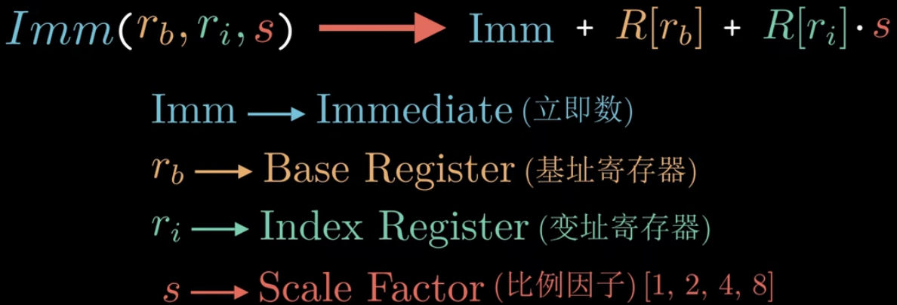

内存引用的其他表示形式如下图所示

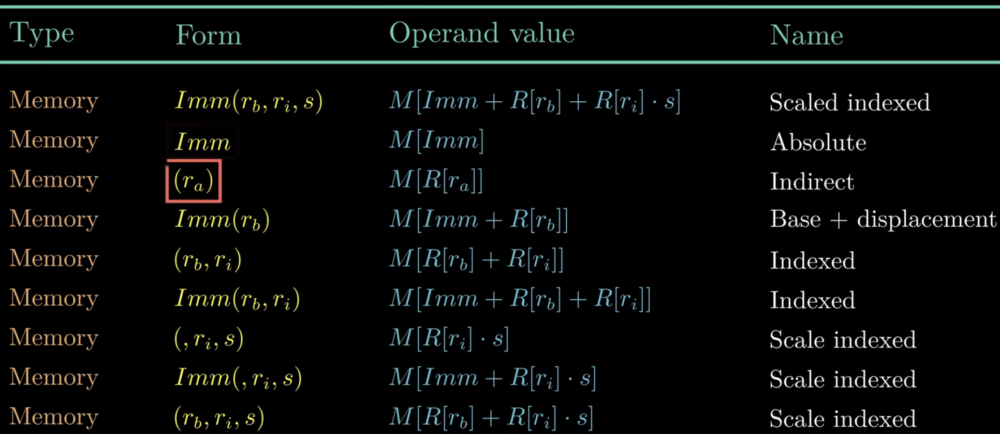

MOV指令：把数据从源位置复制到目的位置

在64位机器中，MOV指令的源操作数和目的操作数不能同时为内存引用，需要用两个mov指令来代替

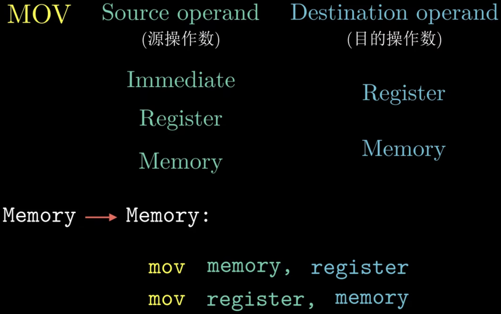

示例

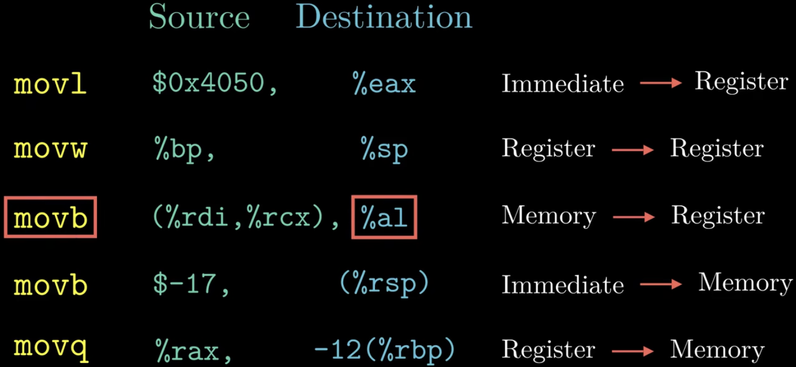

使用mov指令进行数据传送的示例

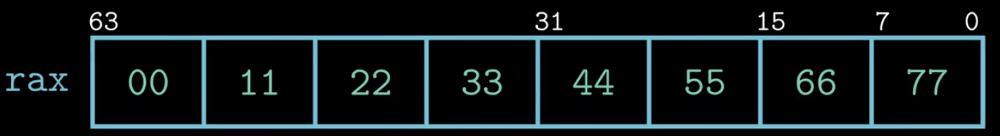

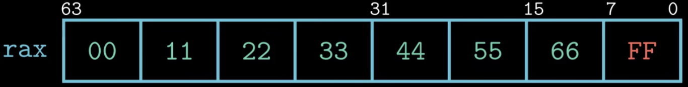

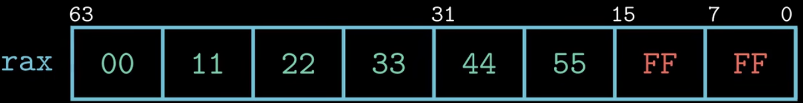

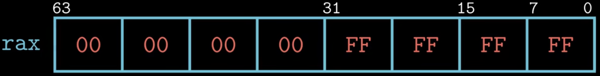

当源操作数和目的操作数位数不相同时：

零扩展传送指令和符号位扩展传送指令，指令最后的两个字符是大小指示符

cltq该指令的源操作数总是寄存器eax，目的操作数总是寄存器rax，与movslq %eax %rax效果一样，只是编码更紧凑一些

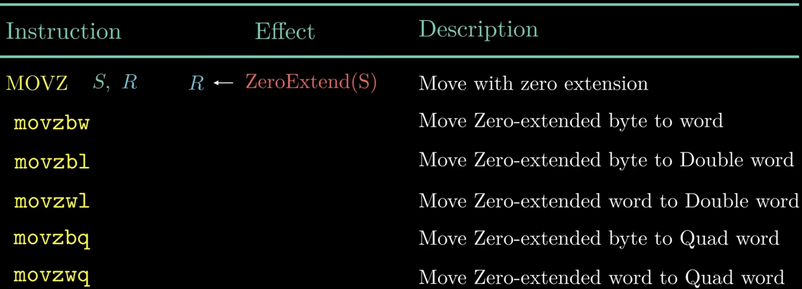

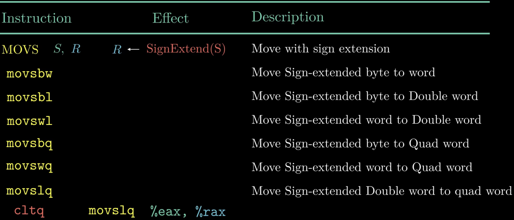
