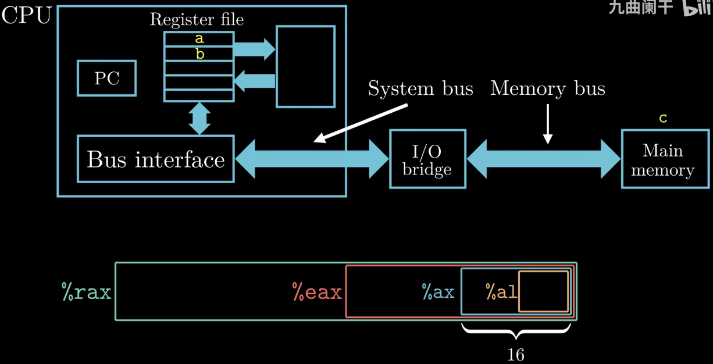
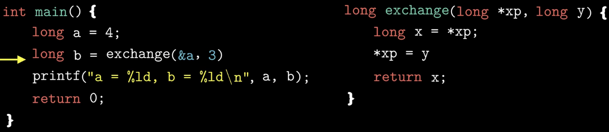
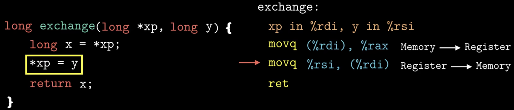
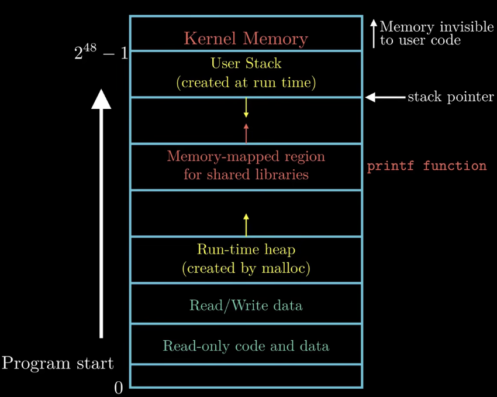
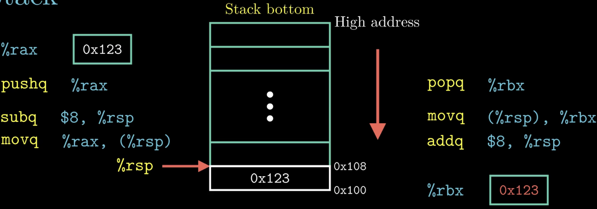

### What：CSAPP中文版教程-第十二节-栈与数据传送指令

### Why：加固一下计算机基础知识，第一性原理很重要

### Content：

指令c = a + b在计算机系统中是如何执行的，如下图：

代码示例：

简单回顾一下程序的运行时内存分布：

栈的增长方向是从高地址到低地址（从上图看是从上往下），因此栈顶的元素是栈中所有元素中最低的。

pushq指令等同于下面的subq指令和movq指令，只不过需要的字节数不一样；同样，popq指令也等同于下面的movq和addq指令。

%rsp寄存器保存的是栈指针。

注意，popq只是从逻辑上删除栈顶元素，实际上原来的0x123还在那里，直到下次pushq才会覆盖！
