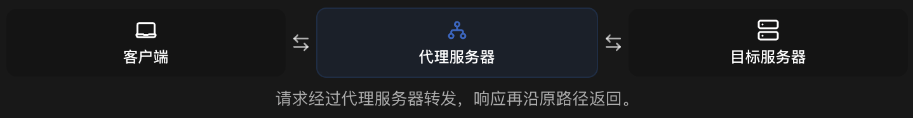
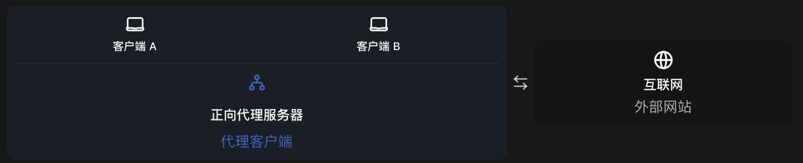
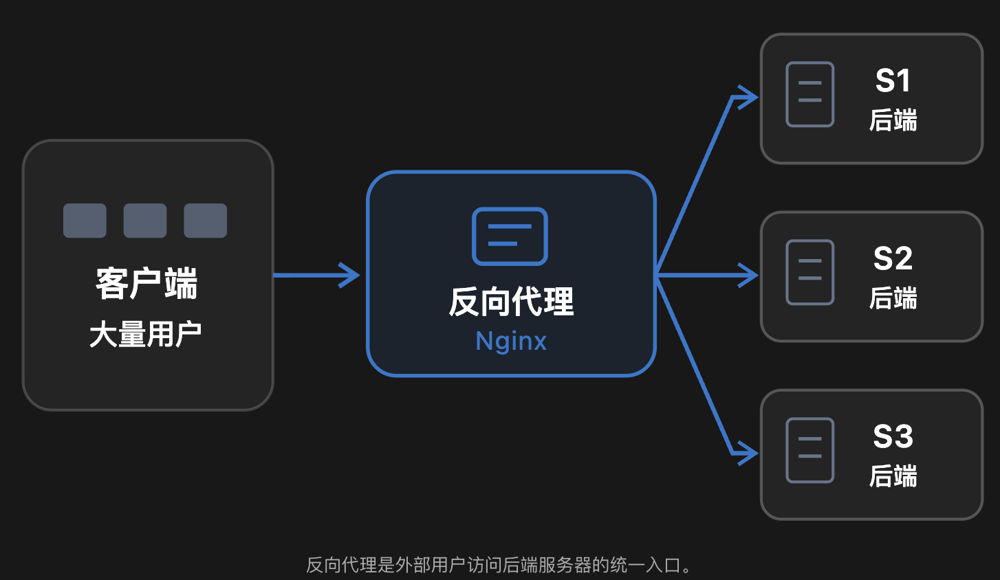
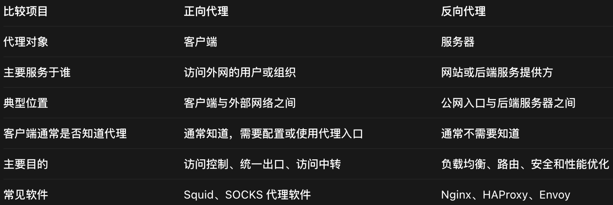
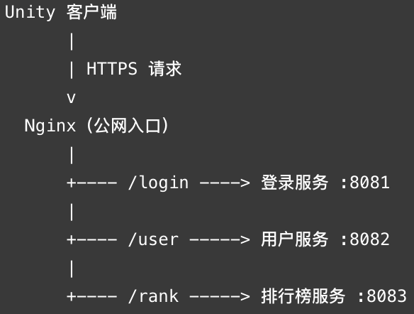
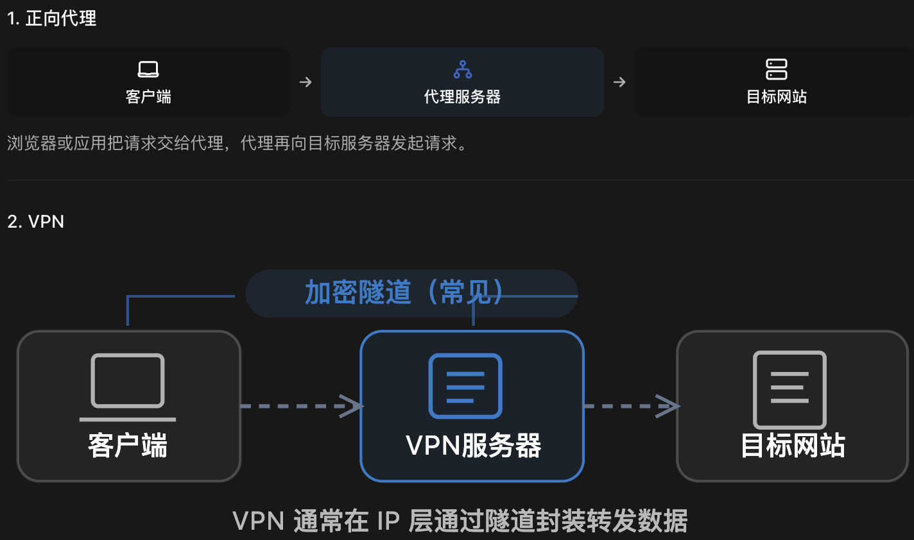
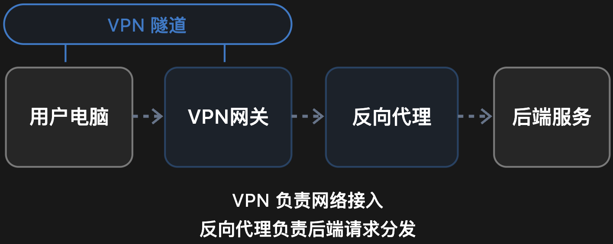

### What：代理与反代理

### Why：OpenAI开始封反代理

### Content：

学习一下什么是代理与反代理，以前总是接触，但是没有仔细了解过

##### 无代理：

##### 有代理：

##### 正向代理：

##### 反向代理：

##### 区别：

##### Unity多人在线游戏可能就有以下结构：

##### 代理与VPN的关系：

##### VPN 是怎么工作的？

假设你在家里，需要访问公司内网服务器 10.0.0.5。

1. 电脑运行 VPN 客户端，建立虚拟网络接口。
2. VPN 客户端与公司的 VPN 网关建立隧道。
3. 电脑发往 10.0.0.5 的 IP 数据包进入隧道，经过封装，通常还会加密。
4. VPN 网关收到数据后解封装，并把原始数据包转发至内网服务器。
5. 内网服务器的响应经过 VPN 网关沿隧道返回。
   这样，你虽然人在家中，但在网络逻辑上可以访问公司的内部网络资源。

VPN 的关键不只是中转流量，而是建立一个虚拟的网络连接。

##### 为什么 VPN 看起来和正向代理几乎一样？

假设你的电脑通过一台位于日本的服务器访问某个网站。

使用正向代理：你的电脑->日本代理服务器->目标网站

使用全隧道 VPN：你的电脑->日本VPN服务器->目标网站

从目标网站看，最终可能都表现为“请求来自日本服务器的 IP”。

但**内部处理方式不一样**：正向代理会接收客户端的代理请求或连接，代表客户端建立到目标的连接；VPN 则主要**通过封装、解封装和路由转发 IP 数据包**实现通信。
