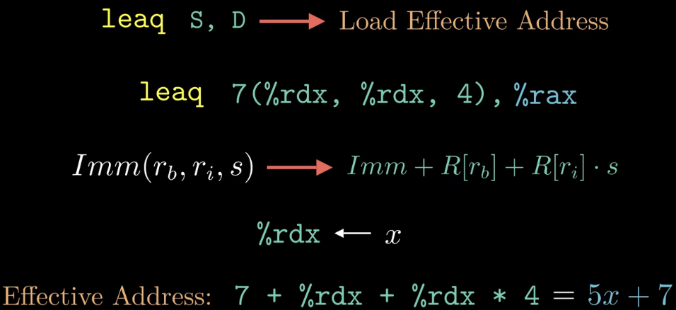
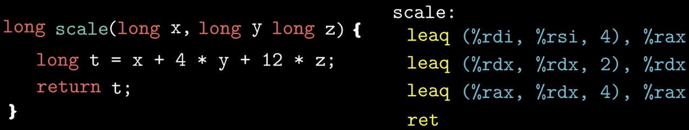
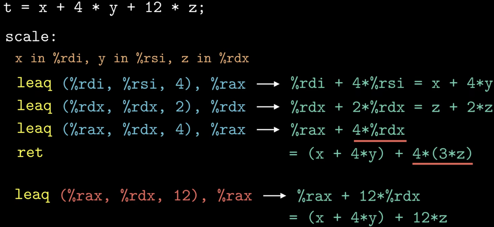
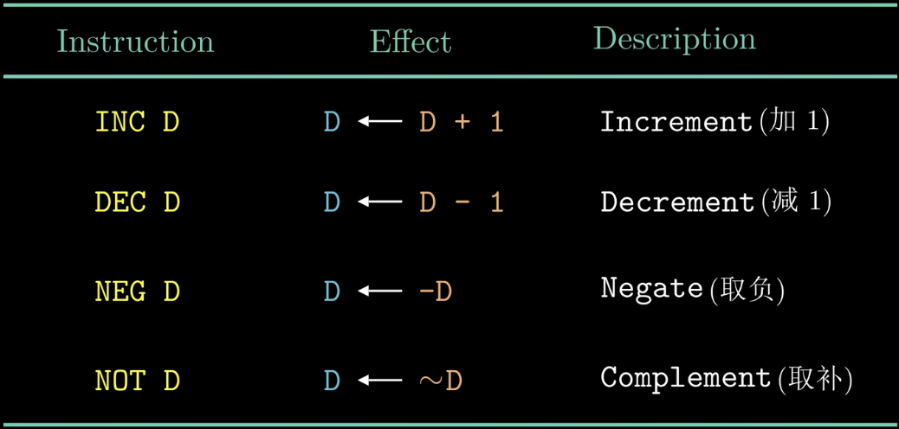
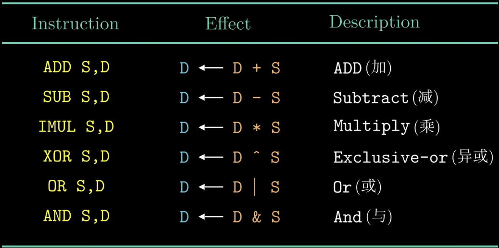
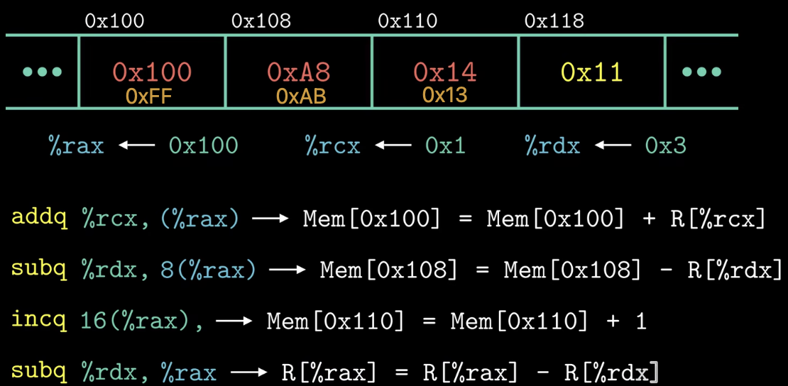
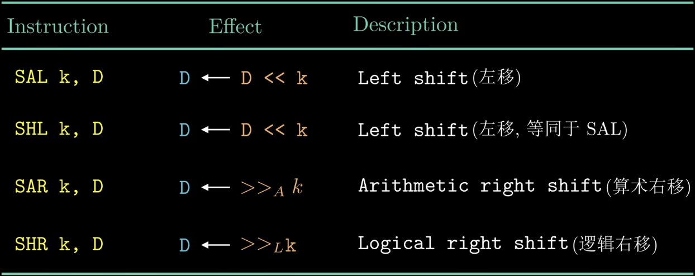
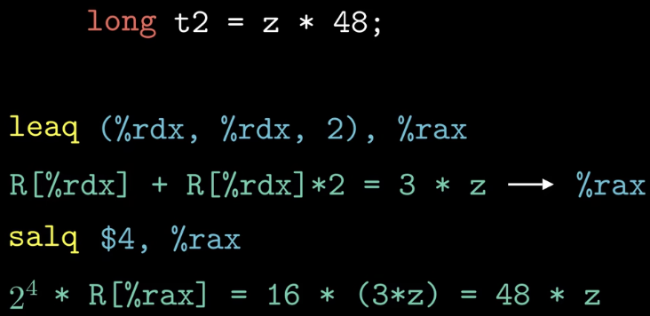
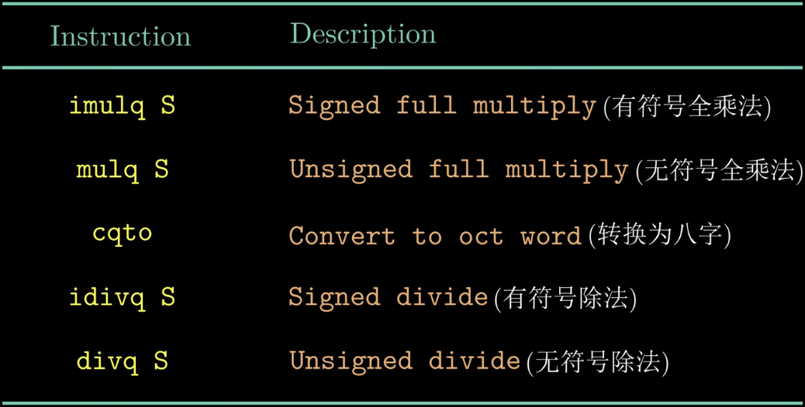

### What：CSAPP中文版教程-第十三节-算数与逻辑运算指令

### Why：加固一下计算机基础知识，第一性原理很重要

### Content：

LEAQ指令：将源位置的数据直接写入目标位置，Q表示地址的位数是4字，因为64位机器中，地址都是4字，所以没有别的变式指令。

leaq指令还可以表示加法和有限的乘法运算，下图左边的C代码经过编译后，可以发现由右侧的三条leaq指令来实现

由于比例因子的值只能是1，2，4，8中的一个，所以必须将12分解为4+8

一组一元操作指令：操作数既是源操作数也是目标操作数，操作数可以是寄存器也可以是内存地址

一组二元操作指令：第一个操作数是源操作数，可以是立即数，寄存器或内存引用；第二个操作数可以是源操作数也可以是目的操作数，可以是寄存器或内存引用。

示例：黄色表示原来的值

移位指令：SAL和SHL效果一样，往右边填0即可，SAR和SHR一个表示算数右移，往左侧填符号位，一个表示逻辑右移，往左侧填0。对于移位量k，可以是一个立即数也可以是寄存器%cl中的数。**注意，只能是这个寄存器，别的不行！**

示例：

特殊算数指令：

