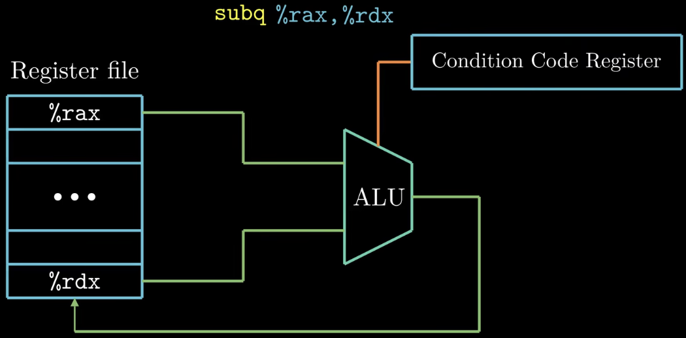
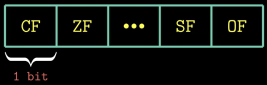
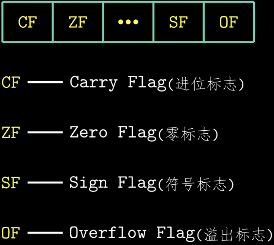
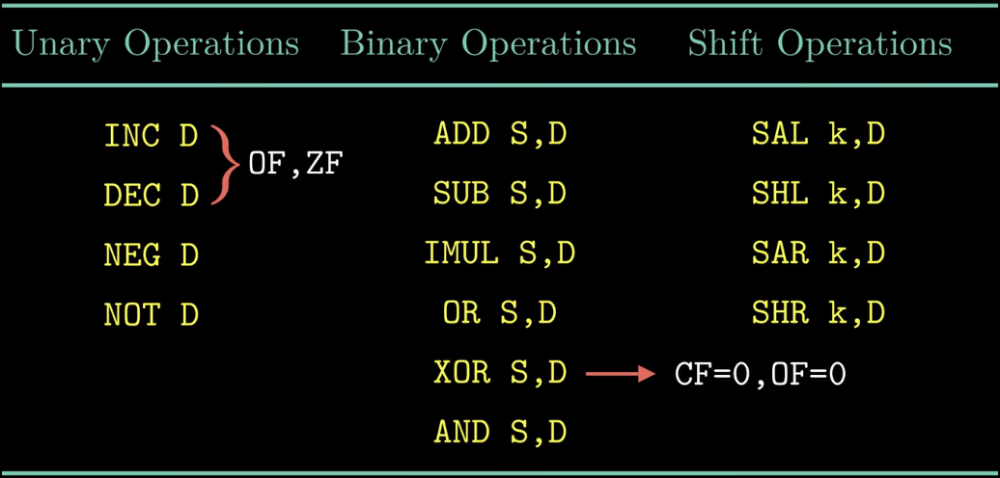
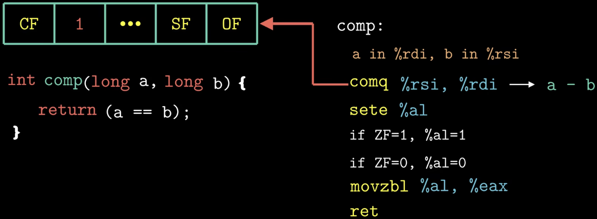
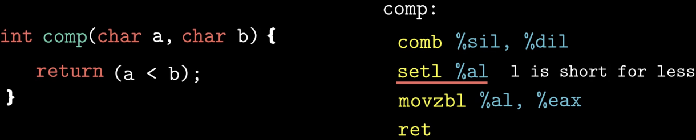
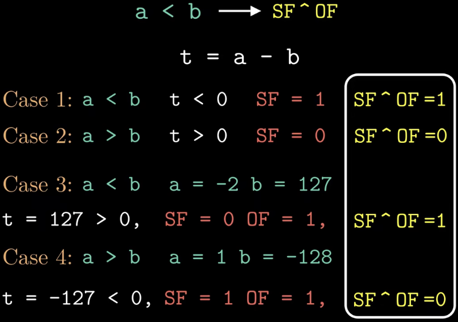
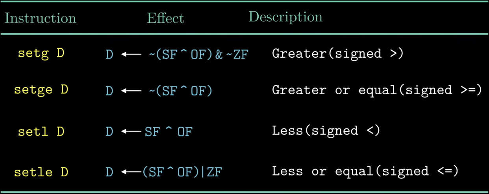
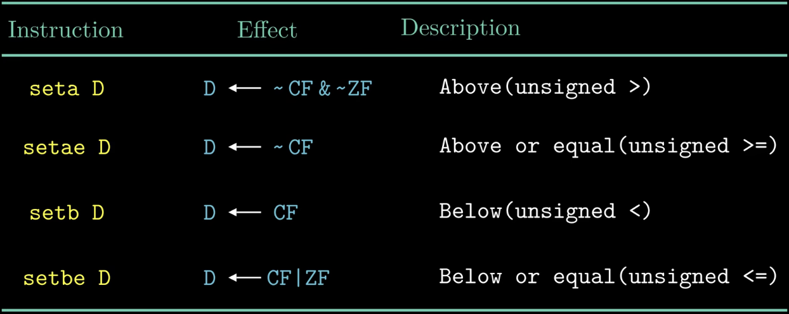

### What：CSAPP中文版教程-第十四节-指令与条件码

### Why：加固一下计算机基础知识，第一性原理很重要

### Content：

算数与逻辑运算指令需要用到ALU计算单元，但ALU计算单元还可以根据运算的结果去设置条件码寄存器。

##### 条件码寄存器

由CPU来进行维护，长度是单个比特位，描述了最近执行操作的属性。值由ALU在执行算数和运算指令时写入的。

一些常用的条件码：

还有两类指令可以设置条件码寄存器：Cmp and Test

cmp指令和sub指令类似，不同的是cmp指令只是设置条件码寄存器，不会更新目的寄存器的值；

test指令和and指令类似，不同的是cmp指令只是设置条件码寄存器，不会更新目的寄存器的值；

##### 条件码的使用

示例：相等ZF为1，否则为0

sete指令：通常情况下不会直接去读条件码寄存器的值，一种方式是根据条件码的某种组合，通过set类指令，将一个字节设置为0或者1。e表示equal。

 对于其他的判断情况，都可以通过条件码的组合来实现：

无符号数的cmp组合

