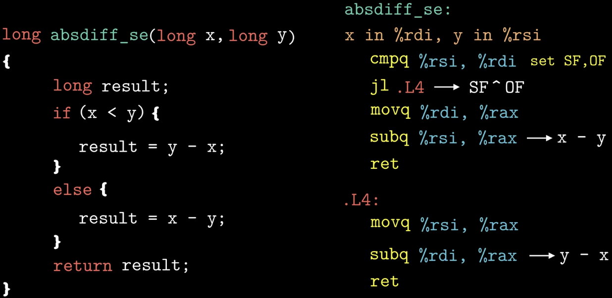
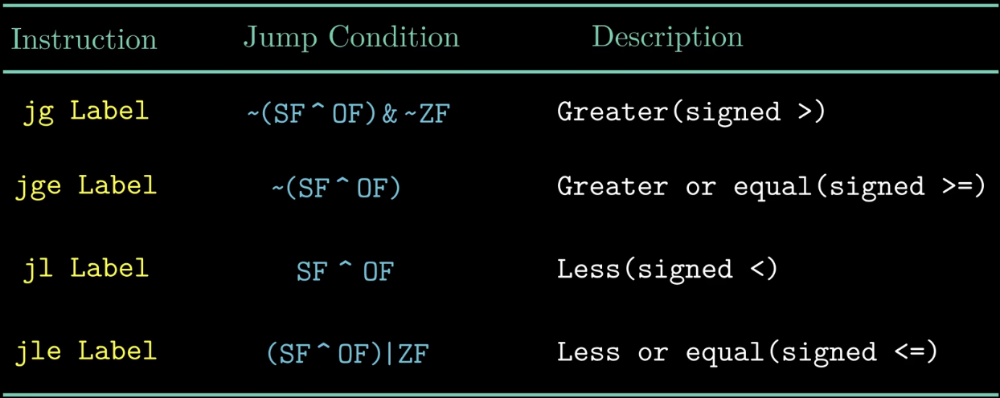
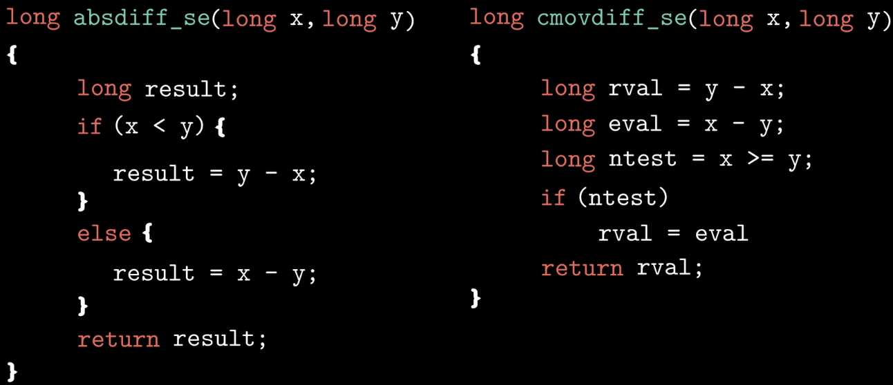
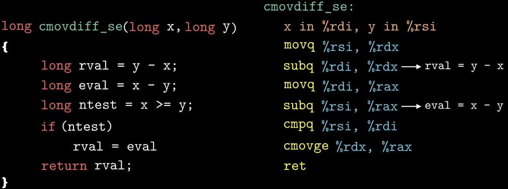
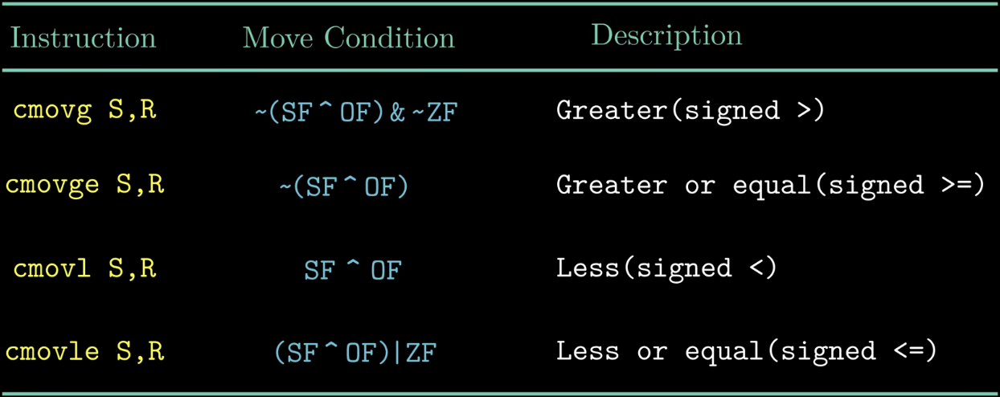
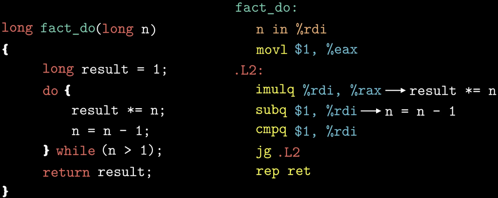
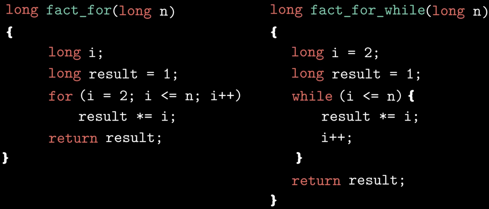
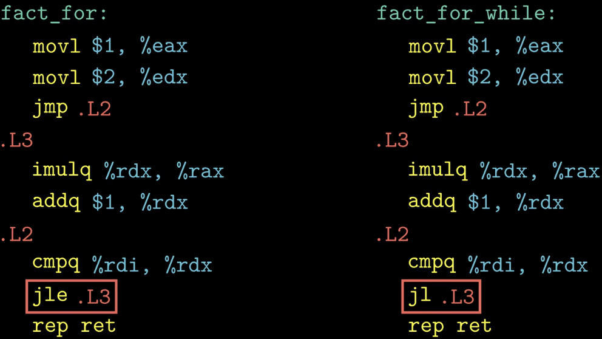

### What：CSAPP中文版教程-第十五节-跳转指令与循环

### Why：加固一下计算机基础知识，第一性原理很重要

### Content：

##### 跳转指令

跳转指令会根据条件寄存器的某种组合来决定是否进行跳转，和有符号数的set指令的组合一样

if-else在现代处理器上，它的执行效率可能会比较低，针对这种情况，有一种替代的策略，可以使用数据的条件转移来代替控制的条件转移

指令cmov根据条件码的某种组合来进行有条件的传送数据，当满足规定的条件时，将寄存器%rdx内的数据复制到寄存器%rax中。在上图的示例中，只有当x>=y时，才会执行这一条指令。

更多的条件传送指令如下图所示：

注：为什么基于条件传送的代码会比基于跳转指令的代码效率高？这是因为现代处理器通过流水线来获得高性能，当遇到跳转指令时，处理器会根据分支预测器来猜测每条跳转指令是否执行，当发生错误预测时，会浪费大量的时间，导致程序性能严重下降。

##### 三种循环实现阶乘

注：上图汇编代码是使用-Og这个级别的优化规则产生的。

综上，**三种形式的循环语句都是通过条件测试和跳转指令来实现的**。

##### switch

执行switch语句的时间与case的数量是无关的，所以在处理多重分支时，与一组很长的if-else相比，switch的执行效率要高。switch语句使用跳转表这种数据结构。
