### What：CSAPP中文版教程-第十六节-过程（函数调用）

### Why：加固一下计算机基础知识，第一性原理很重要

### Content：

##### 过程（函数调用）的机制

假设函数P调用函数Q，函数Q执行结束后返回函数P。当函数Q正在执行的过程中，函数P以及相关调用链上的函数都会被暂时挂起。

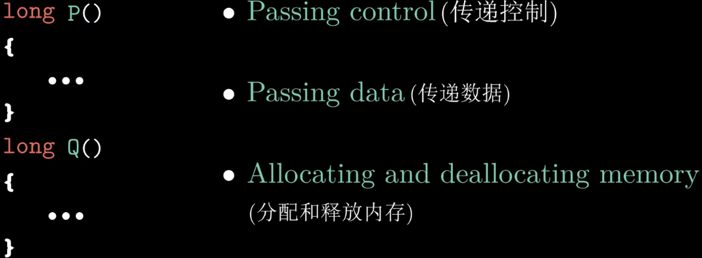

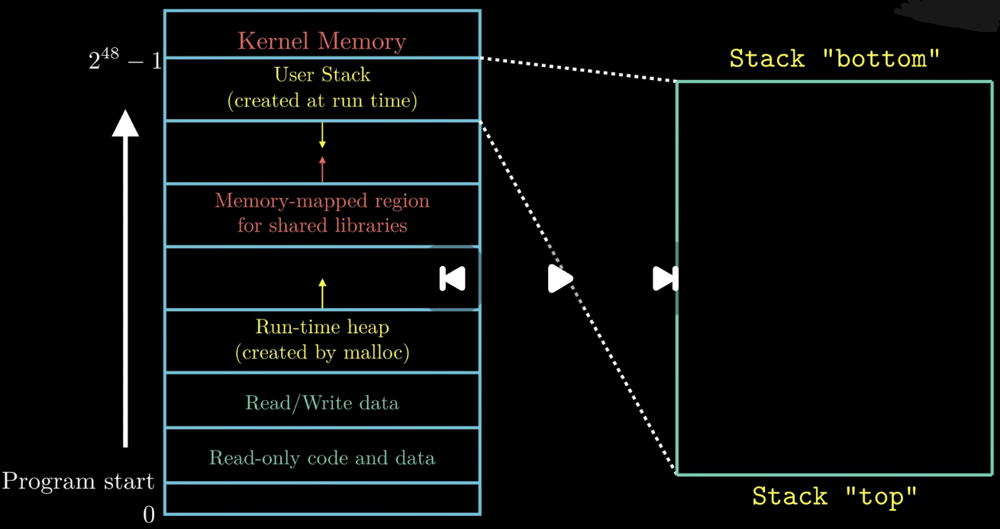

**栈帧：**当函数执行所需要的存储空间超出寄存器能够存放的大小时，就会借助栈上的存储空间，我们把这部分存储空间称为函数的栈帧。

当函数P调用函数Q的时候，会把返回地址压入栈中，这个地址表示当函数Q执行结束返回时要从函数P的哪个位置继续执行，这个返回地址的压栈操作不是通过push，而是通过指令call。

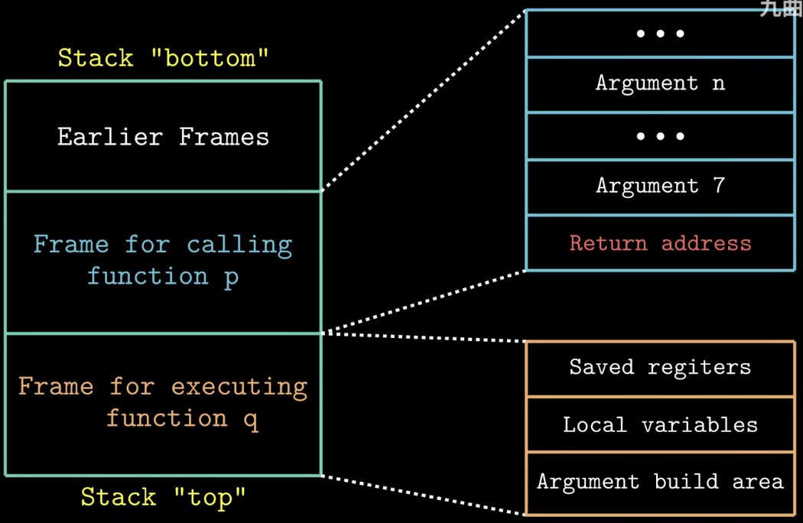

示例：

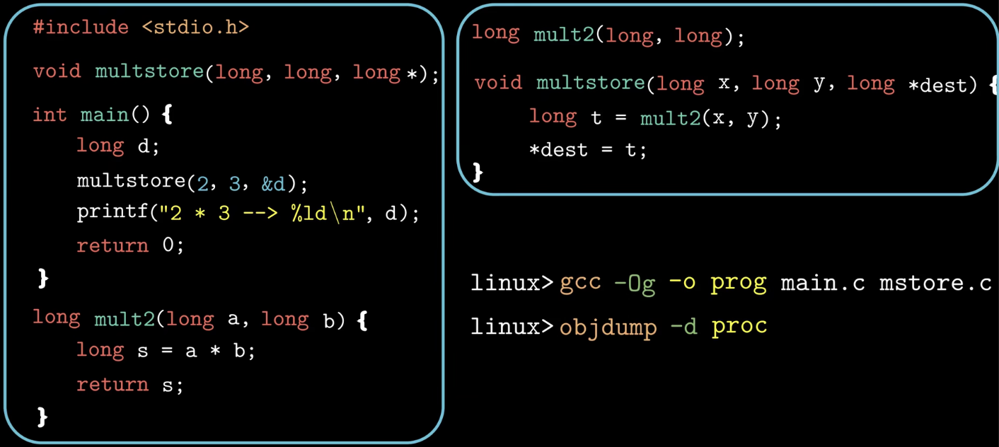

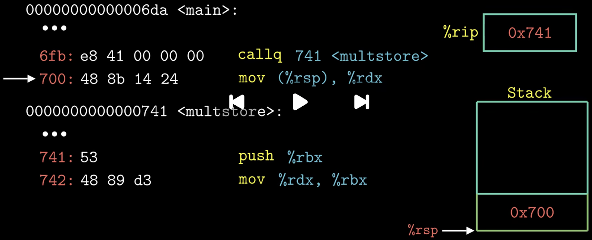

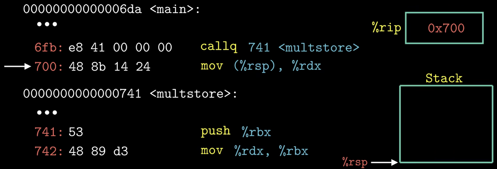

当main函数调用multstore函数的时候，先把multstore函数的执行地址放入寄存器%rip中，以此实现函数调用，还会把函数multstore执行结束后应该继续执行的地址压入栈中。当函数multstore执行完毕，指令ret从栈中将返回地址弹出，写入到程序指令寄存器%rip中，函数返回，继续执行main函数。

**参数传递：** 如果一个函数的参数数量大于6，那么超出的部分就要通过栈来传递。参数1到参数6可以使用相对应的寄存器。

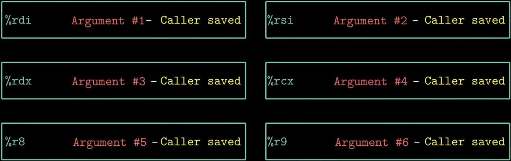

示例：

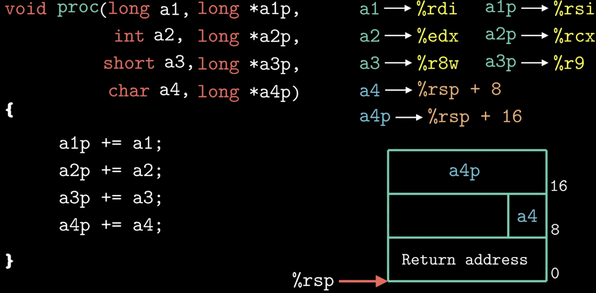

注意：

通过栈来传递参数时，所有数据的大小都是向8的倍数对齐，虽然变量a4只占一个字节，但是还是为其分配了8个字节的存储空间。

使用寄存器来进行参数传递时，使用寄存器的顺序是有特殊规定的，此外，寄存器名字的使用取决于传递参数的大小。下图中列对应的是参数的字节大小，横对应的是参数的顺序。

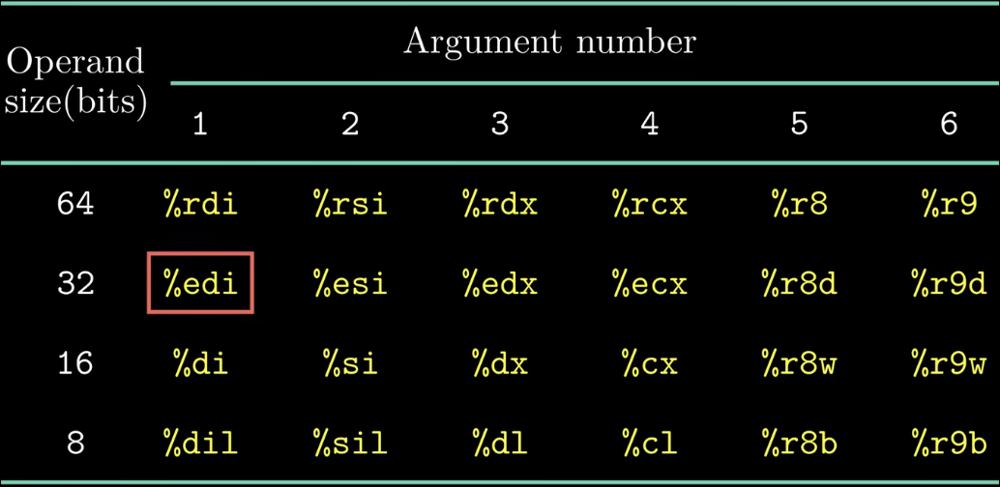

示例：

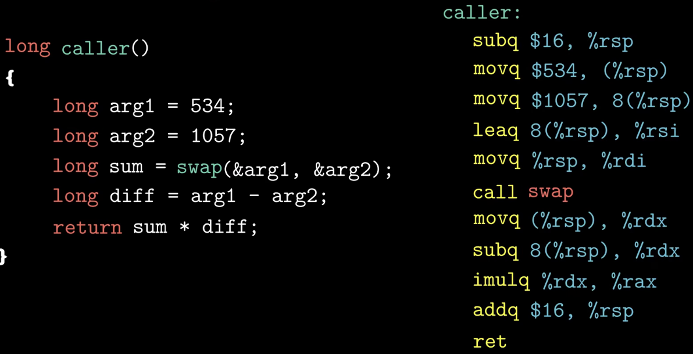

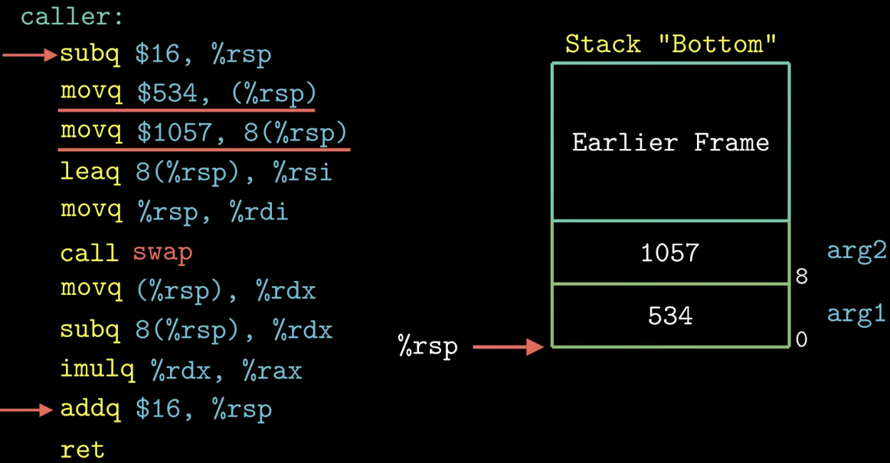

subq指的是开辟16个字节的存储空间，然后将局部变量的值存储到caller函数的栈帧中，接着获取这两个局部变量的地址并放入函数swap的参数寄存器中，然后调用swap。函数caller调用结束前，使用addq释放分配给局部变量的空间（逻辑释放，实际上值还在里面）。

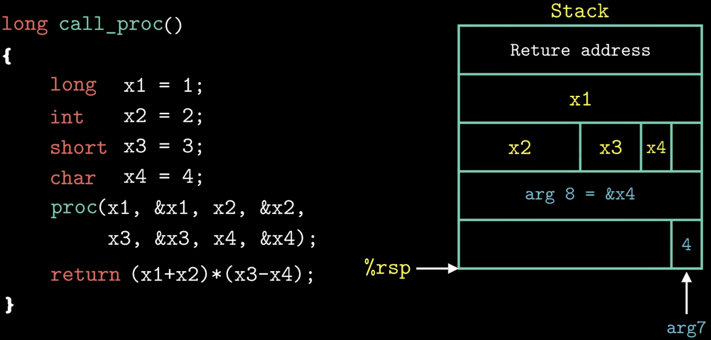

参数需要对齐，局部变量不需要。

在程序执行过程中，寄存器是被所有函数共享的一种资源，为了避免寄存器的使用过程中出现数据覆盖的问题，处理器规定了寄存器的使用规则。所有的函数调用都必须遵守这个规则。

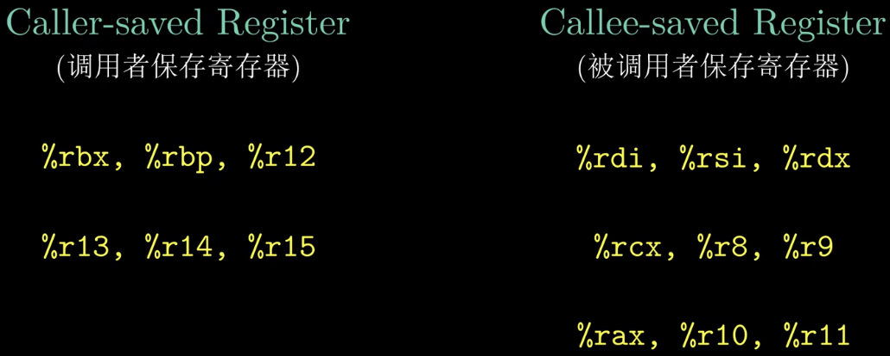

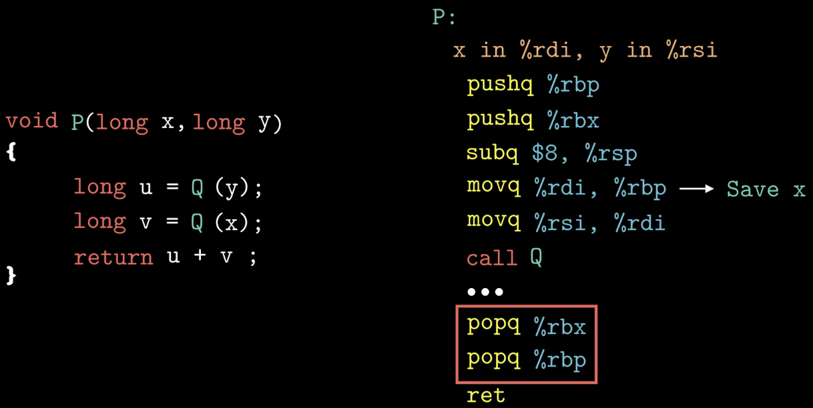

**示例：P调用Q时如何保存数据（AI总结）**

图中的C代码应当写成下面这样：P需要返回计算结果，因此返回类型应为`long`，而不是图中的`void`。

```c
long P(long x, long y)
{
    long u = Q(y);
    long v = Q(x);
    return u + v;
}
```

在本例使用的System V AMD64调用约定下，进入P时，参数`x`在`%rdi`中，参数`y`在`%rsi`中，函数返回值放在`%rax`中。`%rdi`、`%rsi`和`%rax`都可能被Q改写，因此P需要保存两项数据：调用`Q(y)`前保存后面还要使用的`x`；调用`Q(x)`前保存第一次调用的结果`u`。

这里使用被调用者保存寄存器`%rbp`和`%rbx`分别保存`x`和`u`。Q必须保证返回时这两个寄存器的值与调用前一致；同样，P使用它们之前，也必须保存自己调用者的原值，并在返回前恢复。这是调用约定的要求，不是寄存器自动保存数据。

下面是一种与图中代码对应的完整实现（补全了省略部分）。AT&T语法中，双操作数指令通常按“源操作数，目标操作数”书写。

```asm
P:
    pushq %rbp            # 将调用者原来的rbp保存到栈中
    pushq %rbx            # 将调用者原来的rbx保存到栈中
    subq  $8, %rsp        # 调整栈，使执行call前满足16字节对齐

    movq  %rdi, %rbp      # rbp = x，保存后面还要使用的x
    movq  %rsi, %rdi      # 第一个参数 = y
    call  Q               # rax = Q(y)

    movq  %rax, %rbx      # rbx = u，保存第一次调用的结果
    movq  %rbp, %rdi      # 第一个参数 = x
    call  Q               # rax = Q(x)，即v

    addq  %rbx, %rax      # rax = u + v，作为P的返回值

    addq  $8, %rsp        # 撤销前面的栈空间调整
    popq  %rbx            # 恢复调用者原来的rbx
    popq  %rbp            # 恢复调用者原来的rbp
    ret                   # 弹出返回地址，回到P的调用者
```

注意：

- `pushq %rbp`保存的是调用者原来的寄存器值；`movq %rdi, %rbp`才是把`x`保存到`%rbp`中。这里的`%rbp`用于保存普通数据，没有用作栈帧指针。
- 栈遵循后进先出，因此先保存`%rbp`、再保存`%rbx`，恢复时就要先`popq %rbx`、再`popq %rbp`。执行这两个`popq`之前，必须先用`addq $8, %rsp`撤销额外预留的空间。
- 进入P时，`call P`已经压入了8字节的返回地址，此时`%rsp`相对16字节边界偏移8字节。两次`pushq`共占16字节，再用`subq $8, %rsp`预留8字节，便能使后续执行`call Q`之前的栈指针满足16字节对齐。
- 每次`call Q`都会将P中紧随该调用的下一条指令地址压栈；Q通过`ret`取出返回地址，回到P继续执行。最终结果通过`%rax`传递，而不是通过`ret`指令本身传递。

**核心：需要跨函数调用保留的数据，可以放在被调用者保存寄存器中；使用这些寄存器的函数负责保存并恢复其原值。**

递归调用示例：

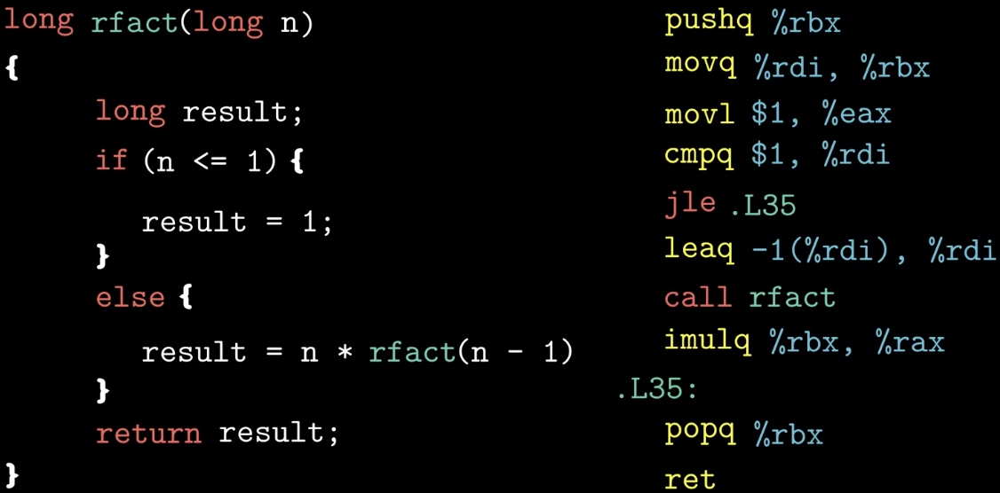

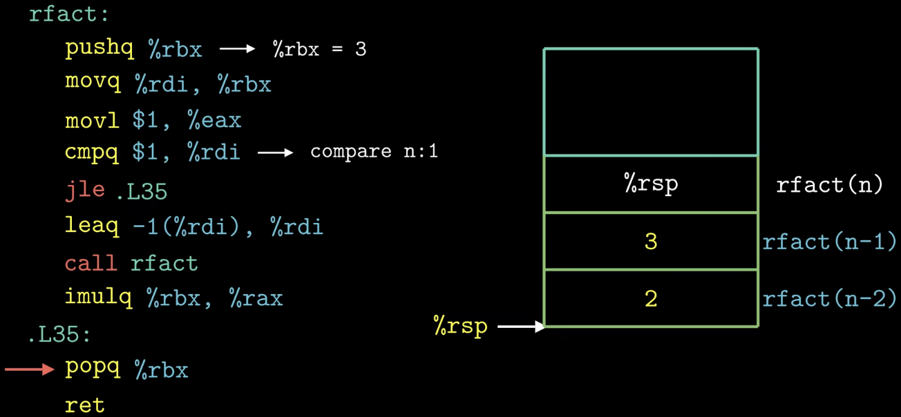
