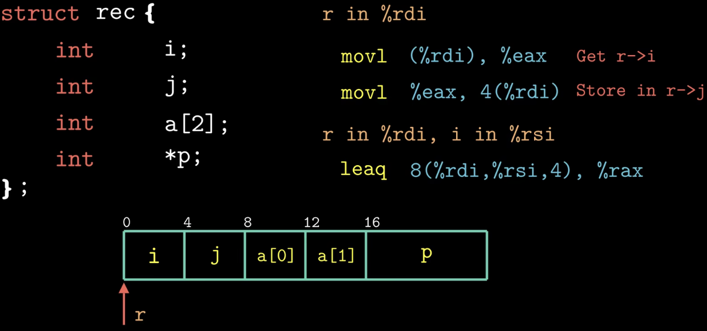
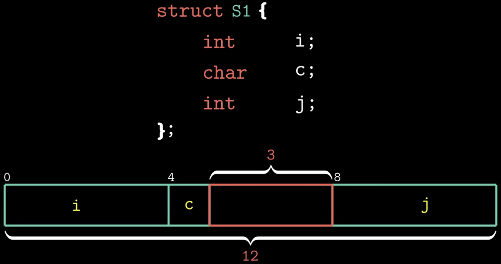
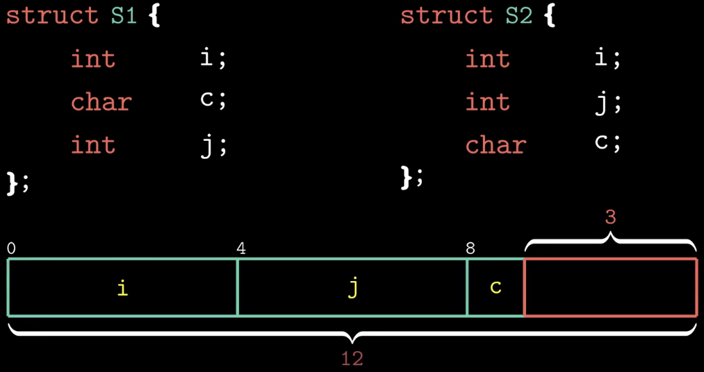
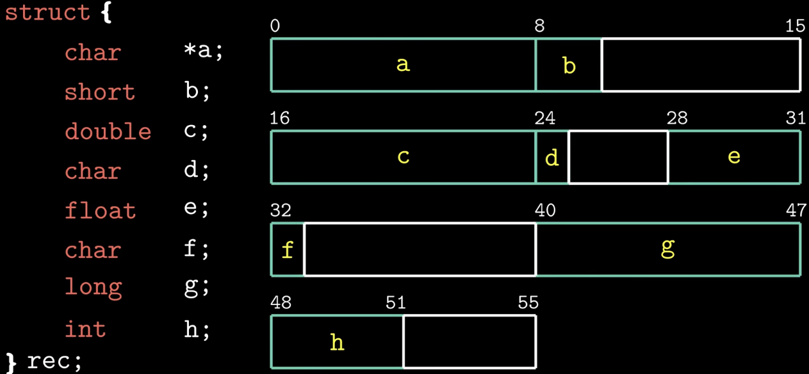
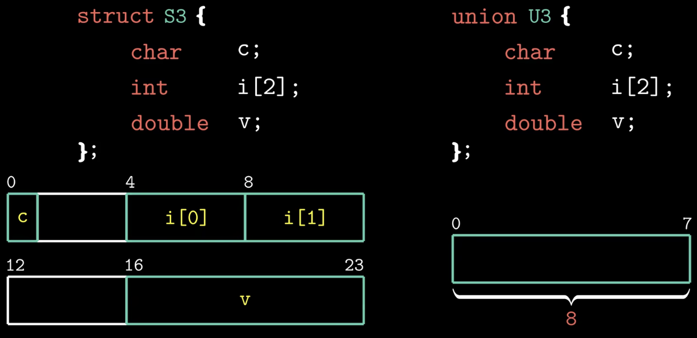
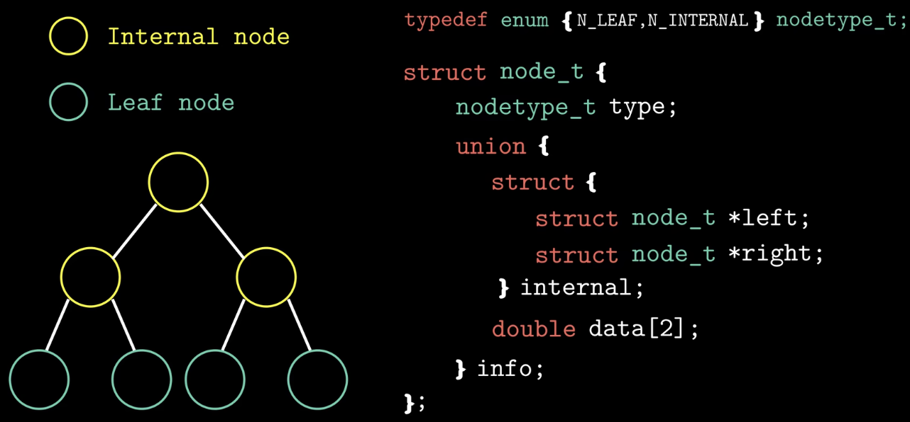
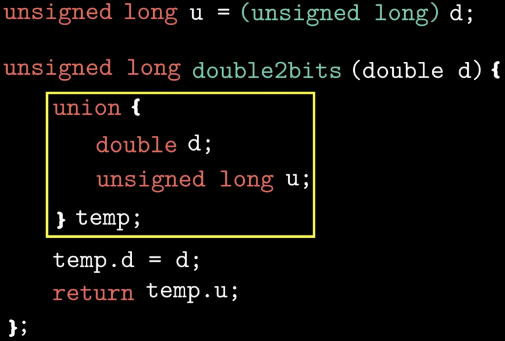

### What：CSAPP中文版教程-第十八节-结构体与联合体

### Why：加固一下计算机基础知识，第一性原理很重要

### Content：

##### 结构体

数据对齐：

原则是任何K字节的基本对象的地址必须是K的倍数。

下图中变量j是int类型，占4个字节，它的其实地址必须是4的倍数。

也可以调整一下结构体定义中变量的顺序，比如将char类型的变量c放到最后一个，这样单个结构体的长度为9，但是如果要声明一个结构体数组，那么需要在结构体的末端进行数据对齐，否则有的结构体实例无法满足对齐原则。

示例：

##### 联合体

联合体中的所有字段共享同一存储区域，所以长度取决于最大字段的长度

应用：事先知道两个不同字段的使用是互斥的

要么是叶子结点，要么是内部节点，内部节点只有左右两个节点的指针，不包含数据，叶子节点只包含数据。为了区分是内部节点还是叶子节点，使用一个枚举变量来标识，这样最后的node_t结构体长度为24，4（枚举）+4（对齐）+16（联合体）。

这个例子中联合体确实省了一点空间，但是相比于节省的空间，却给编码人员带来了麻烦，所以意义不大。对于多个字段的情况，改为联合体带来的空间节省才更吸引人。

联合体还可以用来访问不同数据类型的位模式

