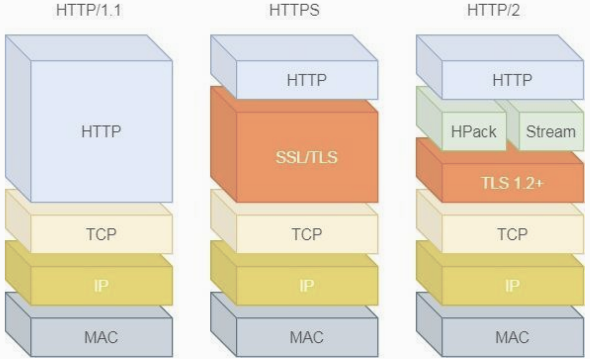
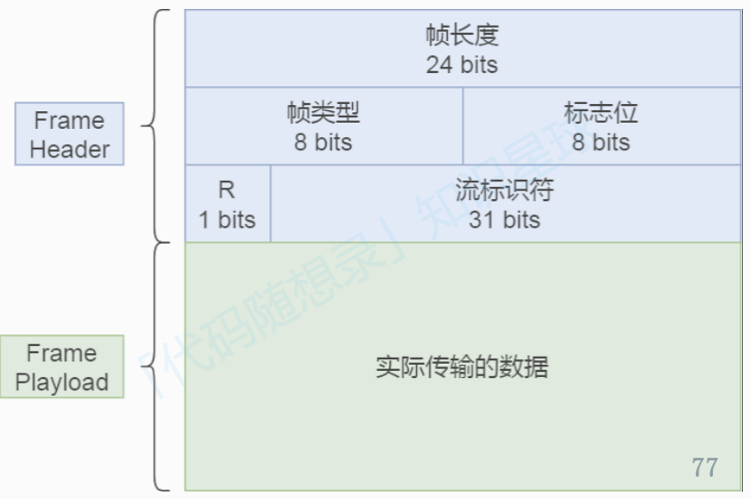
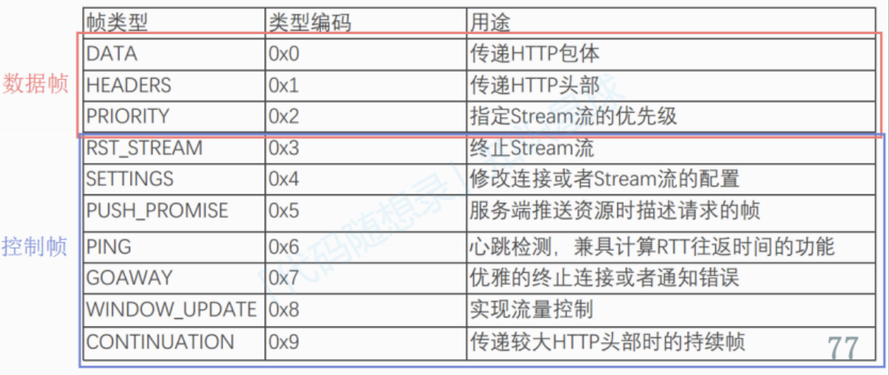
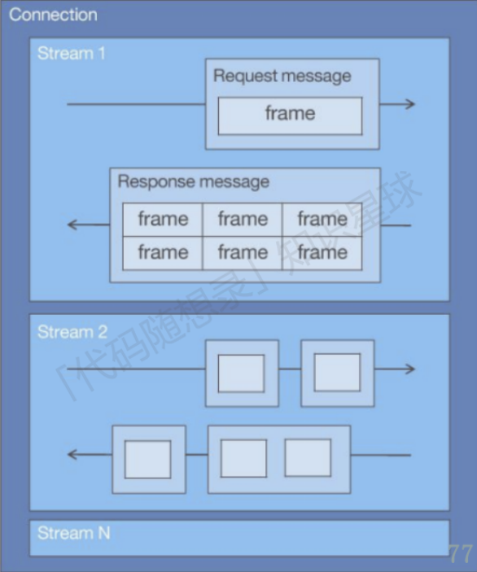
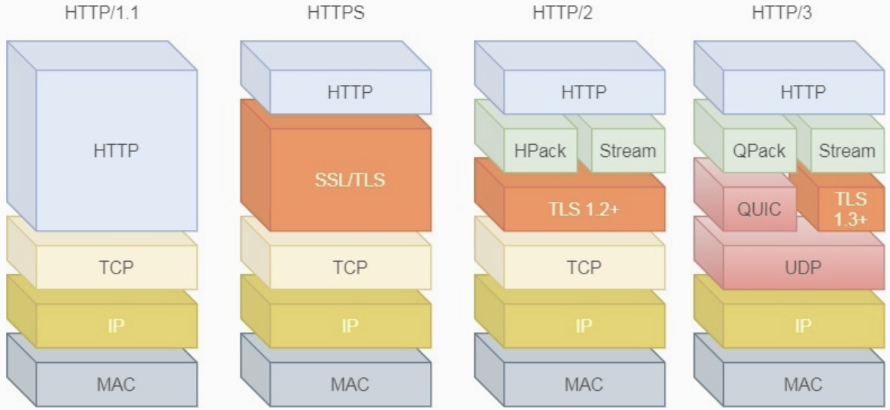
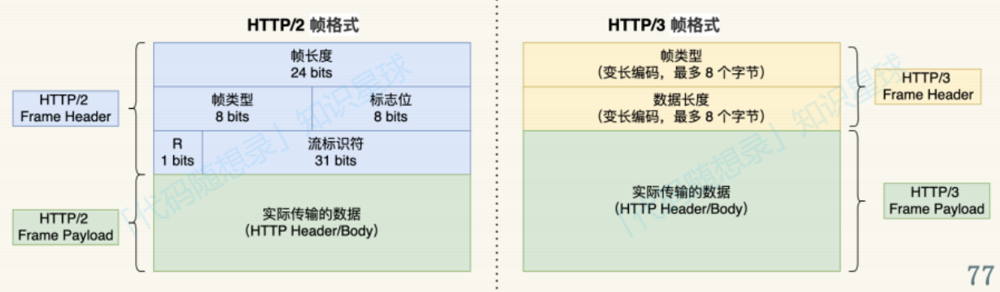
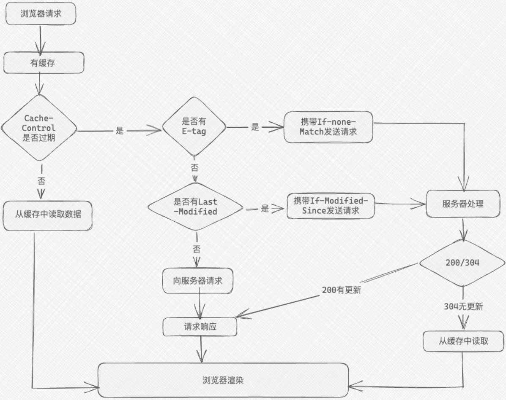
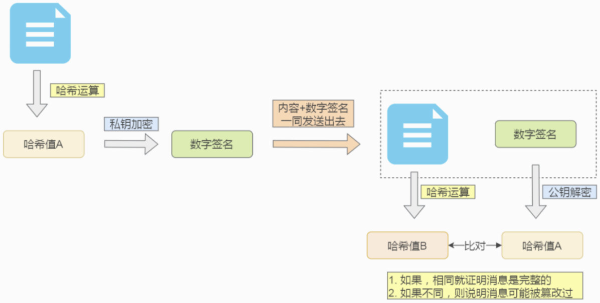
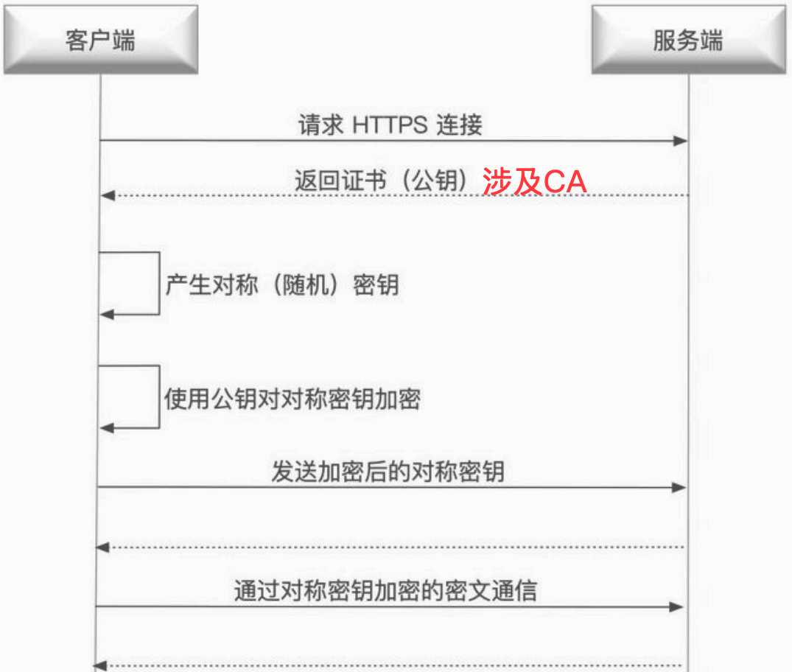
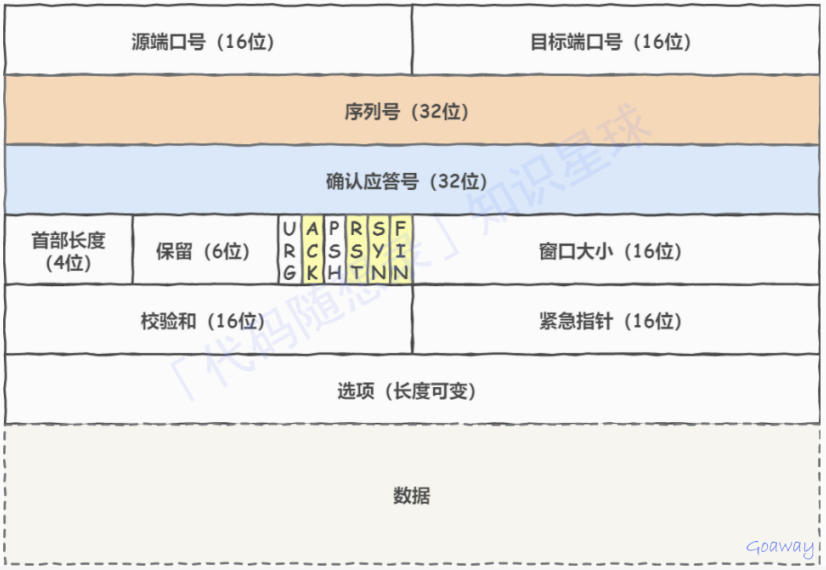

### What：计算机网络关键字总结

### Why：总结关键字，复习的时候根据关键字回忆出对应内容即可

### Content：

##### DNS

域名解析

分布式

为什么不用集中式 单点故障 远距离时延 维护成本大

层级关系 越往右越高

解析过程 查浏览器缓存 查本地Host文件 本地DNS服务器（中国移动） 根DNS服务器 顶级DNS服务器 权威DNS服务器 返回客户端 缓存到本地

递归查询 DNS客户端只发送一次查询请求 适合普通用户和客户端

迭代查询 DNS客户端不断向更高级的服务器发起请求 适合DNS服务器之间通信

##### HTTP

特性 简单、灵活、易于扩展 应用广泛 跨平台

版本 HTTP/1.0 HTTP/1.1 HTTP/2.0 HTTP/3.0

Cookie 服务器产生 保存在客户端 服务器识别客户端

Session 服务器产生 保存在服务器 

**版本演变**

HTTP/0.9 仅有GET方法 没有请求头 服务器只返回HTML格式内容

HTTP/1.0 支持多种请求方法 引入请求头、响应头 不支持持久连接（每次请求都需建立新连接）

HTTP/1.1 长连接（客户端和服务端没有明确提出断开连接就一直保持连接）管道网络传输（解决了请求的队头阻塞，但是没有解决响应的队头阻塞）问题（头部冗余、队头阻塞、无请求优先级、只有客户端可以请求，服务端只能被动响应）

HTTP/2.0 头部压缩（HPACK：静态字典、动态字典、Huffman编码） 二进制帧（文本格式改二进制格式，提高传输效率） 并发传输 服务器推送 问题（队头阻塞，在传输层，基于TCP；TCP+TLS的握手时延迟；网络迁移需要重新连接）

HTTP/3.0 QUIC协议（零RTT连接建立、无队头阻塞、连接迁移、向前纠错机制）

**HTTP缓存**

强制缓存 Expires强缓存 Cache-Control强缓存

协商缓存 Last-Modified和If-Modified-Since ETag（强验证、弱验证）

##### HTTPS协议

特点 信息加密 校验机制 身份证书

优点 安全 确定 缺点 延迟 部署成本高 加密解密计算占CPU资源

SSL/TLS四次握手

HTTP端口号80 HTTPS端口号443

对称加密（使用相同的密钥来进行加解密） 非对称加密（公钥加密，私钥解密） 混合加密

HTTPS采用混合加密 通信建立前采用非对称加密 通信过程中采用对称加密

数字签名 验证消息的来源和完整性

数字证书 现在还缺少身份验证的环节，如果客户端和服务端之间有一个中间人，中间人把原本双方通信的公钥篡改成自己的公钥怎么办？那么CA（数字证书颁发机构）其实就相当于一个合法的中间人！

SSL/TLS协议流程

##### TCP协议

头部格式

