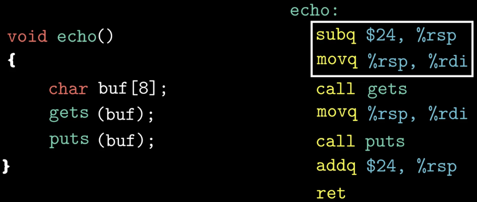
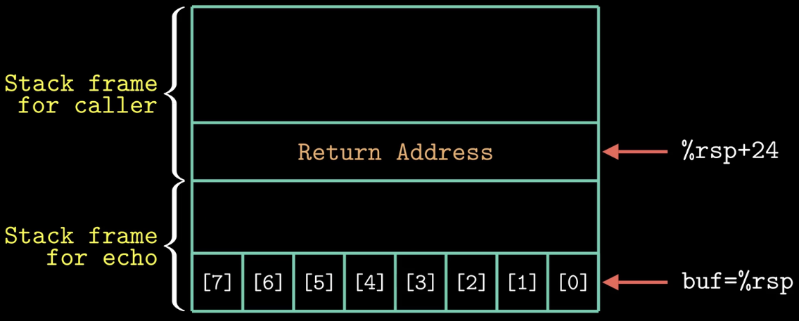
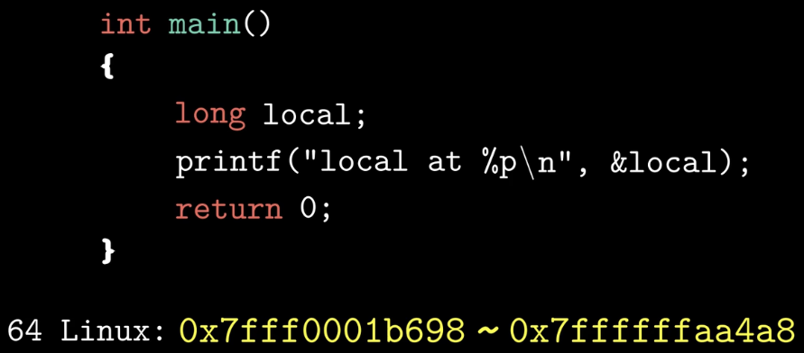
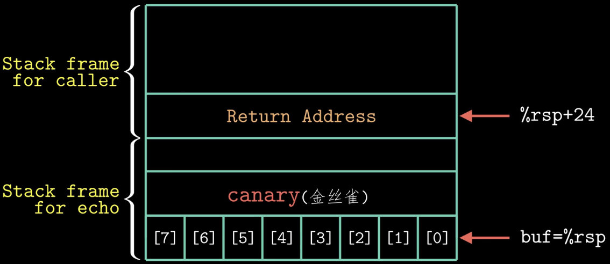
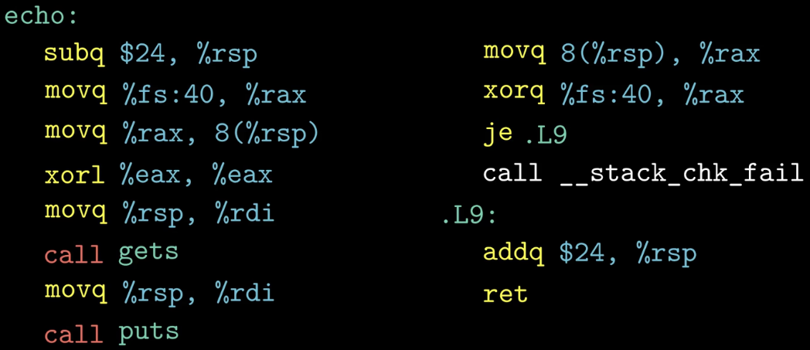

### What：CSAPP中文版教程-第十九节-缓冲区溢出

### Why：加固一下计算机基础知识，第一性原理很重要

### Content：

示例：

虽然buf数组只需要8个字节，但是从汇编中可以看到分配了24个字节，所以当get读取的内容不超过23（gets会在末尾添加一个null）个字节就不会发生严重的错误，如果超过，那么就会覆盖栈中的其他状态信息，比如覆盖了返回地址，那么函数echo执行完毕后就会跳转到一个非法地区，造成错误。

对抗缓冲区溢出攻击

**栈随机化**

相同的程序代码，不同的机器上栈地址不同，同一台机器上地址也不同。否则，一个程序就可以直接攻击多台服务器。下图代码中，局部变量local在64位Linux机器上栈中地址范围如图

ASLR（Address Space Layout Random）：地址空间布局随机化，每次运行程序的不同部分都会被加载到内存的不同区域，增加了系统的安全性，降低了病毒的传播速度。

**栈破坏检测**

在函数返回之前，检测金丝雀值是否被修改来判断是否遭受攻击

前面两个movq指令从内存中读取数值然后将数值放到栈上， 这个数值就是金丝雀值，存放的位置与程序中定义的缓冲区是相邻的，%fs:40可以被简单地理解为一个地址，这个地址的数据被操作系统设置为只读，因此，攻击者无法修改金丝雀值。函数返回前，通过xor指令来判断金丝雀值是否被修改。

**限制可执行代码区域**

以前，x86的处理器将可读和可执行的访问控制合并成一位标志，所以可读的内存页也都是可执行的，栈上的数据需要被读写，所以也是可执行的。后来，处理器的内存保护引入了不可执行位，栈可以被标记为可读和可写，但是不可执行。检查页是否可执行由硬件来完成，效率上没有损失。
