### What：CSAPP中文版教程-第二十节-指令系统结构

### Why：加固一下计算机基础知识，第一性原理很重要

### Content：

##### 指令系统

指令系统是计算机软件和硬件交互的接口，程序员根据指令系统设计软件，处理器设计人员根据指令系统设计硬件。

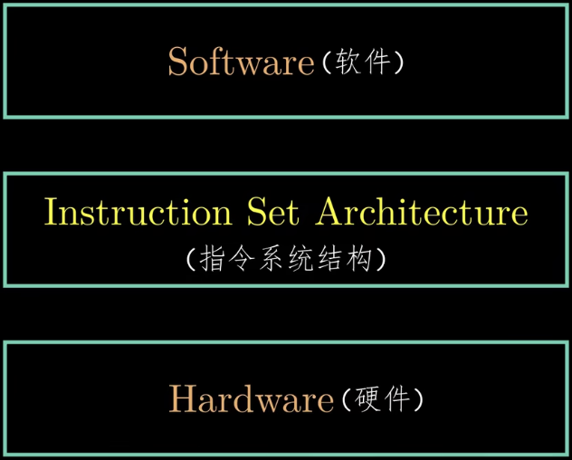

Y86-64:简化的x86-64，包括各种状态单元、指令集及其编码、编程规范以及异常事件处理。

可见状态是指每条指令都会去读取或者修改处理器的某些部分，例如内存、寄存器、条件码、程序计数器以及程序状态等。

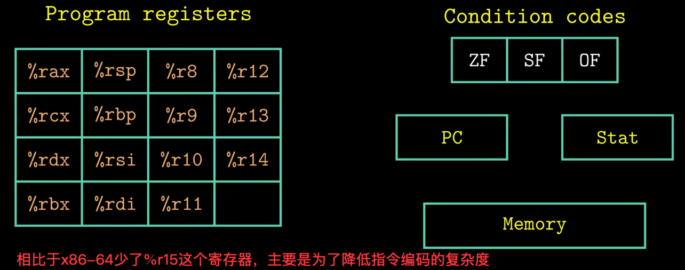

Y86-64的movq指令如下图所示

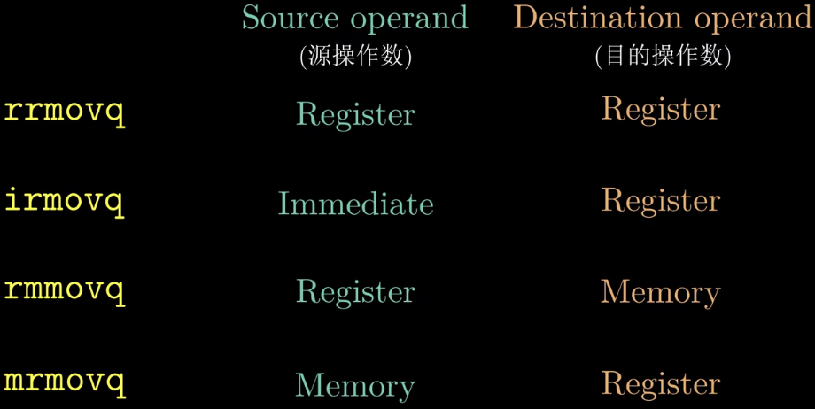

Y86-64的movq指令编码

指令编码为1个字节，这个字节分为两个部分，第一个部分是指令码，第二个部分是指令功能。有的指令需要操作数，就会在后面再添加一个字节，这个字节用来指定一个或者两个寄存器，因此还需要对寄存器进行编码。

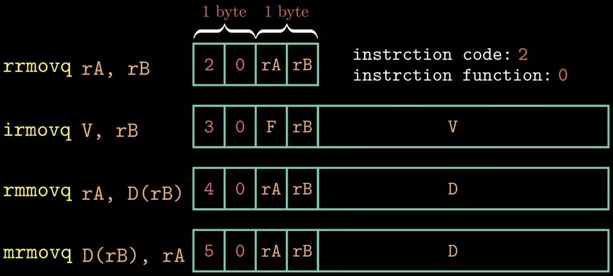

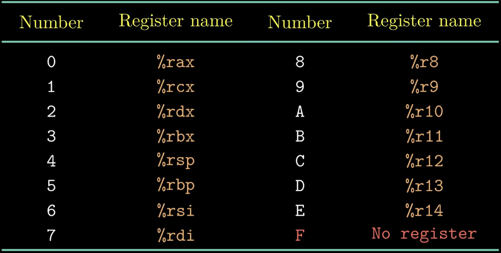

注意，如果一个操作数的位置显示为0xF，表示此处没有寄存器操作数。例如irmovq指令中的第一个操作数是立即数，所以此处用0xF来填充。

Y86-64指令系统中，定义4条整数操作指令，只能对寄存器数据进行操作，而x86-64还允许操作内存数据。由于这四条指令属于同一类型，所以指令代码是一样的。

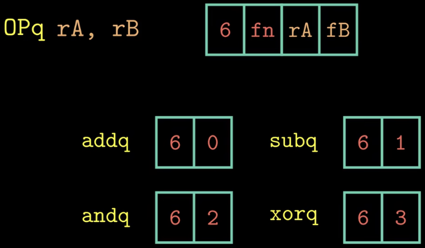

跳转指令一共有7条，和x86一样，都是根据条件码的某种组合来判断是否进行跳转。

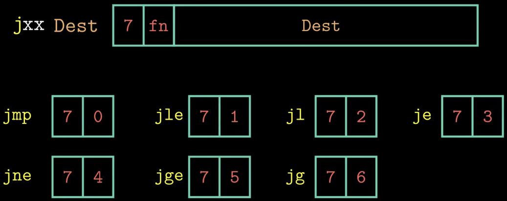

条件传送指令有6条，与数据传送指令rrmovq有相同的指令格式，但是只有条件码满足条件时，才会更新目的寄存器的值。

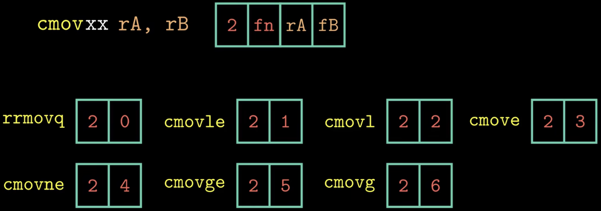

停止指令halt用来暂停系统运行，nop指令用来表示一个空操作，call指令和ret指令则表示函数调用和函数返回，pushq和popq指令则表示入栈和出栈。

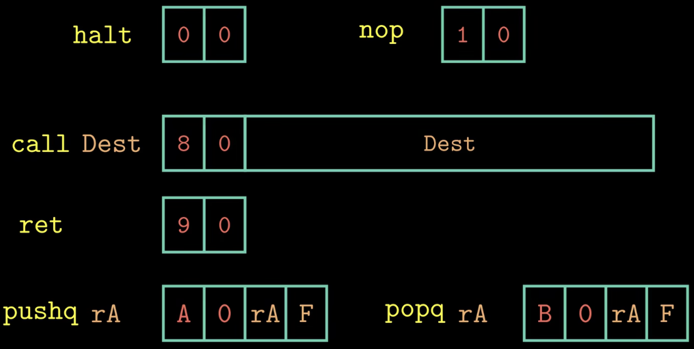

指令编码示例：

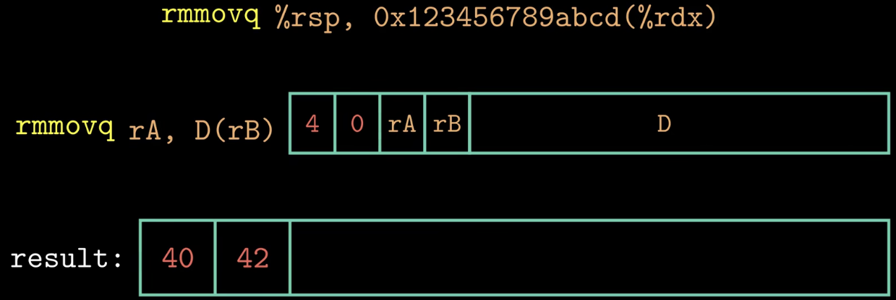

rmmovq编码为0x40，%rsp编码为0x4，%rdx编码为0x2，指令编码中偏移量占8个字节，在前面填0来补齐8个字节，且x86-64采用小端法存储，所以需要对偏移量进行字节反序操作，最后结果如下图

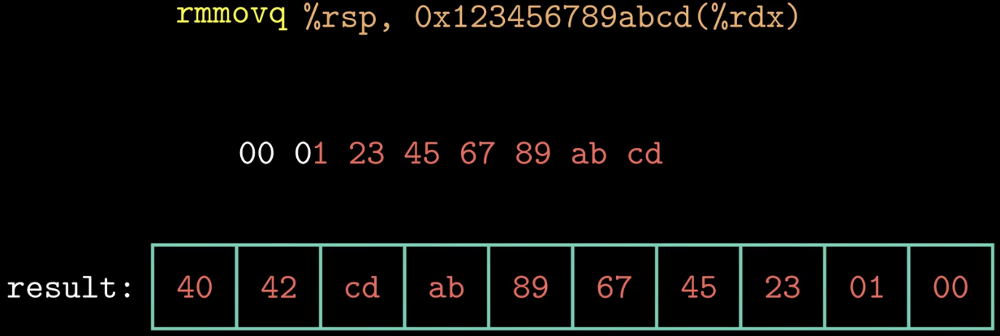

程序的状态码：程序执行的总体状态

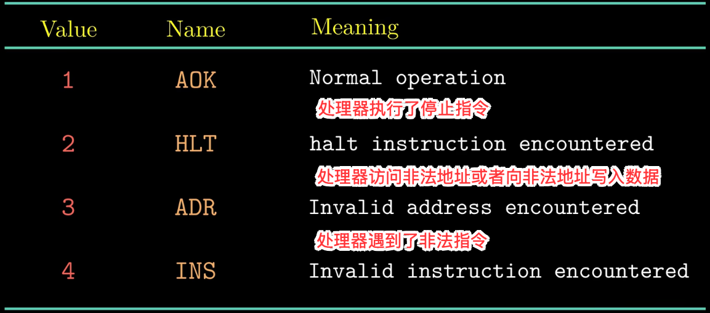
