### What：CSAPP中文版教程-第二十二节-Y86-64的顺序实现

### Why：加固一下计算机基础知识，第一性原理很重要

### Content：

示例：数组求和

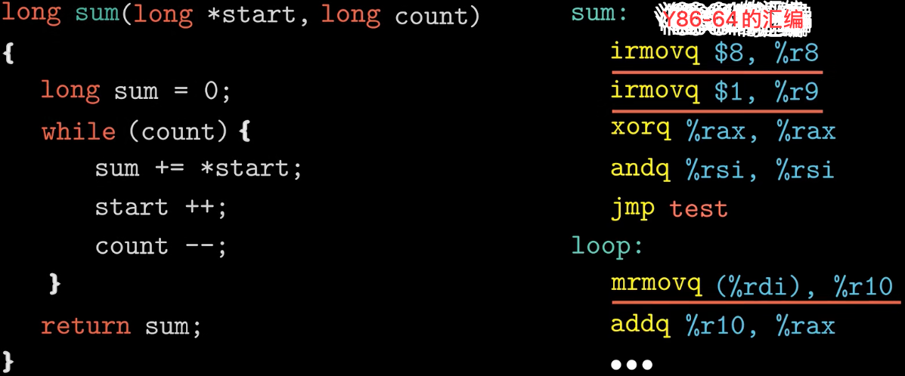

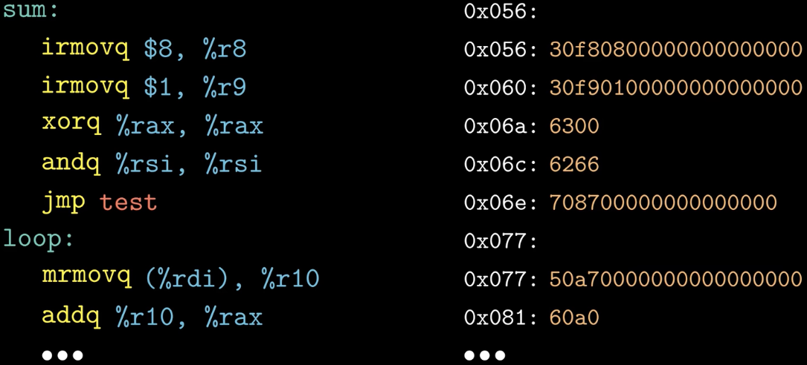

实现Y86-64指令所需要的计算可以被组织为下图所示的6个基本阶段

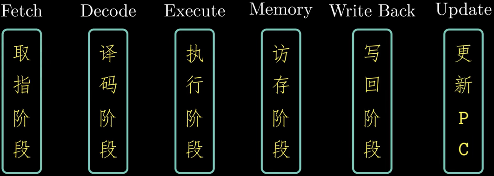

**取指阶段：获取指令**

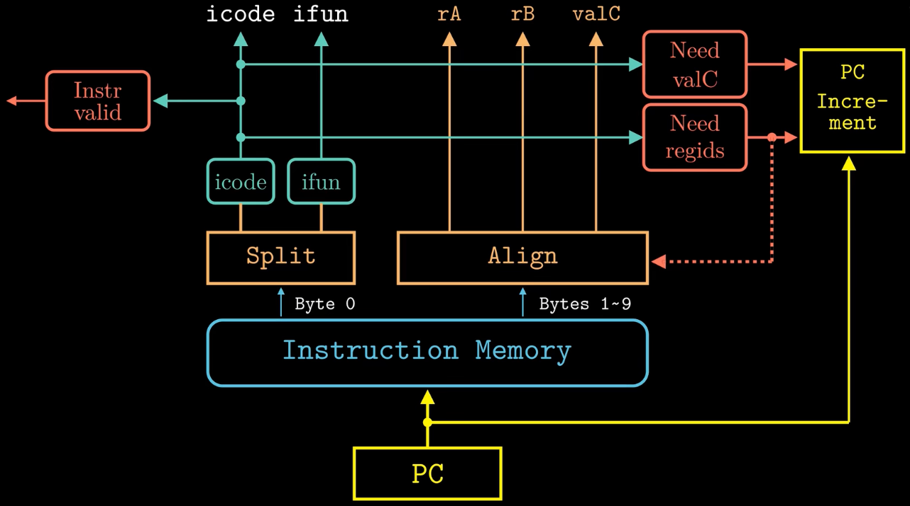

**译码阶段：读寄存器文件**

寄存器文件有两个读端口，可以支持同时进行两个读操作

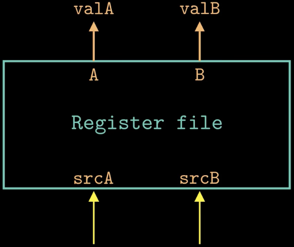

**执行阶段**

算数逻辑单元主要执行三类操作：执行算数逻辑运算 计算内存引用的有效地址 push&pop指令

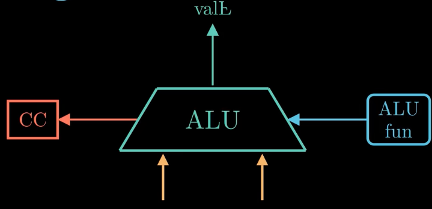

**访存阶段：读写内存**

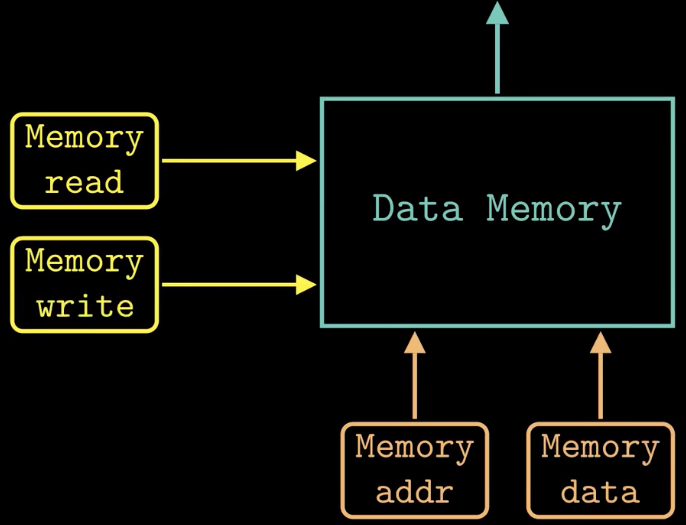

**写回阶段：写寄存器文件**

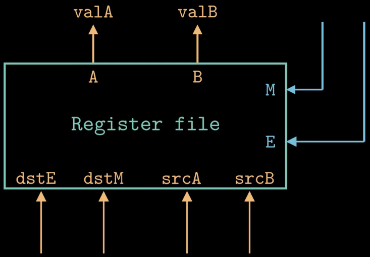

**更新PC：将PC的内容设置为下一条指令的地址**

示例：减法指令的相关操作

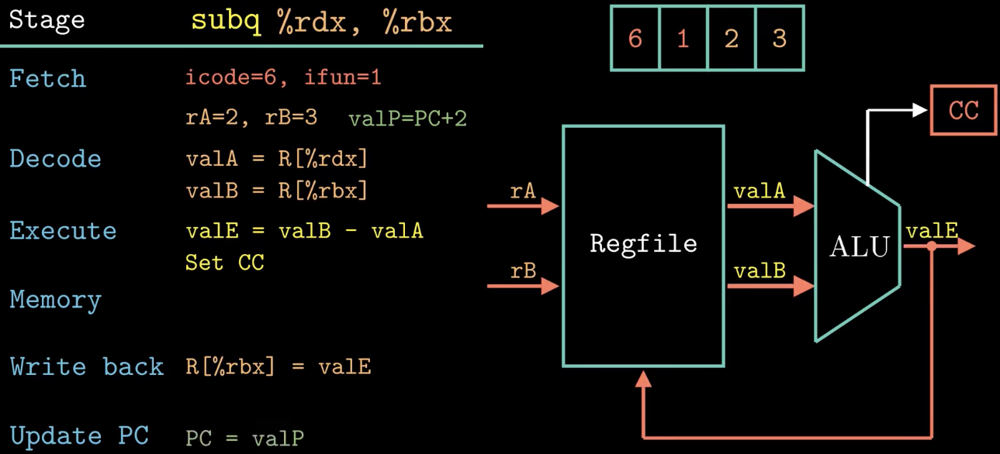

示例：数据传送指令的相关操作

数据传送指令不需要读寄存器文件，所以译码阶段不执行任何操作。

表面上看也不需要ALU部件，但是在实际的硬件中，ALU的输出端口与寄存器文件的写入端口相连，所以该指令在执行阶段使用ALU对立即数执行加0的操作。

该指令也不涉及内存的读写，所以访存阶段也不执行任何操作。

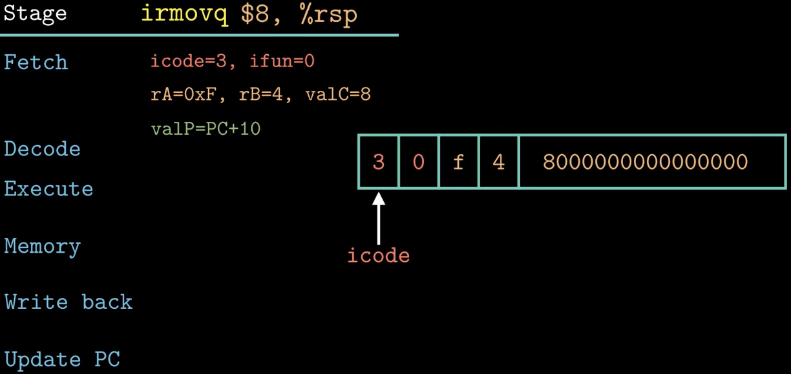

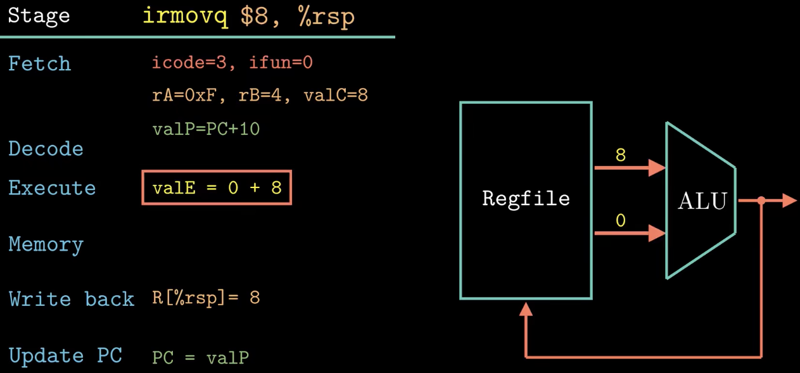

示例：

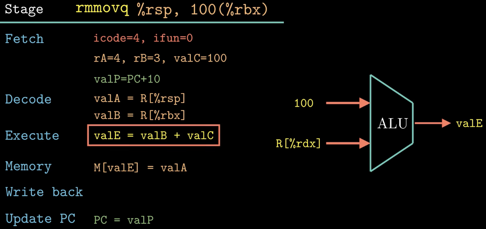

示例：pushq指令

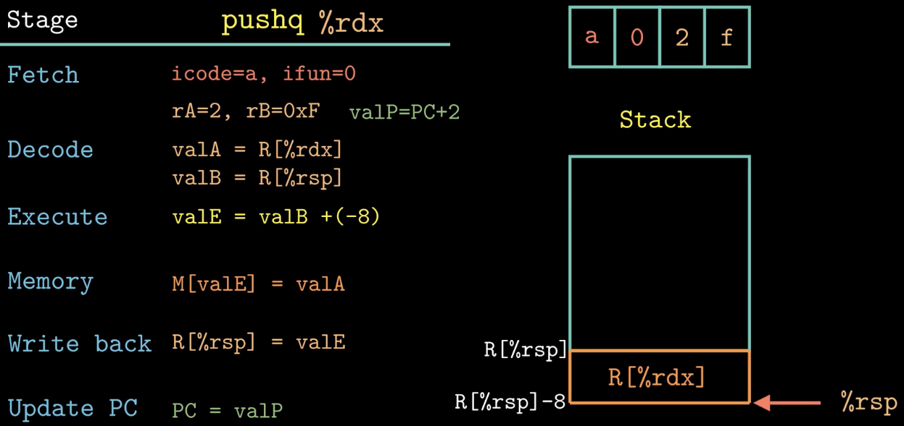

示例：跳转指令

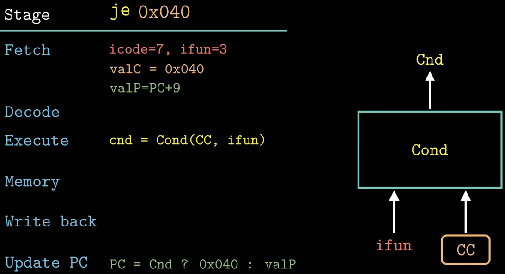
