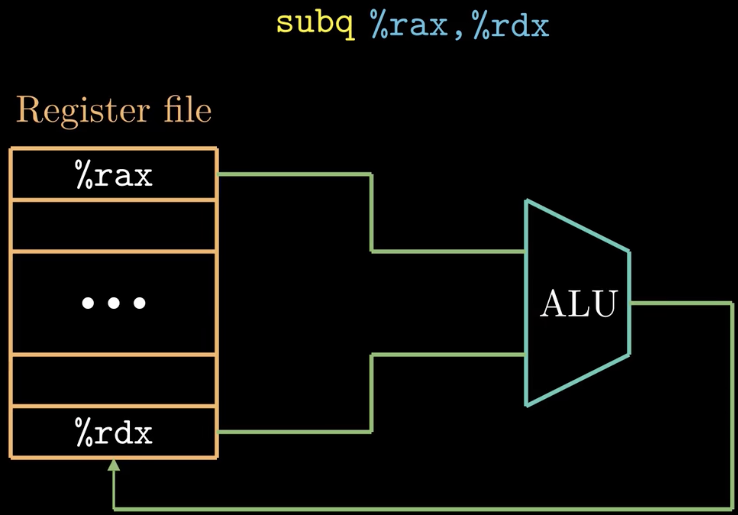
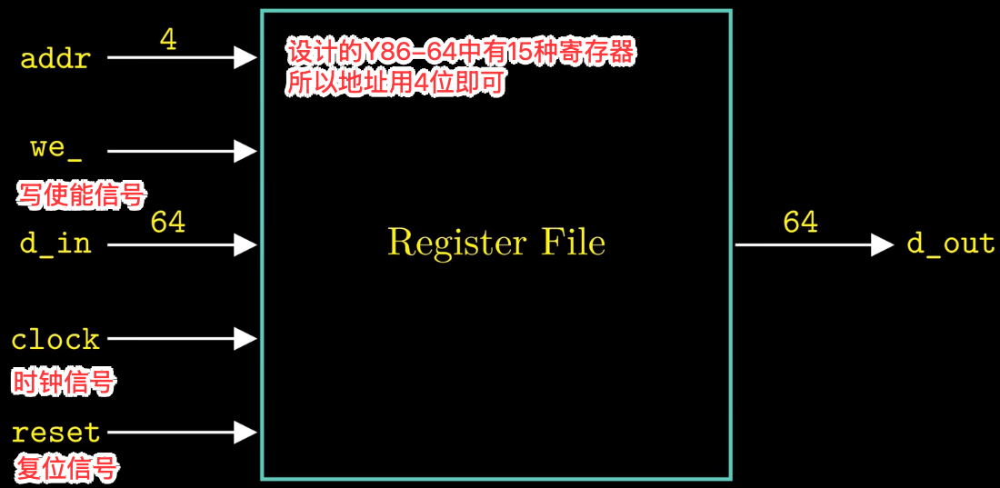
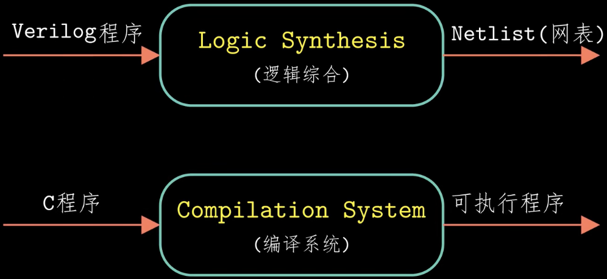
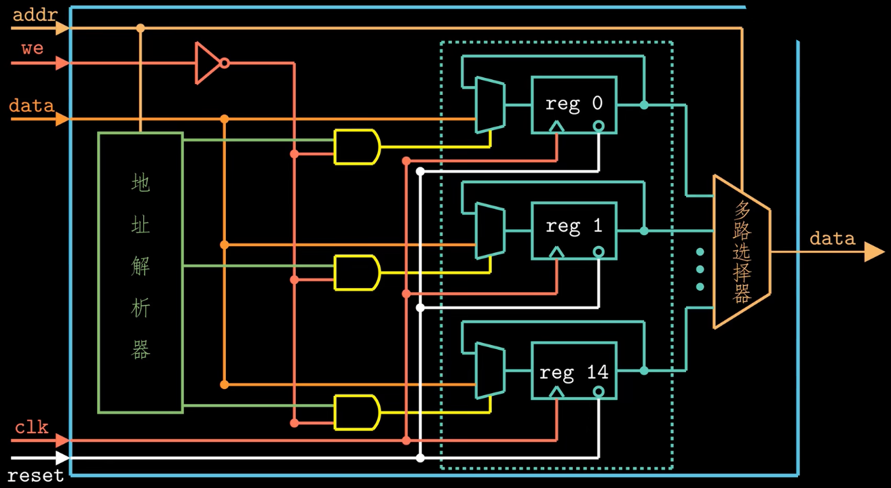
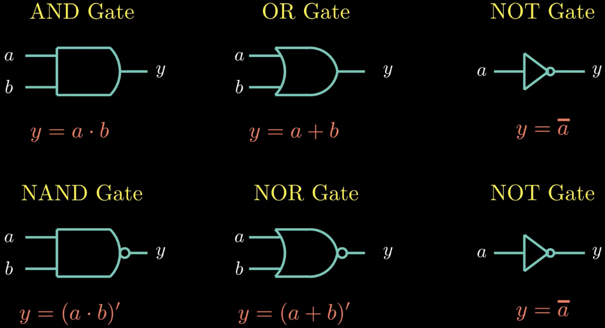

### What：CSAPP中文版教程-第二十一节-数字电路与处理器设计

### Why：加固一下计算机基础知识，第一性原理很重要

### Content：

一个简单的示例：

在处理器中，所有的寄存器的集合被叫做寄存器文件或者寄存器堆。

在处理器中，寄存器与算术逻辑单元是串联的，寄存器文件的输出端口与ALU的输入端口相连。



下图展示寄存器文件的功能表述：

一个读端口，一个写端口，端口的数据位宽是64位



Verilog语言对寄存器文件的描述

```Verilog
module regfile(
  output reg[63:0]  data_out,
  input wire[63:0] 	data_in,
  input wire[3:0]  	addr,
  input wire		clock, we_, reset_
);
  reg[63:0] regfile[14:0];
  assign 	data_out = regfile[addr];
  ...
endmodule
```

使用电子设计自动化（EDA）工具对这段程序进行逻辑综合，得到的电路就能实现预期的功能。

逻辑综合的过程与编译有点类似



寄存器文件内部的结构如下图所示：



数字电路感觉已经不在我所学的范围内了，简单了解一下即可。

基本的逻辑门结构如下图所示：


