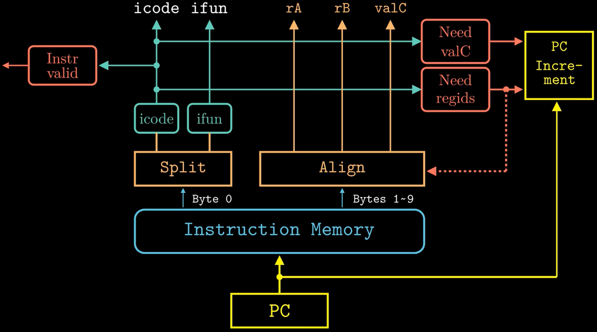
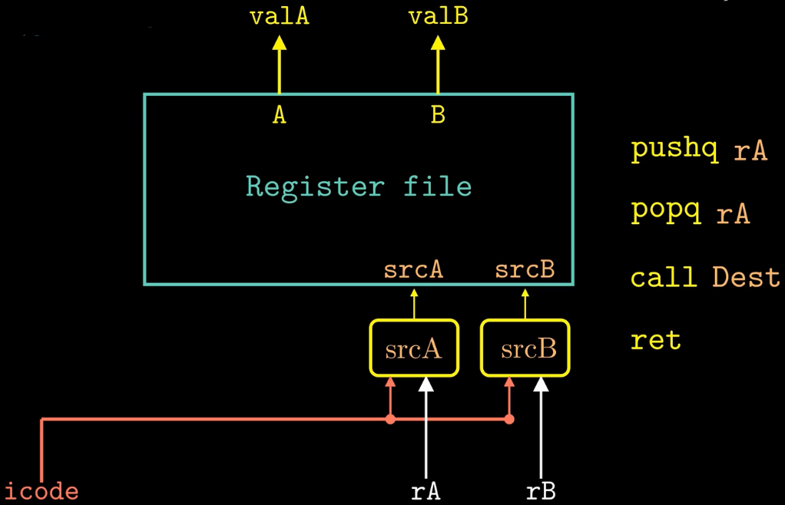
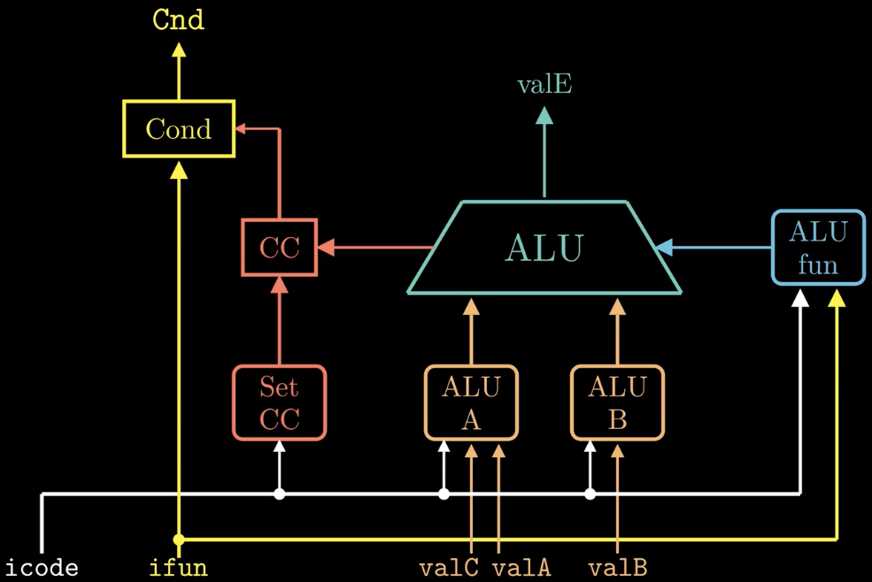
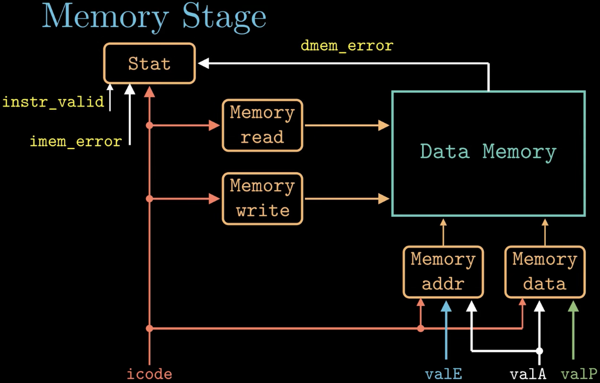
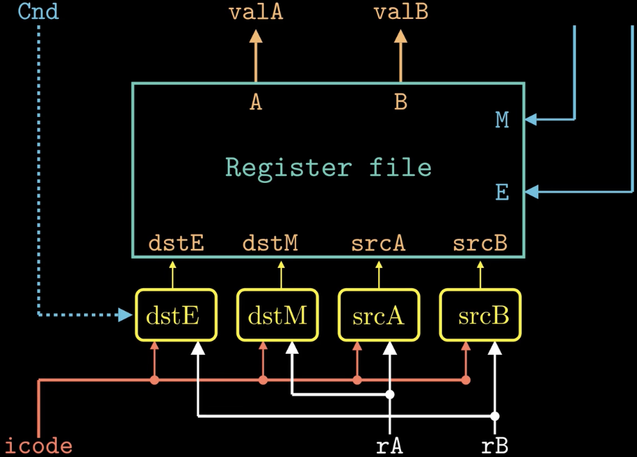
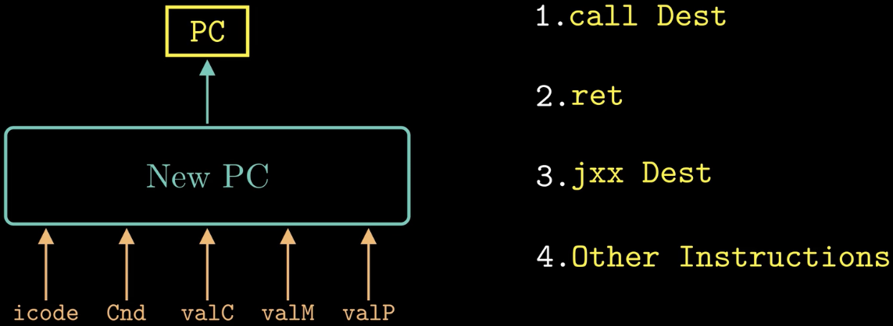

### What：CSAPP中文版教程-第二十三节-Y86-64处理器硬件结构

### Why：加固一下计算机基础知识，第一性原理很重要

### Content：

**取指阶段的硬件设计**

**译码阶段的硬件设计**

srcA和srcB表示寄存器文件两个读端口的地址，加上圆角矩形表示寄存器的ID值。

产生寄存器的ID值需要指令代码icode和寄存器指示值rA和rB，比如右侧的4条指令都需要额外的寄存器%rsp。

**执行阶段的硬件设计**

核心部件是ALU，对于ALU，不仅可以执行算数逻辑指令，还会涉及内存地址的计算以及栈指针的增加或减少的操作。

**访存阶段的硬件设计**

访存阶段的最后操作会根据下图中的信号来计算状态码Stat

**写回阶段的硬件设计**

**更新PC的值**

