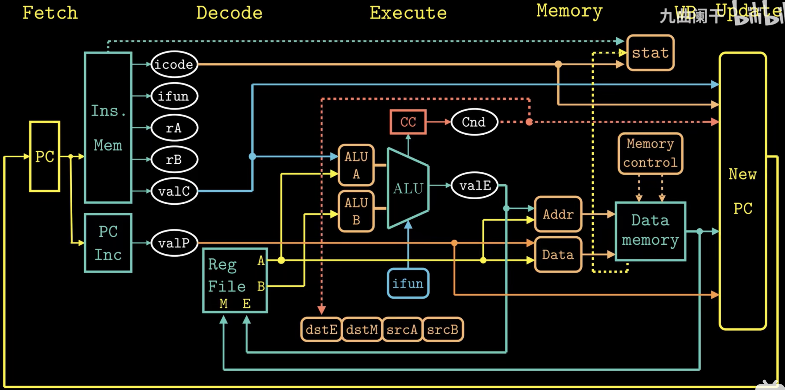
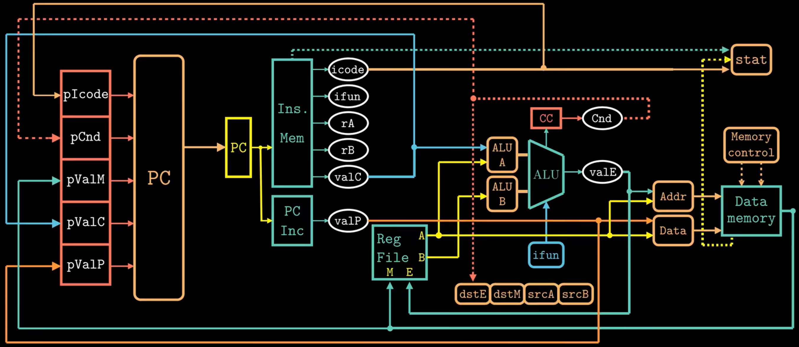
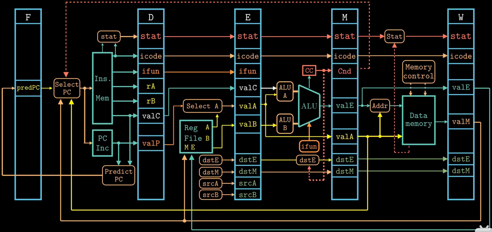

### What：CSAPP中文版教程-第二十五节-流水线硬件结构

### Why：加固一下计算机基础知识，第一性原理很重要

### Content：

##### 复习一下Y86-64的顺序实现：

对于Y86-64的顺序实现，所有阶段的操作都要在一个时钟周期内完成。

##### 电路重定时：改变了系统的状态表示，没有改变它的逻辑行为

改一下上图的结构，使更新PC在时钟周期开始的时候执行，而不是结束的时候执行，具体的实现方法是创建一个寄存器来保存指令在执行过程中产生的信号。

##### 如何把一个顺序结构改造成流水结构

五级流水线的硬件结构如下图所示

