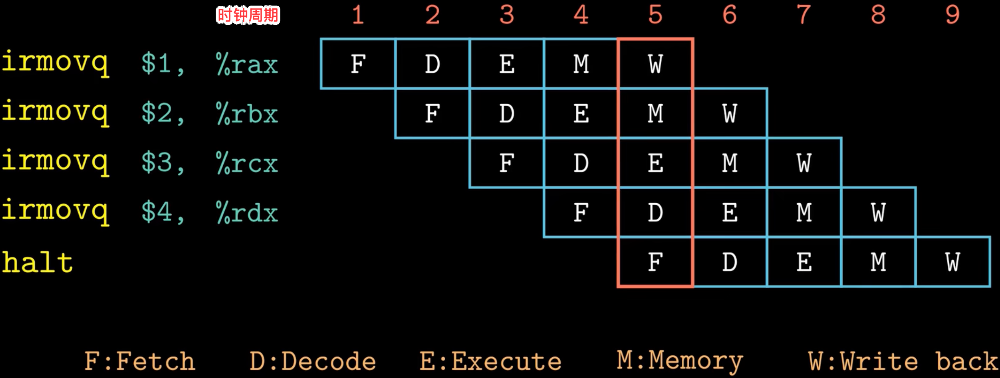
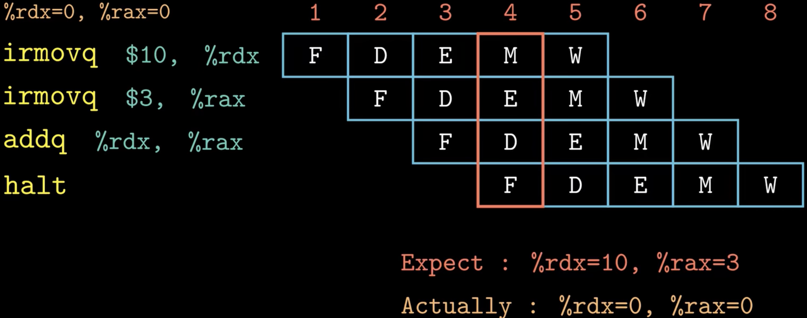
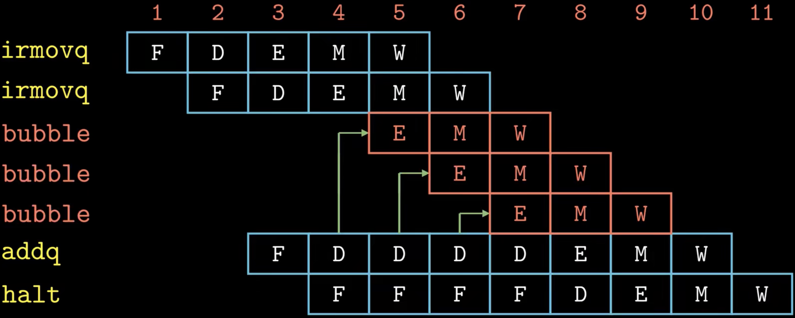
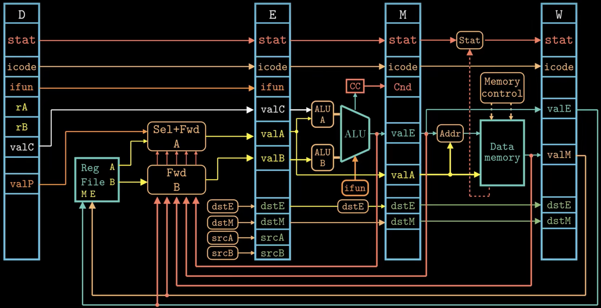
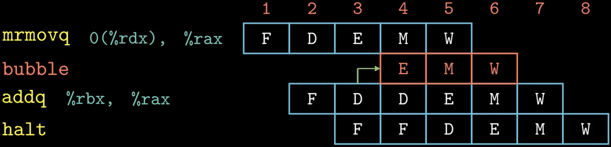

### What：CSAPP中文版教程-第二十六节-数据冒险

### Why：加固一下计算机基础知识，第一性原理很重要

### Content：

##### 示例：

普通指令在流水线中的执行情况

当指令涉及到数据问题，比如下图中addq指令需要前面两个指令的结果

假设寄存器的初始值都为0，在第四个时钟周期时，addq指令希望从寄存器中读取正确的值，但是由于前面的两条指令还没到写会阶段，所以寄存器中的值都是初始值，这就导致结果错误。

由于指令irmovq和指令addq之间存在数据相关，导致流水线结果错误，我们将这种情况称为**冒险或者冲突**。

**冒险分为两类：数据冒险和控制冒险**

##### 如何避免数据冒险

容易想到的就是：暂停技术

停一会儿，直到寄存器中的数据变了再开始执行，但是基于这种机制实现的流水线性能不高，因为程序中数据相关的情况很多

实现上可以插入气泡指令，气泡指令不改变内存、寄存器、条件码以及程序状态

另外一个技术是：数据转发

比如可以将irmovq指令在执行阶段得到的结果直接发给addq指令

数据转发需要在基本的硬件结构中添加一些额外的数据连接和控制逻辑

通过添加旁路路径来转发数据可以解决绝大多数的数据相关问题，但是还有有一部分没有解决。

这时候一个通用的哲学逻辑思考方式又来了！结合！

结合使用暂停技术和数据转发技术！具体情况如下图所示：

