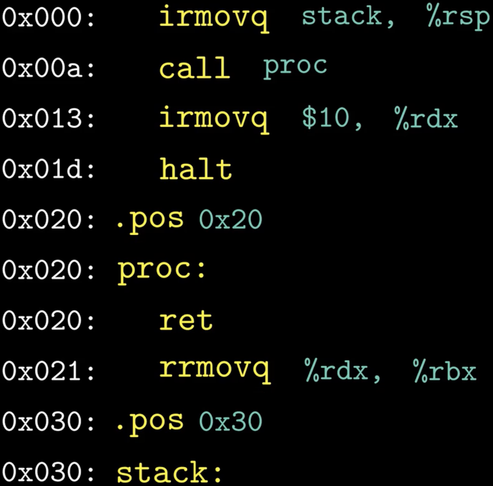
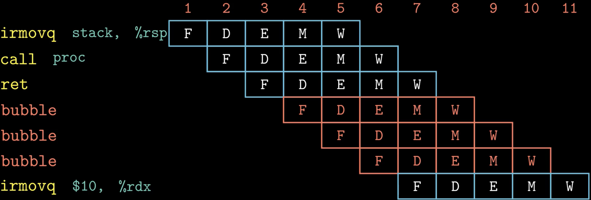
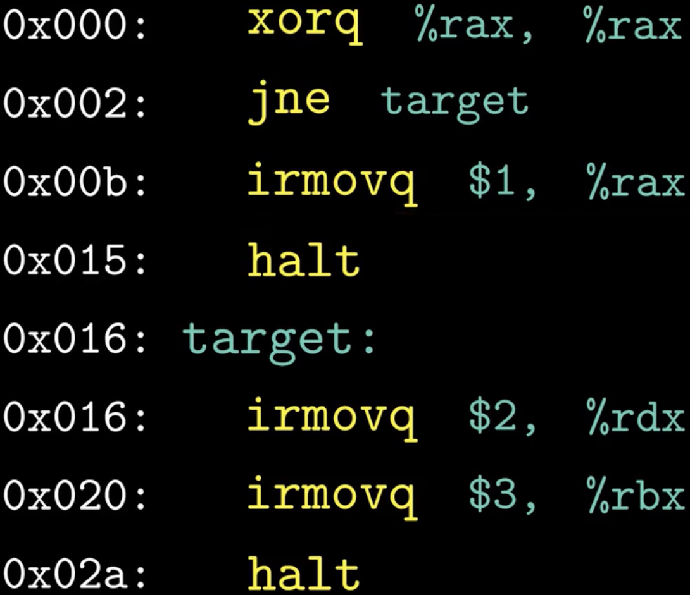
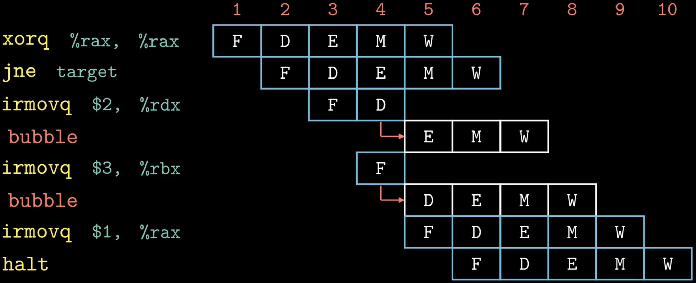
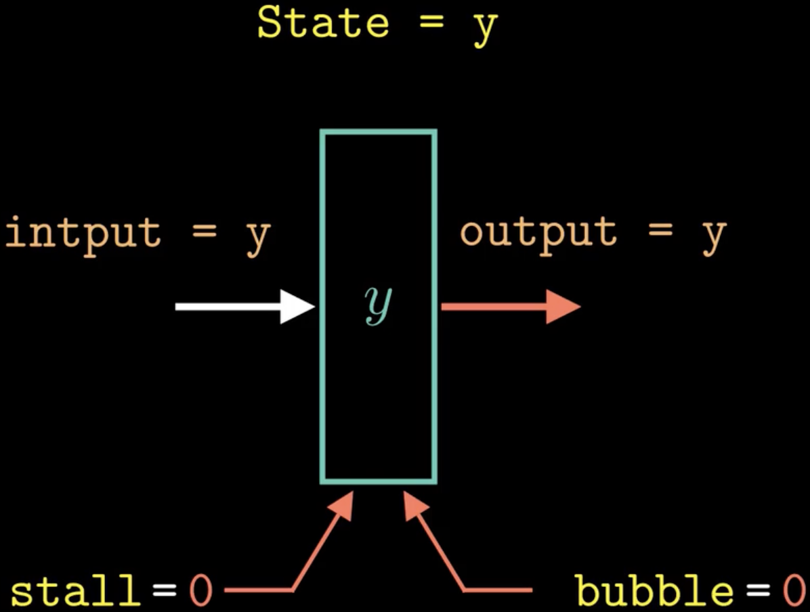

### What：CSAPP中文版教程-第二十七节-控制冒险

### Why：加固一下计算机基础知识，第一性原理很重要

### Content：

##### 示例

包含ret返回指令的源程序如下图所示

指令在流水线中的执行情况

返回指令ret在完成访存阶段后才能得到下一条指令的地址

**分支预测**

分支指令要么跳转要么不跳转，所以可以假设分支指令总是跳转或者不跳转

但是当分支预测错误的时候，会影响程序的执行效率，需要采取相应的方法来处理

包含分支指令的源程序如下图所示

假设总是跳转，那么流水线中的执行情况如下图所示

在第4个时钟周期结束的时候，分支指令完成执行阶段，发现不需要跳转，那么此时就需要去除跳转分支中已经开始的指令，下图中是两条irmovq指令。因为这两条irmovq指令还没有进入执行阶段，所以可以往流水线中插入气泡来解决。

综合上面两个指令的例子发现，我们可以通过暂停和插入气泡来动态地调整流水线的状态，来解决控制冒险。

##### 如何实现暂停和气泡

为每个流水线寄存器引入两个控制信号，暂停信号和气泡信号。

流水线正常执行时，暂停信号和气泡信号都设置为0，当遇到时钟上升沿时，寄存器会加载它的输入来作为新的输出。

