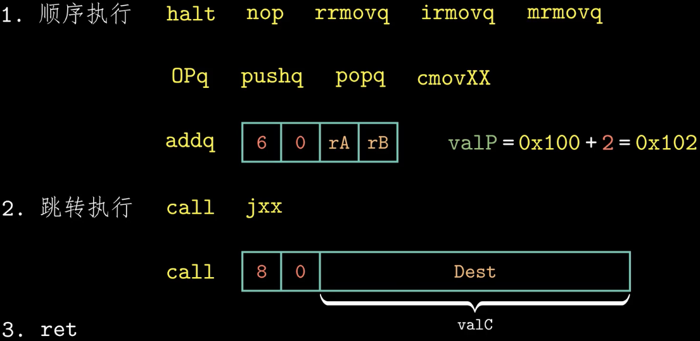
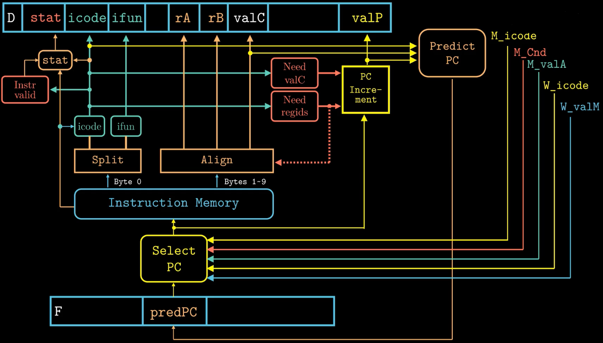
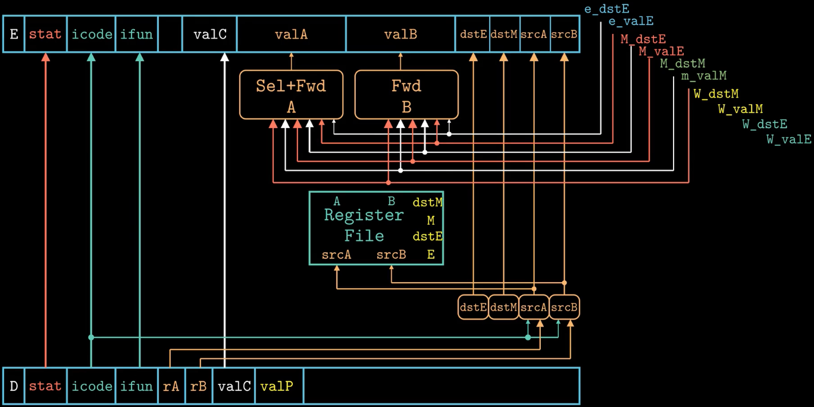
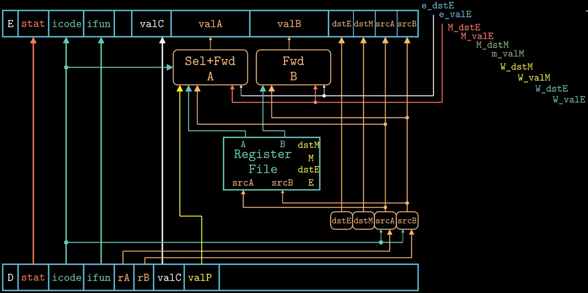

### What：CSAPP中文版教程-第二十八节-Y86-64的流水实现

### Why：加固一下计算机基础知识，第一性原理很重要

### Content：

流水线的各个阶段如何实现

##### 取指阶段

取指阶段最复杂的地方就是如何预测下一条指令的地址

Y86-64的指令主要有下图中的几种类型：

如果是顺序执行，那么下一条指令的地址等于PC+该指令的长度；

如果是跳转执行，那么需要进行分支预测，Y86-64为了简化流水线的硬件设计，选择的分支预测策略是假设总是执行跳转，那么那一条指令的地址等于该指令的常数字段；

如果是ret指令，那么需要从栈中获取函数的返回地址。

##### 译码阶段

前面，为了提高流水线的执行效率，引入了数据转发，可以直接使用相关寄存器的数据，而不是等写回阶段更新完寄存器的值后，再从寄存器文件中读取。

因为有了数据转发，所以我们现在需要判断究竟是直接采用转发的数据，还是需要从寄存器文件中读取数据。判断依据：当前需要读取寄存器的ID值是否等于转发的目的寄存器的ID值。

以下数据需要被转发（存在优先级，1到5优先级逐渐降低）：

1. ALU产生的输出结果；
2. 内存的输出数据；
3. 访存阶段时对寄存器端口E还没有写入的数据；
4. 访存阶段时对寄存器端口M还没有写入的数据；
5. 写回阶段时对寄存器端口E还没有写入的数据；

每一个被转发的数据包括两个部分：一个是寄存器的ID值，用白色信号线表示；另一个是转发数据，用红色信号线表示。

如果没有转发数据，那么就从寄存器文件的A端口和B端口读取数据。

还有一点就是当指令是函数调用指令或者跳转指令时，可以合并valP和valA，因为这两个指令不需要读取寄存器文件A端口的数据。

