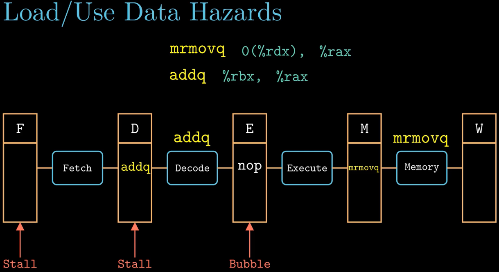
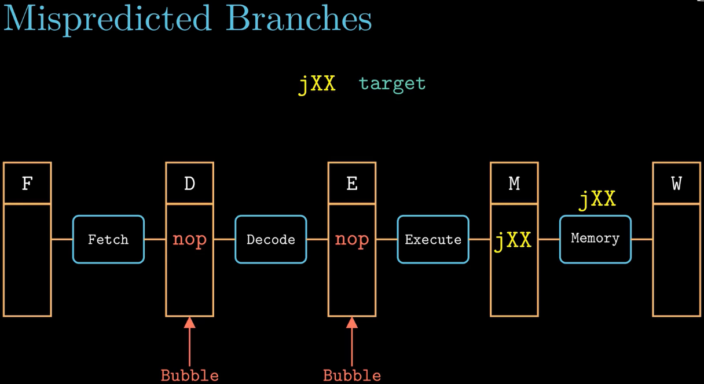
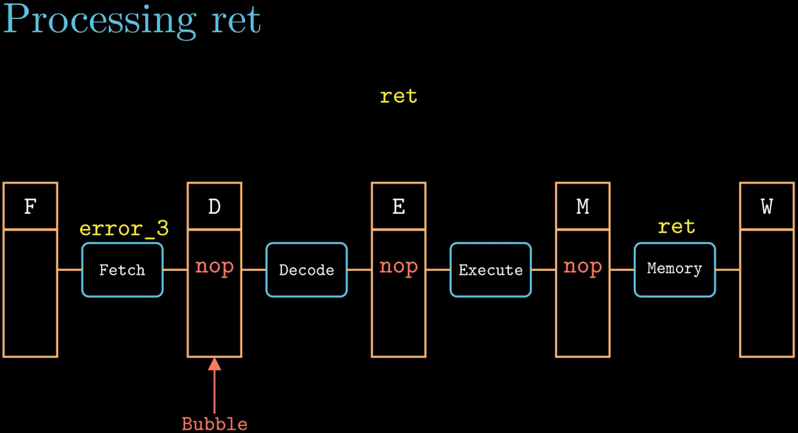
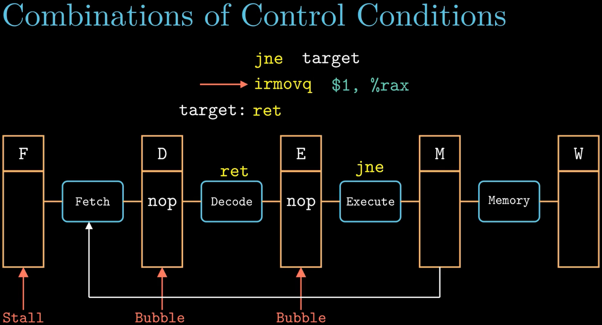
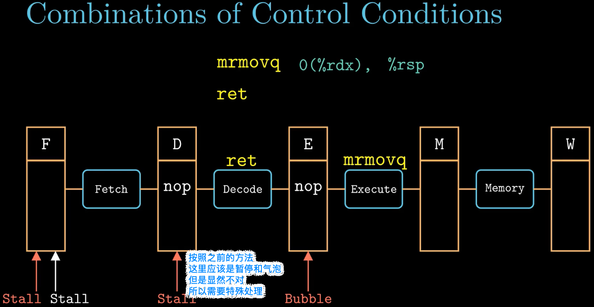
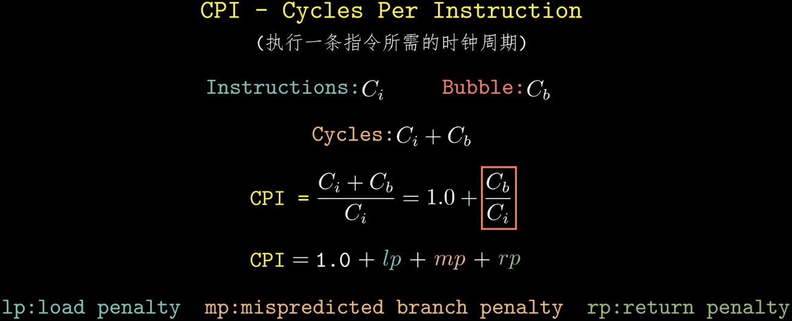
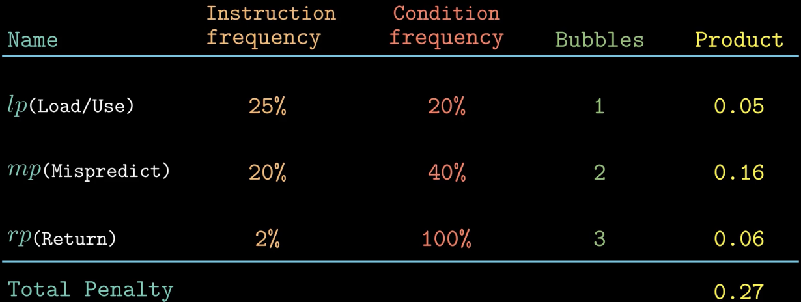

### What：CSAPP中文版教程-第二十九节-流水线的控制逻辑

### Why：加固一下计算机基础知识，第一性原理很重要

### Content：

##### 指令执行时出现的特殊情况以及期望得到的处理

**加载/使用冒险**

指令mrmovq和指令popq都可能产生加载/使用的冒险情况

**分支预测发生错误**

跳转指令达到执行阶段可以检测到预测错误

**返回指令的处理**

流水线的控制逻辑就是在出现特殊情况时通过暂停和插入气泡来保证程序正确执行。

##### 目前为止，我们假设任意一个时钟周期内，最多只能出现一个特殊情况，但是实际情况中，会有两种情况的组合出现。

**跳转指令与返回指令的组合冒险**

**加载/使用冒险与返回指令的组合**

接下来的思想正好和昨天刷到的一个短视频的思想一样，就是在现在的AI时代，做一件事情之前，或者说写代码之前，想好怎么**评估**往往更加重要！

##### 定量分析处理器性能

示例：想要进一步优化，就是减小0.16这个数据，即提高分支预测正确概率。

