### What：CSAPP中文版教程-第三十节-优化程序性能

### Why：加固一下计算机基础知识，第一性原理很重要

### Content：

##### 如何优化程序性能

* **选择合适的算法和数据结构**
* **编译器的能力和局限性**
* **并行化**

**编译器优化程序性能的局限性**

示例

下图中，函数add1和函数add2的含义相同，但是函数add2要比函数add1的性能好，因为add1需要读写内存6次（2次读xp，2次读yp，2次写xp），而add2只需要读写内存3次（1次读xp，1次读yp，1次写xp）。

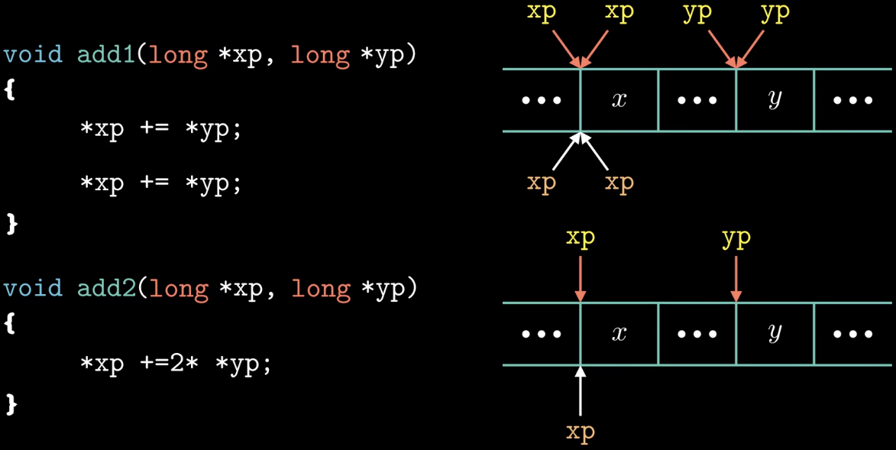

可是能否据此就直接用add2来优化add1？答案是**不能**。

因为会存在一种特殊情况，xp和yp都指向同一个地址，这时add1和add2的结果不同。因此，不能用add2的代码作为函数add1的优化版本。

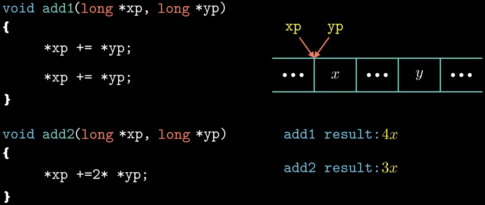

**内存别名引用**

两个指针指向同一个内存位置

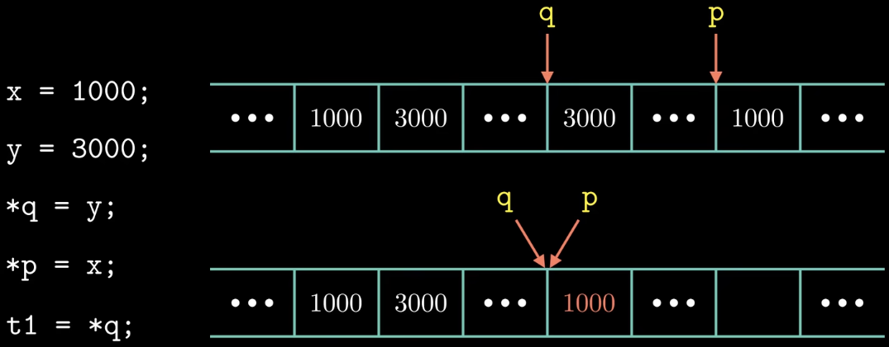

**结论：如果编译器无法确定两个指针是否指向同一个位置，那么编译器就会假设所有的情况都有可能发生，这会限制可能的优化策略。**

**函数调用也会影响优化**

示例

如果忽略函数f的具体内容，那么func1和func2的操作结果相同。但是如下图所示，func1和func2的结果不同，因此，大多数编译器不会把func1优化为func2的形式。

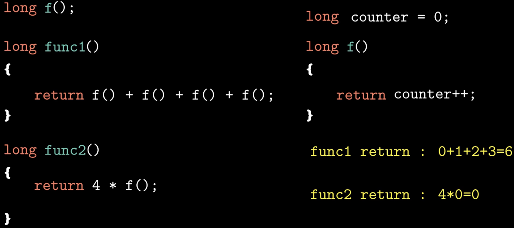

##### 如何表示程序的性能

示例

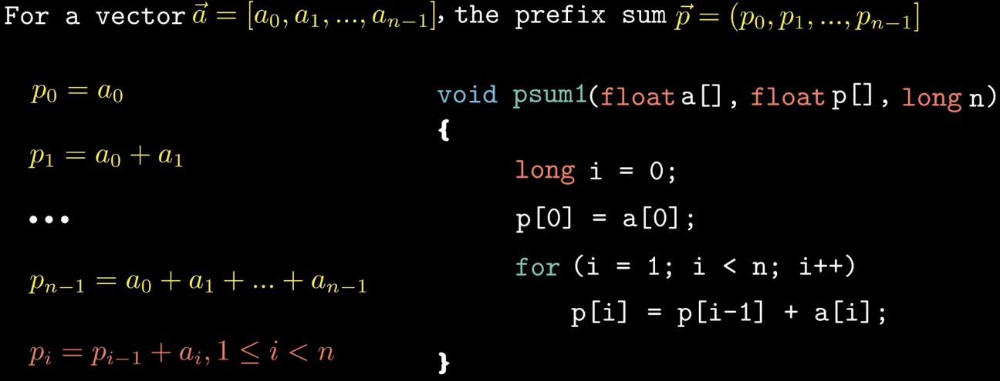

循环展开

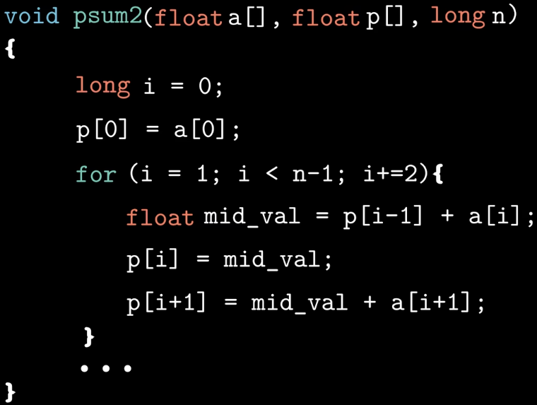

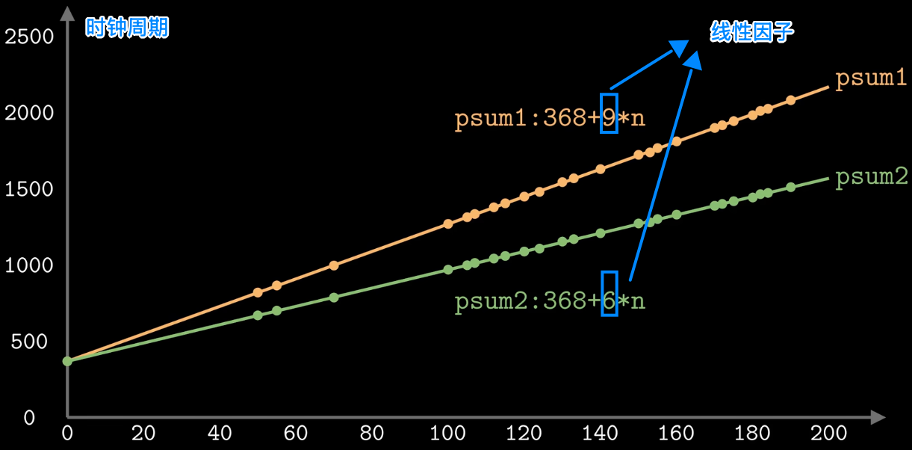

CPE表示每个元素执行所需要的周期数，而不是每次循环所需要的周期数。上图中，psum1的PCE为9.0，psum2的PCE为6.0。

##### 具体如何优化程序

**向量的抽象表示**

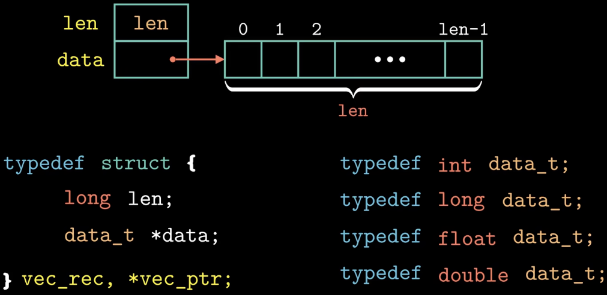

代码示例1：

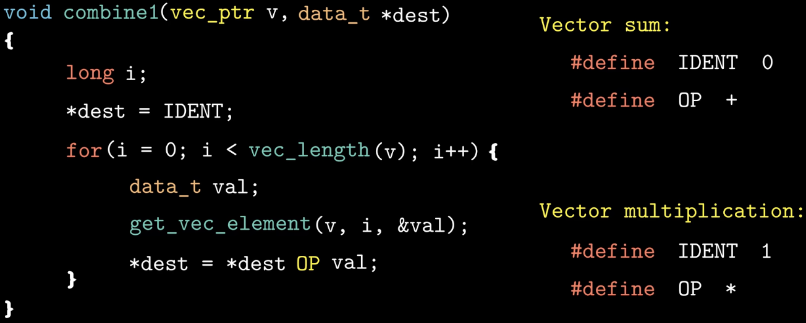

下图中，仅靠编译器的O1优化，就可以大幅缩短程序的运行时间。

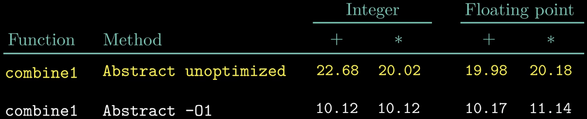

代码移动优化方式

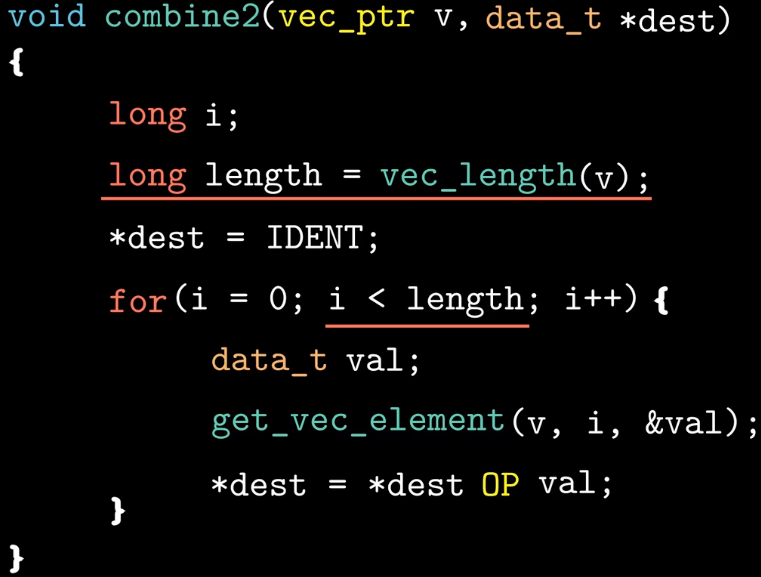

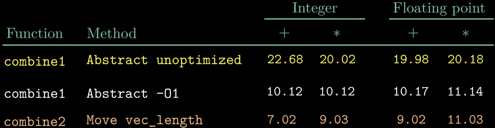

为什么编译器无法自动完成代码移动来提升性能呢？因为编译器无法判断进行代码移动后会不会产生副作用，编译器需要有限保证程序的正确结果，其次才是优化高性能代码。

代码示例2

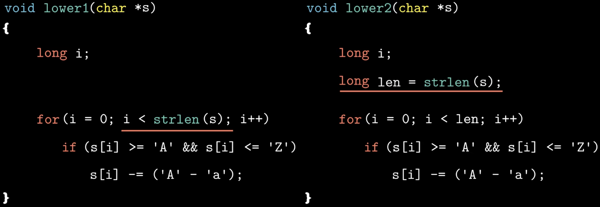

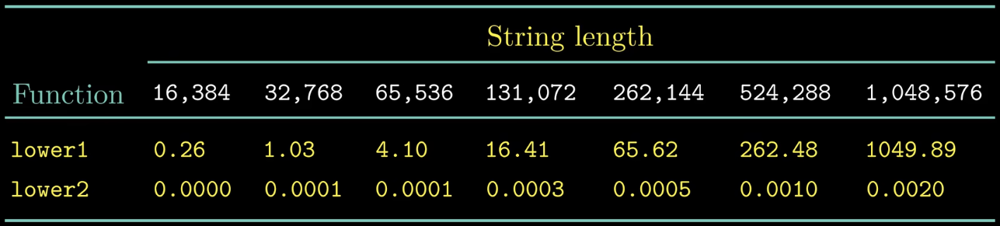

减少函数调用的次数一定能过优化程序性能？

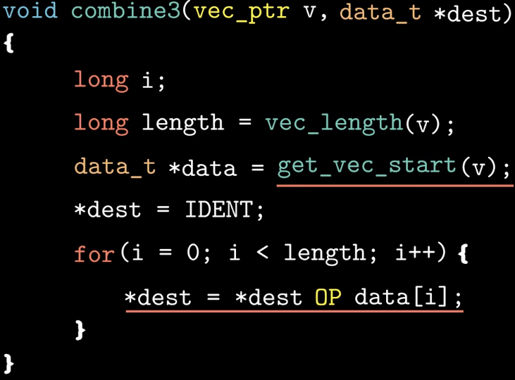

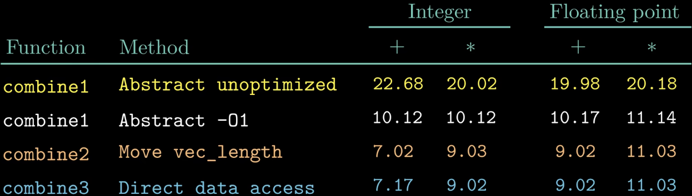

从上图数据可以看到，程序的性能并没有显著的提升，甚至整数求和还降低了。因此循环中可能存在其他的限制因素对性能的限制超过了函数调用。

combine3循环的汇编代码如下

两次读内存，一次写内存

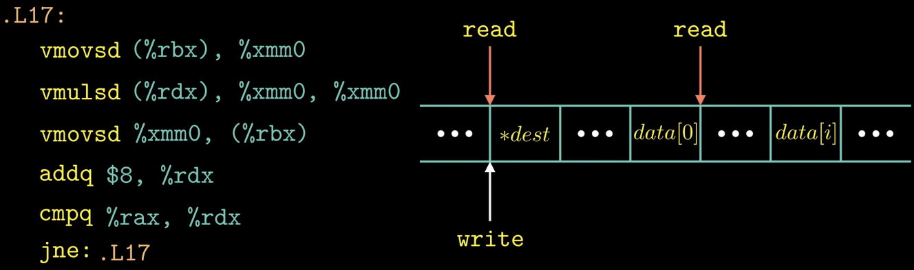

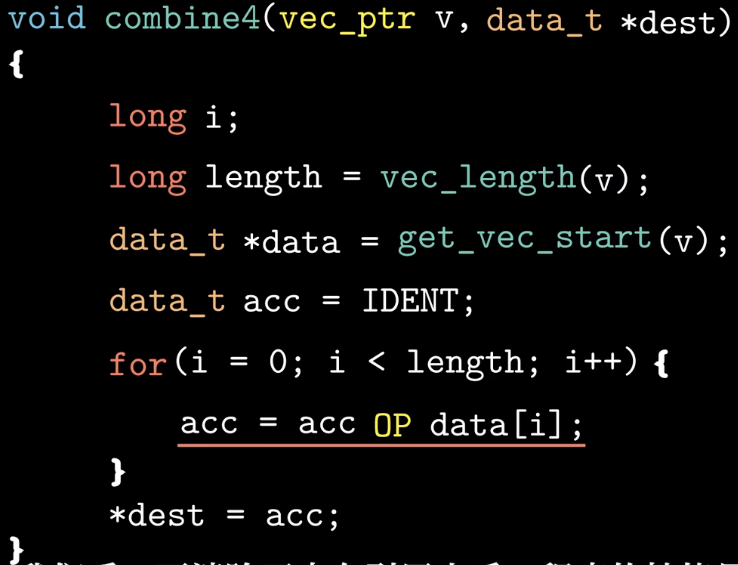

combine4每次循环只有一次读内存，acc是临时变量，读写寄存器的。

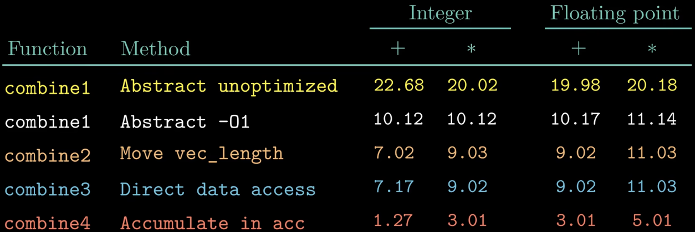
