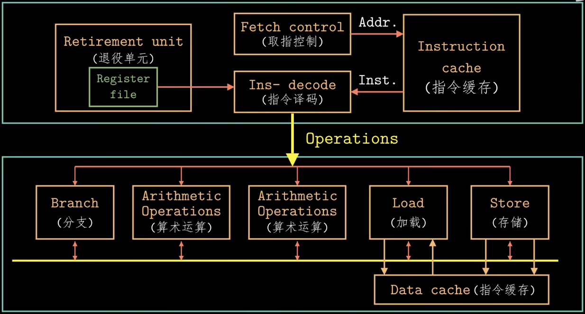
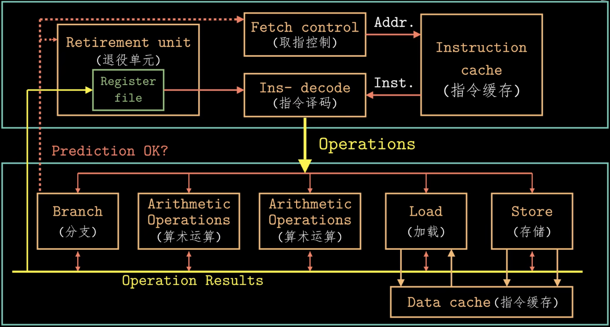
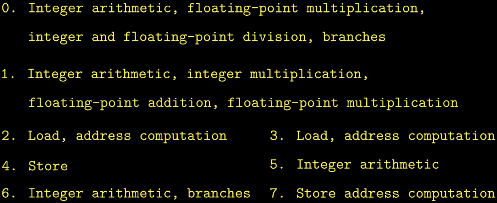
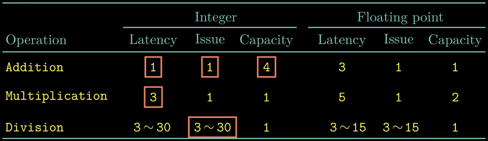

### What：CSAPP中文版教程-第三十一节-理解现代处理器

### Why：加固一下计算机基础知识，第一性原理很重要

### Content：

##### 指令级并行

现代处理器为了做到指令级并行，将整体设计分为两个部分：指令控制单元（ICU）和执行单元（EU）。

指令控制单元负责从内存中读取指令序列，然后译码，从而产生一系列的操作。译码会对指令进行分解，允许任务在一组专门的硬件单元之间进行分割。读操作由加载单元来执行，而写操作由存储单元来执行，处理器的执行单元EU并行执行多条指令的不同部分。

与前面所述的顺序流水线相比，现代处理器每个时钟周期可以执行多个操作，而且是乱序执行的。

示例：

```WebAssembly
addq %rax %rdx    //译码成一个加法操作
addq %rax 8(%rdx) //译码成一个读操作，一个加法操作和一个写操作
```



**投机执行：现代处理器采用分支预测技术来猜测是否选择分支，同时还会预测分支的目标地址，甚至在不确定分支预测是否正确之前就开始执行这些指令，如果后面发现分支预测错误，会将状态重新设置到分支点之前的状态，开始执行另外一个方向上的指令。**



如果使用了投机执行指令，执行结果暂时不会存放到寄存器文件或者内存中，直到可以确认应该执行这些指令时，再把结果写回到寄存器文件或者内存。

分支操作会被指令控制单元ICU送到执行单元EU。还有分支单元等。

**退役单元：包含寄存器文件同时控制着寄存器的更新**

指令在译码时，指令的相关信息被存放在一个先进先出的队列中，这些信息会一直保存在队列中，直到发生下面两种情况中的一个：

一条指令的操作完成了，且所有引起这条指令的分支点也都被认为预测正确；

引起该指令的某个分支点预测错误，那么该指令会被清空，丢弃计算结果；

##### Intel Core i7 Haswell处理器

这款处理器一共有8个功能单元



算数运算的性能

Latency：操作需要的时钟周期数

Issue：操作开始后需要间隔多久才能开始下一个该操作

Capacity：有多少个处理该操作的单元

除法是范围是因为与除数和被除数有关


